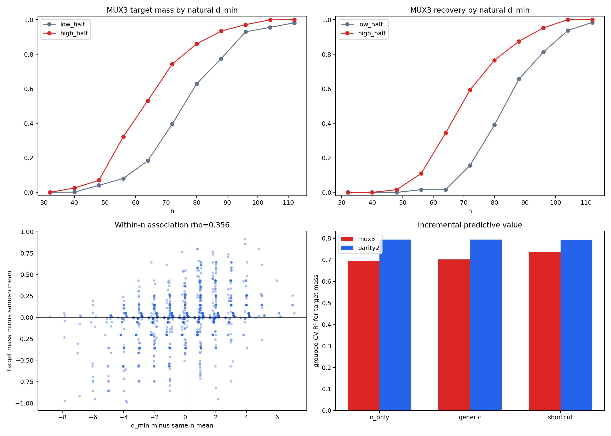

# E23 补充：Uniform 自然冲突覆盖分析结果

## 1. 实验做了什么

本分析没有重新训练模型。它使用既有 parity2/MUX3 采样干预实验中的全部 `adamw / uniform_random / step=40000` 结果：

- `n=32,40,...,112`，共11个 nested cutoff；
- 每个 `n` 有128份随机训练集；
- 每份训练集有32个模型 seed；
- parity2 与 MUX3 使用完全相同的输入子集。

脚本根据原 `DATASET_SEED=2026082901` 重建每条随机排列及其 nested prefix，并对全部2,816条 uniform target-dataset 记录逐一核对 SHA256 dataset signature 和 conflict fraction，全部一致。

MUX3 为：

\[
f(x)=\begin{cases}
x_1,&x_0=1,\\
x_2,&x_0=0.
\end{cases}
\]

对每个训练集分别统计：

- `d1`：能够反驳 `copy x1` 的样本数；
- `d2`：能够反驳 `copy x2` 的样本数；
- `d_min=min(d1,d2)`：两个 shortcut 中证据较弱的一侧。

主问题是：在样本总数完全相同的情况下，`d_min` 更大的普通 uniform 数据集是否更容易恢复完整 MUX3。

## 2. 主判决

主结果使用 `target_function_mass`，按每个 `n` 分别计算 `d_min` 与目标质量的 Spearman 相关，再对有效 `n` 等权平均。128个 dataset index 在不同 `n` 上构成 nested path，因此置信区间和置换检验都以整条 dataset path 为重采样单位。

| 目标 | 同 `n` 平均 Spearman | 95% block-bootstrap CI |
|---|---:|---:|
| MUX3 | **0.3564** | **[0.2800, 0.4352]** |
| parity2 阴性对照 | -0.0269 | [-0.1074, 0.0463] |
| MUX3 − parity2 | **0.3833** | **[0.2795, 0.4942]** |

MUX3 的单侧 block-permutation `p=0.00019996`，即5,000次置换的最小可分辨非零值。Parity2 与同一 MUX shortcut 指标没有稳定关系，且两目标相关差值的95%区间完全大于0。

这通过了预注册的主相关、置换和阴性对照判据。

## 3. 相变区的直观效应

在每个 `n` 内按 `d_min` 排序并分成上下两半，MUX3 在相变区出现大幅分离：

| n | 低 `d_min` 目标质量 | 高 `d_min` 目标质量 | 低组恢复率 | 高组恢复率 |
|---:|---:|---:|---:|---:|
| 56 | 0.081 | 0.323 | 0.016 | 0.109 |
| 64 | 0.184 | 0.531 | 0.016 | 0.344 |
| 72 | 0.396 | 0.744 | 0.156 | 0.594 |
| 80 | 0.629 | 0.860 | 0.391 | 0.766 |
| 88 | 0.774 | 0.934 | 0.656 | 0.875 |

极小 `n` 时两组都缺乏足够证据，极大 `n` 时两组都接近饱和；自然覆盖差异的影响最大，恰好出现在相变窗口。这与“训练集需要同时排除两个 copy shortcut”一致。

## 4. Grouped cross-validation

交叉验证按 `dataset_index` 分组，保证同一 nested path 不会同时进入训练折和测试折。比较：

1. `n-only`；
2. `generic`：`n`、标签不平衡和一般语义格覆盖；
3. `shortcut`：在 generic 上增加 `d_min`、两类反证不平衡和冲突格覆盖。

### MUX3

| 模型 | target-mass CV R² | target-mass MSE | recovery Brier | recovery log loss |
|---|---:|---:|---:|---:|
| n-only | 0.6943 | 0.06551 | 0.09387 | 0.31694 |
| generic | 0.7022 | 0.06382 | 0.09461 | 0.31651 |
| shortcut | **0.7369** | **0.05638** | **0.07698** | **0.26581** |

相对 generic，shortcut 特征使 target-mass MSE 降低约11.7%，recovery Brier 降低约18.6%，log loss 降低约16.0%。

### parity2 阴性对照

| 模型 | target-mass CV R² | recovery Brier | recovery log loss |
|---|---:|---:|---:|
| generic | 0.7944 | 0.05875 | 0.21110 |
| shortcut | 0.7937 | 0.05975 | 0.21389 |

同一 shortcut 特征对 parity2 没有增益，反而略微降低 held-out 表现。结果不支持“这些变量只是普遍更好、更均衡的数据集”的解释。

## 5. 裁决

预注册裁决为：

> **`strong_support_for_natural_shortcut_discrimination`**

三条证据现已闭合：

1. **外生干预**：人工提高 selector 冲突样本会提前 MUX3 相变并翻转 parity2/MUX3 顺序；
2. **静态复现**：fixed-D SMC 在没有 optimizer 时复现相同竞争结构；
3. **自然波动**：普通 uniform 数据中，随机获得更多双侧 shortcut 反证的训练集本来就更容易恢复 MUX3，而 parity2 阴性对照没有该关系。

因此，MUX3 的相变困难不是 target-only Neural K-profile 的直接结果。普通随机数据需要先获得足以同时排除 `copy x1` 与 `copy x2` 的证据；样本总数相同，不代表有效辨识约束相同。

## 6. 边界

- 自然波动分析本身仍是观察性证据；因果方向主要由既有 conflict-enriched 外生干预承担；
- `d_min` 只显式表示两个已知 copy shortcut，不等于完整 aggregate competitor denominator；
- 回归模型用于检验增量解释力，不是跨任务普适相变公式；
- 结果只修正 Neural K-profile 到辨识样本复杂度的桥，不影响先验简单性和 loss-resolved 差异收缩两条核心经验原则。
