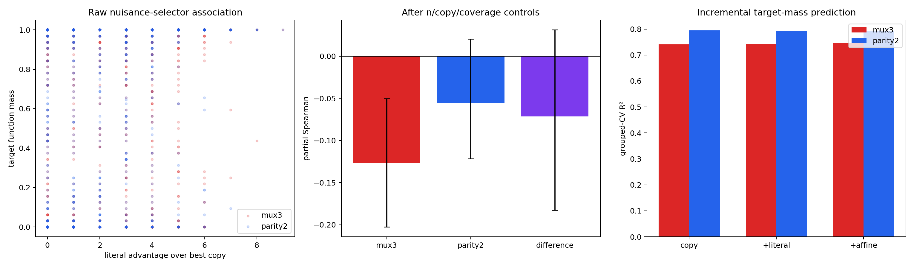

# E23 补充：Uniform 冗余位假 Selector 分析结果

## 1. 分析对象

本分析使用既有 `adamw / uniform_random / step=40000` 的2,816条 target-dataset 结果，不重新训练。对每份8-bit训练集，把5个冗余位 `x3...x7` 及其取反分别代入 MUX selector，形成10个预注册 nuisance-literal 竞争函数：

\[
g_s(x)=\operatorname{MUX}(s(x),x_1,x_2).
\]

这些 selector 在总体分布上的期望准确率均为75%。分析计算它们在当前训练集 conflict 子集上拟合真实 `x0` 的程度，并重点考察：最强 nuisance literal 比最佳 `copy x1/x2` 多减少了多少训练错误。

所有索引由原固定 seed 重建并通过 dataset signature 核对。统计、bootstrap、置换和交叉验证均以128条 nested dataset path 为独立单位。

## 2. 一个直接的有限样本现象

虽然任意独立假 selector 的总体准确率只有75%，从10个 nuisance literals 中取训练集表现最好的一个，会产生明显的多候选选择效应：

- `n=32` 时，最佳 nuisance literal 的平均训练集 MUX 准确率约0.84；
- 随 `n` 增大，该值逐渐下降，在 `n=104...112` 时约0.79；
- 相比最佳 `copy x1/x2`，nuisance literal 平均还能少错约1.4到2.6个训练样本。

也就是说，在普通 uniform 数据中，即使没有人为构造 nuisance shortcut，5个冗余位已经经常提供一个比两个常数 selector 更贴合当前有限训练集的假 selector。

## 3. 控制 Copy Shortcut 后的主结果

主统计量为 `literal_advantage_over_copy` 与 `target_function_mass` 的 partial Spearman。残差化控制：

- `n` 固定效应；
- 标签不平衡；
- 目标相关语义格覆盖；
- `copy_refutation_min` 与双侧不平衡；
- conflict 四格覆盖。

| 目标 | Partial Spearman | 95% path-bootstrap CI |
|---|---:|---:|
| MUX3 | **-0.1268** | **[-0.2026, -0.0503]** |
| parity2 阴性对照 | -0.0555 | [-0.1216, 0.0205] |
| MUX3 − parity2 | -0.0714 | [-0.1827, 0.0312] |

MUX3 的单侧 block-permutation `p=0.004998`。因此，在控制原 copy shortcut 与一般覆盖以后，某个冗余 literal selector 越能偶然贴合训练集，MUX3 完整目标质量仍然越低。

Parity2 的区间覆盖0，方向弱于 MUX3；但两目标相关差值的区间仍覆盖0，因此阴性对照没有达到预注册的“强支持”标准。

## 4. Grouped cross-validation

按 dataset index 分组的5折交叉验证比较：

1. `copy_baseline`：一般覆盖和既有 copy-shortcut 特征；
2. `literal_nuisance`：加入10个 nuisance literal 的最佳错误数、优势和优胜数量；
3. `affine_nuisance`：进一步加入冗余位 GF(2) affine selector，作为次级诊断。

### MUX3

| 模型 | target-mass CV R² | target-mass MSE | recovery Brier | recovery log loss |
|---|---:|---:|---:|---:|
| copy baseline | 0.74079 | 0.055553 | 0.076276 | 0.264490 |
| + nuisance literal | **0.74320** | **0.055037** | **0.075325** | **0.262438** |
| + affine selector | 0.74567 | 0.054508 | 0.076813 | 0.266255 |

Literal 特征对 target mass 和二元 recovery 都有小幅 held-out 增益；更宽的 affine 候选只继续改善 target-mass MSE，却没有改善 recovery，因此不能把所有可枚举 nuisance 函数都视为网络同等容易的竞争者。

### parity2 阴性对照

| 模型 | target-mass CV R² | recovery Brier | recovery log loss |
|---|---:|---:|---:|
| copy baseline | 0.79507 | 0.060341 | 0.215133 |
| + nuisance literal | 0.79299 | 0.061782 | 0.218351 |

同一 literal 特征对 parity2 的 held-out 预测反而变差，支持其主要反映 MUX selector 竞争，而不是普通“数据集质量”。

## 5. 预注册裁决

结果为：

> **`partial_support_for_nuisance_selector_competition`**

支持部分：

1. MUX3 partial correlation 的CI完全小于0，置换 `p<0.01`；
2. nuisance literal 在 copy baseline 之外仍带来 MUX3 held-out 增量；
3. parity2 没有对应预测增益。

未达到强支持的原因：

1. MUX3 与 parity2 的 partial-correlation 差值CI仍覆盖0；
2. 增量效应明显小于 `copy x1/x2` 与 `d_min` 主机制；
3. 更宽的 affine selector 族没有稳定改善二元 recovery。

## 6. 对输入维数猜想的含义

现有8-bit结果证明了一个必要前兆：冗余位确实已经形成训练集可见的假 selector 竞争，并在控制两个 copy shortcut 后保留小幅独立信号。因此，“总输入维数增加会扩大 MUX3 相对 parity2 的辨识劣势”具有经验可行性，不再只是纯思想实验。

但本分析没有改变输入维数，不能建立 scaling 方向。若以后继续，必须通过配对维数扫描直接测量：

\[
\Delta n_{50}(d)=n_{50}^{MUX3}(d)-n_{50}^{parity2}(d),
\]

并同时记录最佳 nuisance selector 的训练集优势是否随冗余位数增长。当前结果只支持把该扫描列为有根据的后续实验，不要求立即开展。

## 7. 边界

- 主结果来自 uniform 自然波动，是观察性证据；
- nuisance literals 只是极小的竞争函数子族；
- 最优候选效应随候选数量增长，不能把系数跨维度直接比较；
- GF(2) affine 函数对 tanh MLP 的动态可达性不一致，因此只作次级诊断；
- 结果修正的是 fixed-D 竞争分母，不改变 full-target Neural K-profile。
