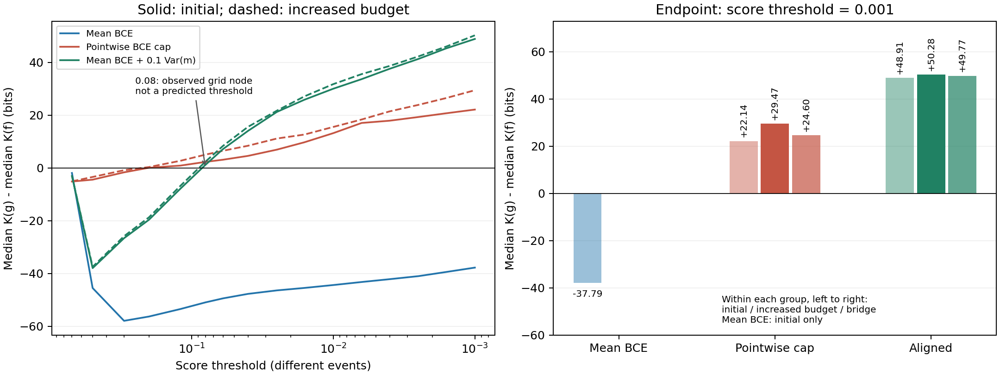
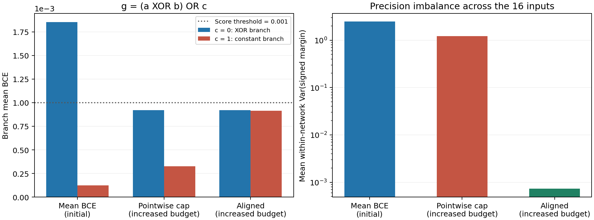

<a id="update-20261027"></a>

# 2026-10-27 补充：XOR / XOR-OR 的幅度对齐与复杂度换序

本补充整理 2026-10-24 已完成的实验，发布整理日期为 2026-10-27。它补充 E31 的幅度与精度讨论，不替换旧结果。本文不是事后补写的正式预注册；定性的事前预测、采样前固定的配置，以及看到结果后追加的复核在下文分开说明。本次发布没有新增训练或神经采样。

**核心结论不只是幅度对齐成功，也包括平均 BCE 作为复杂度标尺的局限：raw-BCE 体积是合法测量，但在某些情形下不够适合作为独立逻辑复杂度的统一标尺，因为它混入了样本和分支间的精度分配。后续需要在既有联合输出框架中修订或补充测量协议；对齐也不是已证明唯一正确的标尺。**

## 1. 动机与事前预测

若把“随 loss 降低收缩更快”定义成更复杂，再用它解释“复杂规则收缩更快”，就缺少定义之外的检验。这里先使用独立的逻辑结构判断，再问一个具体的输出精度干预能否改变反直觉的神经体积排序。

**证据链是：先独立逻辑判定 g 严格更复杂，再识别 raw K 的反常排序，随后提出幅度对齐可能反转的事前预测，最后用实测换序检验预测。** 独立逻辑判定不是从 K 的大小或曲线斜率反推的；原始逻辑预期及干预预测均在本轮采样前提出。

固定规则为：

```text
f(a,b,c,d) = a XOR b
g(a,b,c,d) = (a XOR b) OR c
```

第四位 d 不参与规则。g 比 f 多一个有实质作用的控制变量 c，而不是更长却能消去的表达式。为给独立逻辑判定一个严格、可检查的表述，本次网页整理先明确语言，再给出证明：门库为 AND2、OR2、XOR2、NOT1，每门至多 2 个输入、每门成本 1，接线免费；允许输出单个原始输入或常数的 0 门程序。成本是该固定门库中最小电路的门数。

f 有 a、b 两个本质变量，不能由 0 门程序实现，而一个 XOR2 门即可实现，所以最小成本为 1。g 有 a、b、c 三个本质变量：固定 b=c=0 时改变 a 会改变输出，固定 a=c=0 时改变 b 会改变输出，固定 a=b=0 时改变 c 会改变输出。单个至多 2 输入的门不可能依赖三个原始变量，所以 g 至少需要 2 门；XOR2 接 OR2 正好用 2 门实现。因此，在这个明确的语言中：

\[
C_{\mathcal L}(f)=1<2=C_{\mathcal L}(g).
\]

这个证明独立于神经采样及 Neural K，给出反循环校准的严格逻辑准则。它是本次网页整理对原始逻辑预期的形式化解释，不声称当时已正式预注册该门库或对 f/g 做过 SAT 最小性求解。另行取得的 AND2 与 AND2-OR 证书也不与此证明混淆。严格的门数关系不等于任意通用描述语言中的严格关系，更不直接推出任意网络、测度或连续输出精度协议下的神经 K 保序。

与上述逻辑准则相反，普通平均 BCE 的既有低 loss 测量给出 K_g<K_f。这里的“反常”指它与独立逻辑排序不一致，而不是先用神经体积定义复杂度，再把另一种神经排序称作逻辑证明。

在本轮采样之前，用户提出：c=1 时 g 恒为 1，容易的常数分支可能先获得很低 BCE，让仍需区分 XOR 的 c=0 分支保留较高 loss；限制样本之间的输出幅度差异，可能缩小原倒序，甚至使 g 的相对成本反超 f。这里必须区分“差距缩小”与“排序反转”。这是定性前瞻干预预测，未事先预测具体 K 差值或交叉阈值。

## 2. 协议与测量对象

### 2.1 固定网络、参考测度与事件

使用完整 4-bit 世界的 16 个 0/1 输入，按 a,b,c,d 从高位到低位枚举。真值表 ID 为 f=0x0FF0、g=0xCFFC。网络固定为 4→16→1 tanh，97 个独立标准 Gaussian 神经坐标；隐藏层权重和 bias 除以 2，输出层权重和 bias 除以 4。所有池从先验初始化，不使用训练权重。

对目标 h 的 logit 记为 z_i，正确方向 margin、逐点 BCE 和总体 margin 方差定义为：

\[
m_i=(2h(x_i)-1)z_i,\qquad
\ell_i=\log(1+e^{-m_i}),\qquad
\bar m=\frac1{16}\sum_{i=1}^{16}m_i,\qquad
\operatorname{Var}(m)=\frac1{16}\sum_{i=1}^{16}(m_i-\bar m)^2.
\]

三种分数分别定义三种不同的筛选事件；其中 lambda=0.1 沿用历史幅度对齐协议，在本轮采样前固定，没有按是否反转调参。

| 名称 | 分数 s_h | 约束含义 |
|---|---|---|
| mean_bce | \(\frac1{16}\sum_i\ell_i\) | 允许样本之间调剂平均 loss 预算 |
| max_bce | \(\max_i\ell_i\) | 每个样本都有同一个 BCE 上限 |
| aligned | \(\frac1{16}\sum_i\ell_i+0.1\operatorname{Var}(m)\) | 同时惩罚平均 BCE 与正确方向幅度不均匀 |

\[
V_h^{(s)}(\epsilon)=\Pr_{\theta\sim N(0,I_{97})}[s_h(\theta)\le\epsilon],\qquad
K_h^{(s)}(\epsilon)=-\log_2 V_h^{(s)}(\epsilon),\qquad
\Delta K^{(s)}=K_g^{(s)}-K_f^{(s)}.
\]

正的 Delta K 表示 g 的质量较小、Neural K 较高。三组使用相同的数值阈值，但不是同一个事件；aligned 阈值不是 raw BCE。对象是两个目标各自的 full-target 质量，不是同一个固定训练集内的候选函数竞争。没有额外交 hard-function cell；当 mean_bce 或 aligned 阈值低于 ln(2)/16 时已蕴含完整 hard 正确，max_bce 的对应界是 ln(2)。

### 2.2 原始采样与追加复核

| 阶段 | 作业数 | 每作业独立池数 | 每池粒子数 | 每层适应 / 固定更新 | 报告节点固定更新 | 随机种子 |
|---|---:|---:|---:|---|---:|---:|
| 首轮：两规则、三事件 | 6 | 4 | 2048 | 4 / 16 | 96 | 202610241701 |
| 加预算：两规则、两干预事件 | 4 | 4 | 4096 | 4 / 32 | 96 | 202610241702 |
| 父事件桥接：两规则、两干预、两节点 | 8 | 沿用 4 个父池 | 2048 | 4 / 64 | 128 | 202610241905 |

首轮与加预算合计 40 个从先验初始化的池。池间不交换粒子，各池有独立的 prior、resampling 和 mutation 随机流。pCN 依次更新隐藏层、输出层和全部参数三个块，在当前事件内接受提案。参数及前向使用 float32，log 质量以 float64 累积，禁用 AMP/TF32。原运行环境为 Python 3.13.5、NumPy 2.4.1、PyTorch 2.11.0+cu130，NVIDIA GeForce RTX 3080、cuda:1。

报告节点固定为 0.7、0.5、0.3、0.2、0.12、0.08、0.06、0.04、0.025、0.016、0.01、0.0063、0.004、0.0025、0.0016、0.001。主统计是各池 K 的中位数，不是平均池质量取负对数；发布表保留二者及池范围，不能将粒子视为独立重复。

加预算与桥接都是看到首轮反转和强约束组绝对 K 波动后追加的精度复核，不是新的正式预注册。加预算保留 f/g 的两种干预，普通 BCE 本档未另跑。桥接从 mean_bce≤epsilon 的原父池出发，在 epsilon=0.01、0.001 保持父约束并收紧 max_bce 或 aligned，逐池按下式记账：

\[
K_{\mathrm{child},r}=K_{\mathrm{parent},r}-\log_2\Pr(E_{\mathrm{child}}\mid E_{\mathrm{parent}})_r.
\]

桥接使用新的后续随机流，但继承父池误差；32 个终点池记录不等于 32 个独立先验重复，也不是第三种独立估计器。逐池可加不意味着不同量的池中位数可以逐项精确相加。

## 3. 结果：K 排序反转，而非仅斜率改变

以下为各组分数上限 0.001 时的“g 的池 K 中位数减 f 的池 K 中位数”，单位 bit。数字按各自未舍入估计计算，分别舍入的 K 相减可能差 0.01。

| 筛选事件 | 首轮 Delta K | 加预算 Delta K | 父事件桥接 Delta K |
|---|---:|---:|---:|
| mean_bce | -37.79 | 未另安排 | 作为父事件 |
| max_bce | +22.14 | +29.47 | +24.60 |
| aligned | +48.91 | +50.28 | +49.77 |

普通 BCE 新测 K_f=823.33、K_g=785.55；历史扫描分别为 823.54、786.93，历史 f 的加预算值为 821.91。新加预算 aligned 为 K_f=869.31、K_g=919.60，四池范围分别为 868.41–869.96、912.23–927.45，没有重叠。这些范围描述本批池间波动，不是正式置信区间或全局混合认证。

aligned 在 0.01 时也已反转：首轮 +30.04、加预算 +31.78、桥接 +32.45 bit。首轮在 0.12 为 -7.86，在 0.08 为 +1.14；加预算同样在 0.12 为负、0.08 为正。因此 0.08 是已取网格中首次观察到正差值的节点，不是事前预测阈值，也不是精确定位的连续交叉点。结果不是仅挑最深节点得到的方向。



桥接在 0.001 加入 aligned 的条件成本中位数约为 f：42.79 bit、g：130.97 bit；总 K 中位数为 866.15、915.92，差 +49.77 bit。新增约束对 g 的保留率更低，与从先验直接估计的方向一致。

## 4. 分支 loss 与精度预算机制

下表保留 g 的两支实际 BCE；max_bce 和 aligned 使用加预算结果，mean_bce 使用首轮结果。

| g 的筛选条件 | c=0 分支平均 BCE | c=1 分支平均 BCE |
|---|---:|---:|
| mean_bce≤0.001 | 0.0018534 | 0.0001242 |
| max_bce≤0.001 | 0.0009211 | 0.0003277 |
| aligned≤0.001 | 0.0009212 | 0.0009130 |

普通组允许难分支平均 loss 接近整体上限的两倍，因为两个分支各占 8 个输入，容易分支贡献很小的非负 loss。这不是让易样本贡献负 loss。f 的普通组两支约为 0.001013、0.000965，没有同样强的不均匀。

逐点上限取消难分支超过同一上限的能力，但仍允许易分支额外自信，排序已反转。aligned 进一步使两支 BCE 接近，并将 g 的平均 margin 方差从约 2.461 降至约 0.000730。加预算 aligned 的实际平均 BCE 为 f 0.0009199、g 0.0009171，彼此接近，但并未与普通组进行严格连续条件匹配。



这些观测支持事前提出的干预方向及平均 loss 预算分配解释，但不证明网络内部执行了“先判断 c，再决定是否计算 XOR”的程序。三种筛选事件一起改变精度与幅度分配，尚未分解全部因果贡献。

## 5. 结论与边界

本实验同时给出预测检验与测量定义上的警示：独立逻辑结构与输出精度分配支持的定性事前判断，成功预测了这个函数对在幅度干预后发生 K 排序反转；但这也说明，仅用平均 BCE loss 标定复杂度在某些情况下不够合适。原始平均 BCE 事件下 g 较便宜不是非法测量，而可能反映更便宜的连续实现及可调剂的精度预算。将这种合法体积直接当作独立逻辑复杂度的统一标尺，需要修订或补充协议；换事件后符合逻辑排序也不等于获得唯一、与 loss 无关的正确复杂度。

联合输出分布已经是框架的底层对象，待完善的是在其上选取可比较截面和复杂度定义。幅度相同只是一个特殊选择；也可预先规定不同输入或输出位置的不同目标幅度，但必须明确区域、容差与精度坐标，不能结果出现后任意挑选有利截面。普通 BCE 继续趋零不自动等于幅度对齐，本实验不能推出无正则曲线在无限深尾必然换序。

原记录的独立 float64 复算覆盖 672 个快照、1,900,544 组参数；直接估计的最大 float32/float64 分数差约 1.80e-7，逐层存活计数和 K 累加另行核对。桥接核验检查父快照身份、终点约束及加法账本，没有独立重建桥接逐层存活计数。历史四项工程自检包括解析 Gaussian 半空间、随机流重放和池间隔离；这些是历史核验记录，本次未重跑其中的采样测试。

绝对 K 仍有预算与路径敏感性：f 的 max_bce K 中位数首轮 883.91、加预算 860.10、桥接 851.47。因此小数位不是收敛精度，有限 MCMC 的共享偏差仍不能排除。原加预算 g-aligned 曾在保存进度 JSON 时遇到一次临时访问拒绝，使用已保存的权重和 RNG 检查点、原源码及原配置续跑，没有更改采样参数或筛掉副本。本函数对没有新增 SGD 对照，本补充不包含 SGD 命中时间内容。

## 6. 公开复现入口与本次校验

复现文件位于 `xor_or_alignment_20261027/`。[run_experiment.py](xor_or_alignment_20261027/run_experiment.py)、[bridge_diagnostic.py](xor_or_alignment_20261027/bridge_diagnostic.py)、[verify_bridge.py](xor_or_alignment_20261027/verify_bridge.py) 与历史源码逐字节相同；采样器 SHA256 为 `7960cbdeac3554850eefeb9f596637ed77ba615eaf56e68c4fd4268ece1b0aeb`。[analyze.py](xor_or_alignment_20261027/analyze.py) 只对发布路径和图中文字做适配，移除了私有盘符入口。来源及必要数据的 hash 保留在 [data/provenance.json](xor_or_alignment_20261027/data/provenance.json)，不据此声称重新运行过历史实验。

在本实验目录下，安装 [requirements.txt](xor_or_alignment_20261027/requirements.txt) 对应依赖后，可以只做轻量核验和重画网页图，不启动训练或采样：

```powershell
cd xor_or_alignment_20261027
python -E -s test_offline.py
python -E -s build_figures.py
python -E -s check_release.py
```

只有明确决定重新执行原 SMC 时才运行下列命令；本次发布未执行。采样器保留原 cuda:1 选择，要求相应可见 CUDA 设备，不自动回退 CPU。若另行改设备或数值配置，应保存为新的运行身份，不能冒称原检查点的逐位续跑。

```powershell
$env:XOR_ALIGNMENT_TIER = 'primary'
Remove-Item Env:XOR_ALIGNMENT_JOBS -ErrorAction SilentlyContinue
python -E -s run_experiment.py
$env:XOR_ALIGNMENT_TIER = 'confirm'
$env:XOR_ALIGNMENT_JOBS = 'f__max_bce,g__max_bce,f__aligned,g__aligned'
python -E -s run_experiment.py
python -E -s analyze.py
$env:XOR_ALIGNMENT_TIER = 'primary'
Remove-Item Env:XOR_ALIGNMENT_JOBS -ErrorAction SilentlyContinue
python -E -s bridge_diagnostic.py
python -E -s verify_bridge.py
```

首轮输出 `results_primary/`，加预算输出 `results_confirm/`，桥接输出 `bridge_results/`。桥接需要首轮保存的 mean_bce 节点快照；完整逐参数核验同样需要重跑生成的快照。发布包仅保留小型聚合 CSV 和桥接摘要，不含权重、检查点或大型原始结果，故不能直接复验原始 672 个快照。历史扫描压缩包也未打包；可选环境变量 `XOR_ALIGNMENT_HISTORICAL_PACKAGE` 是其显式数据入口，不提供时分析会报告不可用，不影响本轮直接结果复算。

本次完成所有新增 Python 文件的 py_compile 与 imports 检查、4 项不采样的离线测试，以及从既有聚合数据生成的两张英文标注图。[test_experiment.py](xor_or_alignment_20261027/test_experiment.py) 是保留的历史 GPU/SMC 工程测试，不属于本次离线测试入口，也没有运行。公开代码不依赖框架外研究源码；重新采样、原始快照复核与全局混合验证仍是不同层次的工作。
