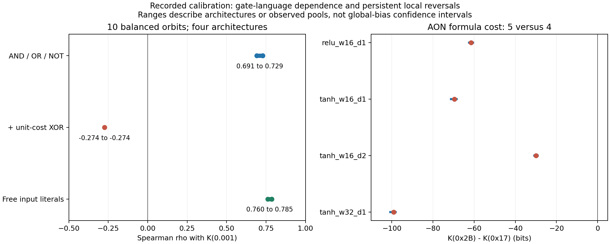

<a id="update-20261027"></a>

# 2026-10-27 补充：独立复杂度校准、逻辑证书与局部倒序

本补充将 2026-10-24 已完成的外部逻辑求解与旧 3-bit 数据重分析纳入 E33，发布整理日期为 2026-10-27，不替换旧跨架构报告。这是对已知神经数据的回顾性校准，不是新盲测或事后补写的正式预注册。本次发布没有新增神经训练、SMC 或完整证书求解。

## 1. 动机：共同排序之外的独立标尺

跨架构共享排序不等于已经证明它是复杂度排序。若只用神经体积收缩定义复杂度，再说复杂规则收缩更快，仍可能循环。需要固定一个独立逻辑语言、成本和目标集合，比较可证最小实现成本、外部代理与 Neural K，并保留不符合预期的关联和倒序。

“严格更多逻辑”不能只靠表达式更长，必须排除冗余和代数消去，且相对于明确门库、编码及最小实现成本成立。固定门库下的严格关系也不能升级为任意通用描述语言、网络架构、参考测度或精度协议下的普遍定理。此处分别报告共享排序、规则家族偏置和架构局部差异，不要求每个外部代理对每对函数都保序。

## 2. 协议与数据范围

### 2.1 旧神经面板与外部代理

旧 3-bit 世界包含 256 个函数，其中 70 个平衡函数；按输入变量置换与输出整体取反共有 40 个轨道，平衡函数占 10 个轨道。这不是允许输入位取反的 NPN 分类。四个架构为 relu_w16_d1、tanh_w16_d1、tanh_w16_d2、tanh_w32_d1；输入编码为 0/1。低 loss 测量使用每目标每架构 8 个池、每池 4096 粒子，完整真值表 BCE 的 16 个阈值从 0.7 至 0.001。本次只读取已完成数据，不重新认证旧 SMC 的全局混合。

旧关联表已覆盖 19 种代理，包括 LZ、SOP 操作数、C1+C2、输出熵、CSR，以及两种门库的精确公式树、精确决策树、ANF、CTM 和 Walsh/Fourier 统计。公式树可以重复子表达式，但不是允许共享子计算的最小 DAG 电路。256 个函数的 total influence 已直接复算；Walsh 平均次数与 total influence 数值相等，不能计作两份独立证据。平衡函数的输出熵恒为 1，不能在该组内排序。

主要比较 K(0.001) 及两个有限窗口收缩率：

\[
s_{\epsilon_1\to\epsilon_2}(h)=
\frac{K_h(\epsilon_2)-K_h(\epsilon_1)}{\log_2(\epsilon_1/\epsilon_2)},\qquad
(\epsilon_1,\epsilon_2)\in\{(0.01,0.001),(0.0025,0.001)\}.
\]

这些有限窗口是本轮回顾性分析中的明确选择，不是对未见数据的预注册预测，也不等于渐近斜率。主要以 10 个平衡轨道计数，不能将 70 个对称函数或四个高度相关架构当作数百个独立规则确认。

### 2.2 明确门库、证书与超时界

| 门库 | 允许门及成本 | 输入反相约定 |
|---|---|---|
| aon_paid | AND2、OR2、NOT1 各 1 门 | 输入 NOT 计费 |
| aonx_paid | AND2、OR2、NOT1、XOR2 各 1 门 | 输入 NOT 计费 |
| aon_free_inputs | AND2、OR2、NOT1 各 1 门 | 原始输入的反相 literal 免费 |

三种语言都允许免费原始输入、0/1 常数及输出反相；电路无环、允许 DAG 共享和无限制 fan-out，每门 fan-in 至多 2。投影或常数可为 0 门。每个预算编码“至多 r 门”，未使用门允许任意填充。含廉价 XOR 的门库预先保留，不能因为负相关而删除或只报告最有利门库。

目标为旧面板全部 10 个平衡轨道代表、8 个固定 4-bit 单输出规则、2 个 4-bit 双输出任务，共 20 个目标，乘三种门库得到 60 项。逐项从 0 门递增，最多 10 门，每实例最多 30 秒，调度总时限 1200 秒，超时或不支持的证明记 unknown，并保留已获得的上下界，不当作无穷复杂。固定目标生成入口为 [run_synthesis.py](proxy_complexity_20261027/run_synthesis.py)，不读取 Neural K 来选规则。

原求解器为 CaDiCaL 1.9.5，使用 `--plain --no-binary --lrat`。只有当前预算 SAT 见证逐点正确、且所有更低预算的 UNSAT 正提示 LRAT 通过独立 Python 检查，才记为 exact。检查器遇到不支持的 RAT 负提示会拒绝认证。它不是形式化验证过的证明内核；CNF 与逻辑语义的对应另由门真值表、见证和小世界独立枚举测试支持。

## 3. 结果：逻辑最小性与门库依赖

### 3.1 60 项中 59 项精确

历史运行的 60 项中，59 项获得最小性证书；剩余 aon_paid 下的 joint4_independent 保留 [8,10] 界。独立检查器重放 215 份 LRAT，共 544711 条 RUP 新增步骤。以下是全部 10 个平衡轨道的最小共享 DAG 门数，不以公式树成本代替电路成本。

| 函数 | aon_paid | aonx_paid | aon_free_inputs |
|---|---:|---:|---:|
| 0x0F | 0 | 0 | 0 |
| 0x17 | 4 | 4 | 4 |
| 0x1B | 4 | 3 | 3 |
| 0x1E | 5 | 2 | 5 |
| 0x2B | 5 | 4 | 4 |
| 0x2D | 6 | 3 | 5 |
| 0x2E | 4 | 3 | 3 |
| 0x3C | 4 | 1 | 3 |
| 0x69 | 8 | 2 | 7 |
| 0x6A | 5 | 2 | 5 |

与旧 Neural K 的 Spearman 范围如下，每格是四个架构的范围。相关性为描述性结果，不提供新的显著性确认。

| 门库 | K(0.001) | 窗口 0.01→0.001 | 窗口 0.0025→0.001 |
|---|---:|---:|---:|
| aon_paid | 0.691 至 0.729 | 0.716 至 0.729 | 0.665 至 0.729 |
| aonx_paid | -0.274 至 -0.274 | -0.274 至 -0.237 | -0.274 至 -0.199 |
| aon_free_inputs | 0.760 至 0.785 | 0.760 至 0.785 | 0.711 至 0.785 |

允许廉价 XOR 后，parity 等函数的逻辑成本降低，但所测普通网络中的 Neural K 仍较高；这种分歧不能隐去。纯仿射 parity 轨道为 0x3C、0x69。仅作为敏感性视图去掉这两类后，三个门库的端点 Spearman 范围分别为 0.626 至 0.626、-0.272 至 -0.272、0.766 至 0.766，负关联仍保留。XOR 能缩短电路不等于已把目标认定为 parity 家族，例如 mux 也可用 XOR 重写；家族划分不能由 K 的不合预期事后决定。

### 3.2 AND2 对与多输出共享

AND2 与 AND2 再 OR 第三位在三种门库中分别为 1 门和 2 门，均有最小性验证。4-bit 证书中的第四位不相关；常数免费时限制第四位与加入无关输入都不改变这对规则的最小成本。下表神经 K 来自旧 3-bit 测量，不是新增 4-bit 神经测量；这对规则的输出平衡度不同，仍可能混入标签比例或几何因素。这些证书不冒称为 E31 中 XOR / XOR-OR 的 SAT 证书。

| 架构 | AND2 K | AND2 OR 第三位 K |
|---|---:|---:|
| relu_w16_d1 | 268.3374 | 328.5456 |
| tanh_w16_d1 | 326.0986 | 404.3580 |
| tanh_w16_d2 | 213.8596 | 242.9043 |
| tanh_w32_d1 | 437.0952 | 545.1974 |

多输出 shared 任务为 `((a XOR b) AND c, (a XOR b) AND d)`；名为 independent 的历史对照为 `((a XOR b) AND c, (a XOR d) AND b)`。后者只是不同前缀，不是已证明的算法独立。

| 门库 | 任务 | 联合成本界 | 分开实现的最小成本之和 |
|---|---|---:|---:|
| aon_paid | joint4_shared | [6,6] | 10 |
| aon_paid | joint4_independent | [8,10] | 10 |
| aonx_paid | joint4_shared | [3,3] | 4 |
| aonx_paid | joint4_independent | [4,4] | 4 |
| aon_free_inputs | joint4_shared | [5,5] | 8 |
| aon_free_inputs | joint4_independent | [8,8] | 8 |

共享实现有独立逻辑收益，但不能据此宣称 Neural K 已获得相等的收益或已经测得神经互信息。多输出神经体积验证仍是另外的命题，本次没有执行。

## 4. 外部代理、共同排序与稳定局部倒序

### 4.1 保留不同代理的正负关联

以下保留 10 个平衡轨道上 11 种代表代理的全部三列结果；另外的代理列、全部 256 个函数及 70 个平衡函数的关联可由随包表和代理复算脚本重建，不将指标个数当作独立证据数。

| 代理 | K(0.001) | 窗口 0.01→0.001 | 窗口 0.0025→0.001 |
|---|---:|---:|---:|
| total_influence | 0.905 至 0.937 | 0.905 至 0.937 | 0.840 至 0.937 |
| boolean_operations_output_symmetric | 0.801 至 0.826 | 0.801 至 0.826 | 0.752 至 0.826 |
| formula_gate_count_aon_output_symmetric | 0.772 至 0.803 | 0.790 至 0.803 | 0.747 至 0.803 |
| formula_gate_count_aonx_output_symmetric | -0.274 至 -0.274 | -0.274 至 -0.237 | -0.274 至 -0.199 |
| decision_tree_internal_tests | 0.570 至 0.610 | 0.570 至 0.610 | 0.492 至 0.610 |
| mingard_generalization_complexity_c1_c2 | 0.382 至 0.442 | 0.382 至 0.442 | 0.382 至 0.563 |
| critical_sample_ratio | 0.522 至 0.522 | 0.522 至 0.522 | 0.522 至 0.522 |
| mingard_lz_symmetry_min | 0.441 至 0.522 | 0.510 至 0.522 | 0.415 至 0.522 |
| ctm_b2_d12_symmetry_mean | 0.030 至 0.122 | 0.097 至 0.109 | 0.006 至 0.109 |
| anf_term_count_output_symmetric | -0.057 至 -0.019 | -0.094 至 -0.019 | -0.094 至 -0.019 |
| walsh_spectral_entropy | -0.038 至 0.038 | -0.038 至 0.038 | -0.038 至 0.190 |

旧 10 个平衡轨道共有 45 个函数对，其中 43 对在四个架构的 K(0.001) 点估计上方向相同。这支持这个有限面板的共同排序，但不证明它等于经典 Kolmogorov 复杂度，也不能推断任意任务总体中例外的比例。



### 4.2 匹配部分几何后仍有倒序

匹配输出比例、相关变量数及 total influence 后，10 个平衡轨道提供 5 个 AON 公式成本严格不同的函数对。下表为高公式成本函数的池 K 中位数减低成本函数的池 K 中位数，单位 bit；全部 20 个架构/配对的中位差都为负。这是局部倒序，不因总体正相关而删除。

| 低成本函数 → 高成本函数 | relu_w16_d1 | tanh_w16_d1 | tanh_w16_d2 | tanh_w32_d1 |
|---|---:|---:|---:|---:|
| 0x17 → 0x2B | -61.507 | -69.557 | -29.897 | -99.098 |
| 0x1B → 0x2B | -175.341 | -340.531 | -135.951 | -459.072 |
| 0x2E → 0x2B | -172.422 | -344.699 | -136.857 | -465.784 |
| 0x1E → 0x2D | -4.786 | -5.334 | -2.165 | -11.331 |
| 0x6A → 0x2D | -100.941 | -66.054 | -13.770 | -76.923 |

19 个架构/配对的所有跨池差值均为负；例外是 tanh_w16_d1 的 0x1E→0x2D，其跨池范围为 [-11.221,0.005] bit。这里比较每目标 8 个池，范围不是置信区间，也未涵盖各池共享的系统偏差。原探索性补核曾按池重采样 5000 次、保留跨 loss 相关性，但没有多重检验控制；本次轻量发布复算只重算端点中位差与跨池范围，不声称重做了该 bootstrap。

一个具体例子是 0x17（NOT majority3）与其第三输入位取反得到的 0x2B：两者均平衡、依赖 3 个变量、total influence=1.5；输出取反取最小后的 AON 公式成本分别为 4、5，而 tanh_w16_d1 的 K(0.001) 分别为 360.716629、291.159592 bit。匹配这几项指标并不等于控制全部混杂。

在 0/1 编码下，第一层 `b + sum_j w_j x_j` 的输入位取反需要：

\[
w'_j=-w_j,\qquad b'=b+w_j.
\]

该变换的 Jacobian 绝对值为 1，但一般不保持独立参数先验；若原 b 与 w_j 独立且零均值，则 `Cov(w'_j,b')=-Var(w_j)`。所以“只否定一个输入”的逻辑变换不要求在原 0/1 iid 先验下具有相同 Neural K。输入 NOT 的计费、输入编码及参考测度必须分开，不能据此宣布所有描述复杂度关系失效，也不能事后删除这对规则。

## 5. 可保留的结论与尚未解决的问题

外部校准不是不存在：固定逻辑门库给出了独立最小性证据，旧神经面板有稳定共同排序，部分代理存在明显正关联。但廉价 XOR 门库有负关联，匹配部分几何后也有跨架构稳定的局部倒序。三者必须同时保留，不能只挑最高相关，也不能把有限代理都改称 Kolmogorov 复杂度。

联合输出分布已经是框架的底层对象；后续需要完善的是比较截面、精度坐标与复杂度定义，而不是把联合输出重新发明为补救。共同排序、共享家族偏置和架构特异偏置需要在明确目标总体与权重下区分；若要声称某家族只是少数例外，必须先定义总体，并在下一批目标上独立确认预期方向。

此处逻辑证明检查不能认证旧 SMC 无偏，有限面板的描述性相关不能证明任意网络保序，共享 DAG 的收益也不能替代多输出神经测量。对已有数据作的几何匹配和家族敏感性分析均为探索性，不因事后补充池间波动检查就成为正式预注册确认。

## 6. 公开复现入口与限制

最小复现代码位于 `proxy_complexity_20261027/`，依赖见 [requirements.txt](proxy_complexity_20261027/requirements.txt)。[exact_circuits.py](proxy_complexity_20261027/exact_circuits.py) 保留原编码器、整数真值表见证执行器及正提示 LRAT 检查器；合成与证书分析副本只将旧私有数据入口改为本子目录的 `data/`。来源及数据 SHA256 见 [data/provenance.json](proxy_complexity_20261027/data/provenance.json)。

随包最小数据包括：256 行函数/代理面板，四架构全部函数在 0.01、0.0025、0.001 的 3072 行 K 聚合表，304 行端点代理关联，60 行历史门数/界摘要，以及 10 个平衡轨道的 320 行端点池记录。这足以自包含地复算本补充的聚合比较，但不含旧神经粒子、权重、完整训练过程或原始证书堆；历史 exact 标记的摘录不是新一轮证明。

在原实验目录下运行以下命令，只做逻辑轻量测试、既有数据复算及网页重画，不启动训练、SMC 或 SAT 求解：

```powershell
cd proxy_complexity_20261027
python -E -s test_offline.py
python -E -s audit_existing_proxies.py
python -E -s recompute_calibration.py
python -E -s build_figures.py
python -E -s check_release.py
```

[audit_existing_proxies.py](proxy_complexity_20261027/audit_existing_proxies.py) 重算 19 列代理的关联、total influence 恒等关系及匹配对；[recompute_calibration.py](proxy_complexity_20261027/recompute_calibration.py) 复算门库关联、43/45 共同方向及 20 个局部倒序比较。LZ、CTM 等代理的既有列值作为输入保留，并非本次从原始压缩/CTM 库重新生成；本包的“自包含”仅指这些列值上的公开复算，不等于重新实施全部历史代理算法或旧 SMC。

只有另行决定重建全部逻辑证书、并已在 PATH 提供支持上述选项的 CaDiCaL 时，才运行以下命令；本次未执行。求解器不是 Python requirements 的一部分，不自动下载或更换。超时可能导致新一轮 exact 数量不同，必须保留 unknown 与界，不能保证再次恰好 59 项。

```powershell
python -E -s run_synthesis.py
python -E -s analyze_certificates.py
```

生成的 DIMACS、LRAT、见证及日志写入本子目录 `results/`；证书分析先检查冻结源码和面板 hash，再重放证明与见证，之后才读取旧神经聚合表。原始 215 份 LRAT 未打包，所以本次没有重放它们。[test_exact_circuits.py](proxy_complexity_20261027/test_exact_circuits.py) 与 [verify_small_world.py](proxy_complexity_20261027/verify_small_world.py) 是保留的求解器测试入口，不是本次离线测试命令。

本次完成所有新增 Python 文件的 py_compile 与 imports 检查、5 项无求解器离线测试、既有代理关联及局部倒序复算，并生成 1 张英文标注图。没有修改原始研究目录、旧 E33 报告、主构建或索引；没有新增神经训练、采样、commit 或 push。
