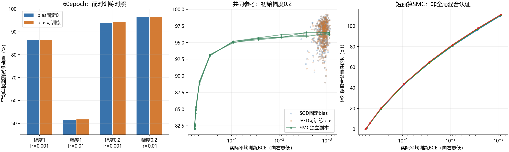

# 第一轮结论：收紧raw BCE后，静态样本达到SGD的测试水平

2026-09-19。已在本地物理GPU1 RTX3080完成，不使用远程5090。没有改写49号或公开论文。

## 核心结果

固定一个由作者公开逻辑重建的16样本MNIST 0/7训练集、2008测试图、3/6宽度LeNet。初始化权重U[-0.2,0.2]，静态采样bias固定0。训练使用原生两类CE，静态约束及报告使用等价的稳定raw BCE。

| 条件 | 平均单模型/单粒子测试准确率 |
|---|---:|
| G&C：只要求训练分类全对 | 82.1344% |
| SMC：训练全对且BCE≤0.3 | 93.1083% |
| SMC：训练全对且BCE≤0.1 | 95.0906% |
| SMC：训练全对且BCE≤0.01 | 95.8853% |
| SMC：训练全对且BCE≤0.001，首次到达 | 96.3977% |
| 同一终点额外512轮固定核更新 | 96.3677% |
| SGD：bias固定0，lr=0.01，60epoch | 96.3588% |
| SGD：bias可训练，其他相同 | 96.3589% |

SGD各512个配对初始化；SMC为4个独立作业、各1024粒子，所有作业从独立G&C起点开始，没有SGD预热。SMC测试标签不参与接受、目标节点或预算选择。这些是单网络准确率的平均，不是集成多数票成绩。

额外更新后，各SMC副本为96.3288%至96.4150%。仍有每副本1024种不同完整测试预测向量，不能把平均性能一致误读为完整函数分布已成为一个点；存在多样性也不证明混合充分。

**可以支持的结论：**在本实验中，只按训练分类正确筛选的G&C明显低于SGD；在同一零bias参考测度下继续收紧raw BCE，静态条件样本也达到相同测试水平。因此，原先的hard-fit对照不足以排除loss-resolved静态选择对泛化差距的解释。

**不能升级为：**已推翻Peleg所有实验；SGD等于静态采样；完整函数概率分布已相同；所有架构和训练集都如此。

## 两个代码疑点的实际裁决

### bias不是主要解释

原公开代码的bias先验固定0，而SGD允许训练bias，确实值得控制。但在关键的a=0.2、lr=0.01组，可训练bias减固定bias的准确率仅约0.00010个百分点，配对初始化bootstrap 95%区间为[-0.01352,0.01362]个百分点。两组均512/512训练全对。

这排除了“该主要差距很可能只由是否训练bias造成”的简单解释，不能继续只凭代码差异保留这一归因。

### 学习率与初始化确有交互

a=1、lr=0.001时约86.4%至86.5%，训练BCE已极低并很早平台；a=0.2、lr=0.001时平均约93.9%至94.2%，但仍有模型未完全拟合；a=0.2、lr=0.01时全部拟合并约96.36%。

a=1、lr=0.01两组没有任何模型完整拟合；固定bias/可训练bias分别83/512、95/512出现非有限输出。它们是数值/优化失败条件，不当作静态或泛化反例。

小初始化的优势并未因固定学习率而消失。不同初始化先验的raw BCE不能脱离输出尺度直接横比，尤其不能用大初始化下极低BCE反驳小初始化参考测度的条件曲线。

## BCE匹配还缺哪一步

在固定a=0.2、lr=0.01、bias=0的SGD终点上，做了不按准确率选箱的探索性匹配。分箱包含全部SMC源阈值，防止直接混合不同条件分布造成错误。

- log10箱宽0.1：共同支持80/512，即15.625%。SGD为96.3521%，SMC匹配后96.3797%，差值SGD-SMC=-0.02765个百分点，区间[-0.44399,0.37259]。
- 半箱宽0.05：共同支持68/512，即13.281%。SGD为96.3711%，SMC为96.3728%。

这是有限分箱、共同支持子集的结果，不是全体SGD的严格matched-BCE确认。终点节点0.003与0.001之间缺少足够密的中间采样，使覆盖不足。未来若需要更强结论，应依据训练BCE分布冻结密集节点并独立确认，而不是继续挑选高测试准确率点。

额外终点更新前后的静态均值均约0.000889；SGD终点BCE中位数约0.00116。两者属于邻近低loss区域，但不能仅凭接近就叫作精确相同loss。

## 质量、时间与文件

- 作者数据选择及归一化与独立重建完全一致；前向、梯度、10步SGD与普通单模型float64实现一致至约1e-16量级。
- 原始采样源码和作者文件hash未改变。SMC固定核继续更新另存，不覆盖首轮。
- NumPy float64复核72组抽存权重，每组原定16模型、80输入；跳过并记录4个非有限失败模型。所有实际核查均无分类翻转；SMC训练约束无观测违例。有效主条件与SMC的最大logit绝对差约6.08e-6。失败大初始化组另有巨大数值，未混作正常误差指标。
- 深端点初始祖先只剩5至9个；高接受率、多个副本和继续更新稳定仍不是全局混合证明。
- 8条件共4096网络，训练循环合计20.25秒，训练侧评估35.28秒；四个G&C收集29.30秒，初始SMC推进206.92秒，终点固定核更新81.69秒。含相应落盘等的主要运行约6.5分钟，不含写代码、预检和离线审计。没有仍在运行的本实验训练或采样进程。

首轮到此结束，未自动追加新训练集、宽度扫描、幅度正则或更深采样。

- [完整分析报告](analysis/REPORT.md)
- [机器可读汇总](analysis/summary.json)
- [预定协议](PROTOCOL.md)
- [主脚本，无argparse](experiment.py)
- [终点检查](endpoint_check.py)
- [独立分析](analyze.py)

