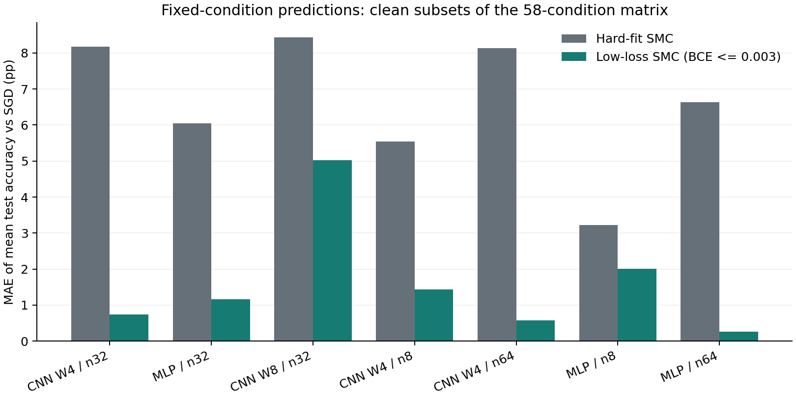
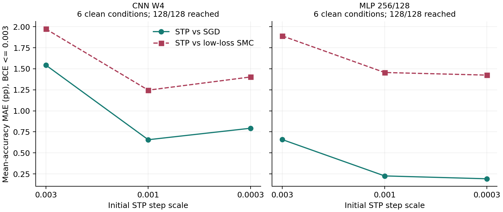
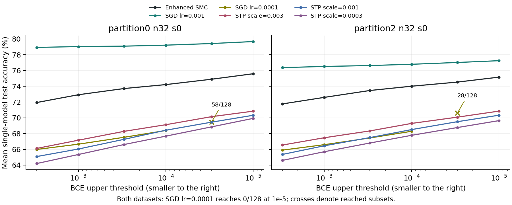

<a id="update-20261027"></a>

## 2026-10-27 验证扩展：静态条件分布与训练结果的对应

本补充接续 E36 的单数据集 raw-BCE 复核，汇总后续的 58 条件 CV、直接 Guess & Check（G&C）、增强 SMC、无梯度 STP 及宽 CNN 边界。它是同一验证问题的扩展，不替换上面的历史正文，也不把旧实验计为新的独立证据。

**文档身份：**以下动机与协议说明整理于 2026-10-27，是依据已完成程序、配置和结果所作的回顾性说明，不是当时正式提交的预注册。原矩阵采用先冻结静态预测、再运行 SGD 的流程；衔接组不是新的盲预测，后追加的采样复核、步长扫描、广泛 STP 和宽 CNN 诊断也不冒称独立盲预测。本轮只整理、制图与轻量核验，没有重新训练或运行 SMC。

### 1. 动机与问题

参数先验诱导的函数分布不均匀，本身不足以说明实际训练选择哪些函数。这里检验的是：**在同一网络、训练数据和明确参考测度下，把连续训练 loss 纳入静态条件，能否比只要求分类全对更准确地预测不同训练方法在未见输入上的函数预测？** 比较的是预测层面，不预设参数分布相同。

主任务把 MNIST 十个数字类别随机分成两组，每组五类，并按类别分组赋二分类标签。这是任意的 **5 vs 5 类别分组，不是 iid 随机标签**：同一数字的所有图像仍共享标签，图像和数字类别结构仍然存在。另设训练标签翻转及样本级随机平衡标签控制；后者固定两类数量相等，也不等于无条件 iid Bernoulli 标签。测试标签仍由原数字分组定义。

小训练集未必提供足够信息唯一确定完整数字分组，因此不把这些任务包装成“极少样本充分表达自然视觉概念”的强规则学习展示。即使真实分组难以唯一识别，给定相同信息有限的训练约束，不同方法的未见输入预测是否接近，仍是可检验的问题。反过来，两种方法都在随机标签控制上接近 50% 准确率，也不自动构成精细函数预测对应。

STP 的机制问题是：SGD/Adam 特有的梯度更新，是否是这些泛化行为的必要来源？若只依据前向 loss 比较的 STP，在相同网络、数据和拟合要求下仍有相近泛化及逐图预测，就削弱了“这些现象只能来自 SGD/Adam 专有更新”的解释。STP 不是 SMC 替代品，找到低 loss 解也不是测得该区域的静态质量。

### 2. 比较对象与协议

#### 2.1 静态事件和训练终点

令两类 logit 差为 $d_\theta(x)=z_1(x)-z_0(x)$。固定数据 $D=\{(x_i,y_i)\}_{i=1}^n$，使用平均 raw BCE 和训练分类全对事件：

$$
L_D(\theta)=\frac{1}{n}\sum_{i=1}^{n}\log\left(1+\exp\left[-(2y_i-1)d_\theta(x_i)\right]\right),\qquad
H_D=\{\theta : \operatorname{argmax}z_\theta(x_i)=y_i\ \forall i\}.
$$

参考测度 $\mu$ 为每个权重独立 $U[-0.2,0.2]$，bias 固定为零。直接 G&C 独立抽取参数并拒绝不满足 $H_D$ 的样本；hard-fit SMC 估计同一条件目标，而低 loss SMC 估计下面的累计子水平事件：

$$
\mu_\epsilon(A)=\frac{\mu(A\cap H_D\cap\{L_D\leq\epsilon\})}{\mu(H_D\cap\{L_D\leq\epsilon\})},\qquad
K_D(\epsilon)=-\log_2\mu(H_D\cap\{L_D\leq\epsilon\}).
$$

SMC 先通过最大 signed-margin 违约约束到达 hard-fit，再收紧平均 BCE；采用盒内反射、对状态独立的固定提案尺度混合。错误的 logit tie 排除，正确 tie 按 argmax 规则保留。网络为 float32，约束评分为 float64；不使用梯度或 SGD 预热。固定阈值下核保持目标测度，不意味着有限粒子与有限更新已经全局混合。

SGD 从同一先验初始化，但允许离开初始化盒；STP 和 Adam 同样不投影回盒，SMC 则始终限于盒内。原矩阵每个 epoch 检查节点，记录首次观测到 hard-fit 且越过 BCE 上界的模型；宽 CNN 后续诊断加密到逐更新检查。因此“首次观测终点”和整个静态子水平集是不同分布对象，不能只凭相同名义阈值宣称严格匹配实际 loss。

原矩阵同时保留累计事件及 $0.5\epsilon<L_D\leq\epsilon$、$0.8\epsilon<L_D\leq\epsilon$ 两个区间。比较区间时固定相同的 SGD 子集，同时报告静态保留数、初始化分母及未到达比例；不以人口改变冒充改进。后续 STP/宽 CNN 还报告下界比例 0.8 和 0.95。区间内 loss 直方图未被强制相同，有限区间不等于零测度的等 loss 截面。全部节点与区间保留在[主矩阵节点表](extension_20261027/evidence/cv_all_nodes.json)、[STP 逐节点数据](extension_20261027/evidence/stp48.json)及[宽 CNN 深节点数据](extension_20261027/evidence/wide_deep.json)。

#### 2.2 矩阵、预算与读数

原 34 条件包括三个网络各自的九个干净 n32 条件、各自的两个标签控制，以及 CNN W4 的一个 0/7、n16 衔接组。追加 24 条件为 CNN W4 与 MLP、三种分组、两个数据 seed、n8 与 n64 的组合，没有追加宽 CNN。按二分类标签平衡抽样是数据分布的一部分，不声称覆盖所有训练集。测试探针通常为 2048 张，0/7 衔接组为 2008 张。

| 网络 | 结构说明 | 参数槽数（含固定 bias） | 原条件数 | 追加条件数 |
|---|---|---:|---:|---:|
| CNN W4 | 两卷积层，通道 12/32，全连接 512→240→168→2 | 173890 | 12 | 12 |
| MLP 256/128 | 784→256→128→2，ReLU | 234114 | 11 | 12 |
| CNN W8 | 两卷积层，通道 24/64，全连接 1024→480→336→2 | 693378 | 11 | 0 |

每条件四个 SMC 池、每池 1024 粒子，SGD 为 128 次初始化、lr=0.001、batch=2、最多 2000 epoch；主节点为 0.3、0.1、0.03、0.01、0.003。原矩阵每层更新/节点刷新为 8/24，追加矩阵为 32/96。58 条件的 232 池均达到全部主节点，SGD 在每个主节点均为 128/128；这不消除 G&C 欠额或其他后续任务的未达节点。具体配置和数据身份分别见[配置](extension_20261027/config/cv_protocols.json)、[数据清单](extension_20261027/config/cv_datasets.json)及[完成记录](extension_20261027/evidence/completion58.json)。

准确率均指单模型测试准确率的平均，不是多数投票集成准确率。下式分别定义跨条件平均准确率预测 MAE 和同一条件内的逐图标签频率 MAE，单位均为百分点（pp）：

$$
\operatorname{MAE}_{\rm acc}=\frac{100}{C}\sum_{c=1}^{C}|\bar a_{S,c}-\bar a_{T,c}|,\qquad
\operatorname{MAE}_{\rm point}=\frac{100}{m}\sum_{j=1}^{m}|\hat p_S(y=1\mid x_j)-\hat p_T(y=1\mid x_j)|.
$$

这里 $S$ 为静态 ensemble，$T$ 为训练 ensemble，$m$ 为测试探针数。逐图边际频率接近仍不等于所有输入上的联合函数分布相同；有限初始化噪声和池内相关性也会影响误差估计。四池共 4096 粒子不能视为 4096 个独立重复。

### 3. 58 条件的结果

以下干净子集在名义 BCE≤0.003 比较，数值是预测 SGD 平均测试准确率的误差，不是模型的分类错误率。前三行每组九条件，追加四行每组六条件；不把控制组混入干净平均来改变比较口径。

| 网络与数据 | 条件数 | hard-fit SMC MAE（pp） | 低 loss SMC MAE（pp） | 逐图频率 MAE（pp） |
|---|---:|---:|---:|---:|
| CNN W4，原 n32 | 9 | 8.18 | 0.74 | 4.93 |
| MLP，原 n32 | 9 | 6.05 | 1.16 | 5.26 |
| CNN W8，原 n32 | 9 | 8.43 | 5.02 | 8.78 |
| CNN W4，追加 n8 | 6 | 5.54 | 1.43 | 5.05 |
| CNN W4，追加 n64 | 6 | 8.13 | 0.58 | 4.06 |
| MLP，追加 n8 | 6 | 3.23 | 2.01 | 5.32 |
| MLP，追加 n64 | 6 | 6.63 | 0.26 | 3.88 |

小 CNN 和 MLP 的连续 loss 条件明显改善了 hard-fit 基线；宽 CNN 也有改善，但 5.02 pp 仍是明显偏差。追加 n64 的平均准确率预测更接近，但仅凭 n8/n64 两档不能断言误差随样本量普遍单调下降。约 4 pp 的逐图频率误差与很小的平均准确率误差可以同时存在。逐条件原值、loss 分位数及各池信息见[58 条件数据](extension_20261027/evidence/cv58.json)和[可读 CSV](extension_20261027/evidence/cv58_table.csv)。



六个标签控制均保留。下表是 partition0、seed0、n32 的平均准确率；“翻转”只翻转四分之一训练标签，“随机平衡”只随机化训练标签，不随机化测试标签。

| 网络 | 标签控制 | hard-fit SMC（%） | 低 loss SMC（%） | SGD（%） | 逐图频率 MAE（pp） |
|---|---|---:|---:|---:|---:|
| CNN W4 | 翻转 | 58.83 | 64.81 | 64.72 | 7.72 |
| CNN W4 | 随机平衡 | 52.46 | 52.21 | 53.19 | 6.19 |
| MLP | 翻转 | 57.67 | 62.31 | 61.40 | 8.49 |
| MLP | 随机平衡 | 51.82 | 52.05 | 52.30 | 7.40 |
| CNN W8 | 翻转 | 59.48 | 61.45 | 65.55 | 11.45 |
| CNN W8 | 随机平衡 | 51.40 | 52.13 | 53.07 | 7.70 |

随机平衡控制的准确率接近随机水平，不能单凭均值接近视为强确认；宽 CNN 翻转组仍有明显差距。0/7 衔接组的 hard-fit、低 loss SMC、SGD 分别为 82.28%、93.15%、92.85%。这是本轮 CNN W4 与 lr=0.001 协议，不是上文早期较窄网络与 lr=0.01 的同一组数值。

### 4. 直接 G&C 与增强采样校准

直接 G&C 最终足额的不是只有最初一个衔接组，而是衔接组加全部十二个 n8 条件，共 **13 条件各 512 个独立接受样本**。其余 **45 条件均为预算内零命中**，不存在把这些条件用 SMC 粒子冒充独立拒绝样本的处理。实际 draws、接受数、命中数、耗时与终态保留在[58 条件 G&C 记录](extension_20261027/evidence/direct_gc58.json)及[CSV](extension_20261027/evidence/gc58_table.csv)。

| 条件类别 | 条件数 | 每条件直接 G&C 接受数 | 解释 |
|---|---:|---:|---|
| CNN W4，0/7 衔接组 | 1 | 512 | 足额直接拒绝样本 |
| CNN W4/MLP，追加 n8 | 12 | 512 | 足额直接拒绝样本 |
| 原 n32 及追加 n64 | 45 | 0 | 预算限制，不是零质量或零准确率 |

十二个 n8 条件中，hard-fit SMC 与直接 G&C 平均准确率的 MAE 为 0.119539 pp，约 0.120 pp；[十三条件校准表](extension_20261027/evidence/gc_calibration13.json)保留每个差值。原宽 CNN 的 draws 为 1304448–1314432，并非所有条件都抽满 2000000 次。预算内零命中只说明直接拒绝采样昂贵，不能推断目标无解；易条件下 hard-fit 校准也不是深尾 SMC 充分混合的证明。

常规/增强复核实际完成三条件×两档预算×四池，共 24 池。常规为 1024 粒子、8/24 更新/刷新，增强为 2048 粒子、32/96；目标、数据、网络与参考盒不变，不重训原 SGD。BCE≤0.003 的完整结果如下，K 极差为四池之间的最大值减最小值：

| 条件 | 档位 | SMC（%） | 原 SGD（%） | 准确率差绝对值（pp） | K 极差（bit） |
|---|---|---:|---:|---:|---:|
| CNN W4，0/7 n16 | 常规 | 93.021 | 92.846 | 0.175 | 1.245 |
| CNN W4，0/7 n16 | 增强 | 93.071 | 92.846 | 0.225 | 0.514 |
| CNN W4，partition0 seed1 n32 | 常规 | 76.589 | 77.362 | 0.773 | 7.517 |
| CNN W4，partition0 seed1 n32 | 增强 | 75.888 | 77.362 | 1.474 | 2.326 |
| MLP，partition0 seed0 n32 翻转 | 常规 | 63.484 | 61.402 | 2.082 | 4.757 |
| MLP，partition0 seed0 n32 翻转 | 增强 | 63.673 | 61.402 | 2.271 | 3.266 |

池间 K 极差缩小，但这三个条件在该节点并未因加预算而更接近 SGD。重复性改善不等于预测误差消失，更不等于绝对体积精确收敛。[24 池复核数据](extension_20261027/evidence/recheck24.json)还保留其他节点、有限区间人数和所有池值。

### 5. STP：检验梯度更新的必要性

STP 比较当前参数与同一随机方向的正、负扰动，只接受前向训练 loss 较低的候选；bias 固定零，不读取测试标签选更新，不使用显式梯度。步长按 $\sigma_t=\sigma_0/\sqrt{1+t/2000}$ 衰减，$t$ 从零开始。它是有优化偏置的贪心搜索，不保持静态条件测度，不能用终点计数估计体积，也不以此提出更快训练算法。

早期 0/7 小网络的四档探索性扫描，使用相同的 128 个初始化；下表各行均 128/128 到达。扫描发生于已知首轮差距之后，不能把最吻合档位当作独立确认；它和 58 条件中的 CNN W4 衔接组不是同一网络/学习率协议。完整实际 loss、窄带人数与配对区间保留在[早期步长数据](extension_20261027/evidence/anchor_step_scan.json)。

| BCE 上限 | 初始尺度 | STP（%） | SGD（%） | SMC（%） | STP 实际平均 BCE |
|---:|---:|---:|---:|---:|---:|
| 0.003 | 0.01 | 94.821 | 96.276 | 96.248 | 0.0026455 |
| 0.003 | 0.003 | 95.760 | 96.276 | 96.248 | 0.0029229 |
| 0.003 | 0.001 | 96.054 | 96.276 | 96.248 | 0.0029791 |
| 0.003 | 0.0003 | 96.206 | 96.276 | 96.248 | 0.0029961 |
| 0.001 | 0.01 | 94.960 | 96.314 | 96.398 | 0.0008846 |
| 0.001 | 0.003 | 95.846 | 96.314 | 96.398 | 0.0009727 |
| 0.001 | 0.001 | 96.146 | 96.314 | 96.398 | 0.0009911 |
| 0.001 | 0.0003 | 96.282 | 96.314 | 96.398 | 0.0009985 |

最小尺度在 0.003 节点的 STP−SGD 差约 −0.070 pp，但大尺度继续到更低 loss 并未消除偏差。步长改变了路径，并非只增加计算时间；不能归纳为“算得更久就必然等于 SMC”。

广泛对照覆盖 CNN W4 与 MLP，各有三种分组×两个数据 seed 的六个干净条件，加两个标签控制，共 16 条件×三档尺度＝48 组，每组 128 初始化、五个 BCE 节点。全部 240 个作业节点均保存预测，每个节点都是 128/128 到达。BCE≤0.003 的干净条件汇总如下；[全节点 JSON](extension_20261027/evidence/stp48.json)与[CSV](extension_20261027/evidence/stp48_table.csv)保留全部尺度、控制组、实际 loss 和区间人数。

| 网络 | 初始尺度 | 干净条件数 | STP–SGD 准确率 MAE（pp） | STP–低 loss SMC 准确率 MAE（pp） |
|---|---:|---:|---:|---:|
| CNN W4 | 0.003 | 6 | 1.543 | 1.973 |
| CNN W4 | 0.001 | 6 | 0.656 | 1.246 |
| CNN W4 | 0.0003 | 6 | 0.793 | 1.403 |
| MLP | 0.003 | 6 | 0.658 | 1.891 |
| MLP | 0.001 | 6 | 0.226 | 1.456 |
| MLP | 0.0003 | 6 | 0.192 | 1.424 |



最小尺度下六个干净条件的 STP–SGD MAE 为 CNN 0.793 pp、MLP 0.192 pp；CNN 中间尺度反而更接近，不能按与 SMC 或 SGD 的吻合度事后选步长。各方法在实际 loss 与逐图频率上仍存在差异；平均准确率接近不等于完整函数分布相同。广泛 STP 是在已知 SMC/SGD 结果后固定配置并追加的稳健性检查，不是新的全盲预测。

这些结果支持“在所测条件下，SGD/Adam 式梯度更新不是获得相近泛化的必要条件”，并为架构、数据和连续精度约束形成的共同静态结构提供支持。但它们不证明静态体积是唯一原因；STP 仍可能与梯度方法共享几何偏好，优化器也可能改变函数选择概率，而不只是改变到达速度。

### 6. 宽 CNN 的协议边界

#### 6.1 增强 SMC 与深 loss

对两个原训练集 partition0/partition2、seed0、n32，各完成四个 2048 粒子增强池，每层更新 32 次、节点刷新 96 次，深入 BCE≤1e-5。partition0 的本地两池与云端两池在数据、模型及科学配置一致后合并，没有跨硬件拼接断点；partition2 为四个云端池。最终 SGD/STP 是新的独立初始化 cohort，seed offset=1000000，不能与本地旧轨迹按相同编号直接配对。

| 训练集 | 原 SMC，BCE≤0.003（%） | 增强 SMC，BCE≤0.003（%） | 增强 SMC，BCE≤1e-5（%） |
|---|---:|---:|---:|
| partition0 | 71.54 | 71.94 | 75.59 |
| partition2 | 70.92 | 71.77 | 75.16 |

以下最深节点中，SMC 为四池等权平均；列出的优化器每组均为 128/128 到达。更小学习率 SGD 未到达的结果另列，不填作 0% 准确率。

| 方法，BCE≤1e-5 | partition0（%） | partition2（%） |
|---|---:|---:|
| 增强 SMC | 75.59 | 75.16 |
| SGD lr=0.001 | 79.68 | 77.25 |
| STP scale=0.003 | 70.85 | 70.85 |
| STP scale=0.001 | 70.33 | 70.33 |
| STP scale=0.0003 | 69.93 | 69.65 |

| SGD lr=0.0001 的节点 | partition0 到达数 | partition2 到达数 | 说明 |
|---|---:|---:|---|
| 1e-4 | 128/128 | 128/128 | 准确率分别 68.39% / 68.29% |
| 3e-5 | 58/128 | 28/128 | 只代表到达子集 |
| 1e-5 | 0/128 | 0/128 | 4000 epoch、64000 更新后的预算/步数未达 |

SGD lr=0.001 与 SMC 的差距，从 0.003 节点约 6.99/4.60 pp 缩至 1e-5 节点约 4.08/2.09 pp，但没有消失。最深节点的实际平均 BCE，SGD 约为 9.2e-6/9.4e-6，SMC 约为 6.8e-6/7.0e-6；此时不能说 SGD 因为落到更低平均 loss 才更准。完整数据见[深节点 JSON](extension_20261027/evidence/wide_deep.json)及[CSV](extension_20261027/evidence/wide_nodes.csv)。



0.003 节点增强池准确率标准差约为 0.068/0.371 pp，1e-5 节点约为 0.255/0.177 pp。历史审计复算了八池 488 层存活记账；抽查 160 组节点参数，float64 标准层前向的训练 BCE 最大差异为 4.51e-7，10240 个测试预测 bit 无差异。这些历史实现与记账检查不是本轮重跑，也不是全局混合或不存在共同系统偏差的证明。

#### 6.2 优化器、最后一步与数据组成

Adam 小试是四组各 16 初始化、共 64 条轨迹，全部达到 0.001；不能把它当作 128 初始化正式对照。下面比较 0.003 的实际首次落点与最后一次跨阈值更新线段上的只读插值。原 SMC 在 partition0/partition2 分别为 71.54%/70.92%。

| 训练集 | Adam lr | 实际落点（%） | 插值点（%） | 插值平均 BCE | 0.001 实际落点（%） |
|---|---:|---:|---:|---:|---:|
| partition0 | 0.0001 | 70.17 | 69.89 | 0.00299767 | 70.65 |
| partition0 | 0.001 | 82.87 | 82.58 | 0.00299743 | 83.61 |
| partition2 | 0.0001 | 72.48 | 72.51 | 0.00299732 | 72.68 |
| partition2 | 0.001 | 79.54 | 79.22 | 0.00299727 | 79.56 |

全部插值点满足 0.2% 相对 loss 误差要求，准确率只改变约 0–0.3 pp，故“只是最后一次更新跨过阈值”不足以解释主要差距。仍有约 1%–3% 测试标签改变，且插值不重放更早路径、不改变 Adam 后续状态，也不是静态条件采样。两档学习率的分离在 0.001 仍保留。具体数据和跨阈值记录见[Adam 数据](extension_20261027/evidence/adam_probe.json)。

本地数据组成干预另比较 0/1 两数据 seed、partition0 的 n16/n64。下表均为 BCE≤0.003，优化器均 128/128 到达；每项 SMC 为四个 1024 粒子池。它们与上一节新的云端初始化 cohort 分开报告。

| 数据 | SMC（%） | SGD lr=0.001（%） | SGD lr=0.0001（%） | STP scale=0.001（%） |
|---|---:|---:|---:|---:|
| pair01 n32 seed0 | 97.497 | 99.238 | 94.923 | 93.915 |
| pair01 n32 seed1 | 97.195 | 98.920 | 93.557 | 92.860 |
| partition0 n16 seed0 | 66.803 | 72.798 | 60.712 | 60.093 |
| partition0 n64 seed0 | 78.400 | 83.827 | 73.643 | 72.680 |

任务更容易并未使所有协议重合。0/1 若连 hard-fit 基线也很准，就不能把高准确率单独归功于低 loss SMC；实际 loss、hard-fit/G&C 基线和其他节点保留在[本地诊断数据](extension_20261027/evidence/wide_local.json)。未匹配实际 loss、允许离开初始化盒等因素都应记录，但未经因果干预，不能宣布其中某项已经解释差异。

#### 6.3 该边界意味着什么

不能把宽 CNN 概括成“所有实际优化器一致，只有 SMC 错了”：SGD、Adam、STP 和不同步长本身明显不同，一个静态分布不可能同时精确等于这些不同的分布。另一方面，优化器不一致也不能取消某个指定协议的预测偏差。该结果是优化协议敏感的适用边界，不宣称静态图景整体无效，也不宣称差距已经消失或被完全解释。

### 7. 可保留的结论

在多个固定小数据条件中，低 loss 静态分布比仅要求 hard-fit 更准确地预测实际训练，且相近泛化并不只出现在一种梯度优化方式中。STP 增加了检验更新机制必要性的对照维度，但不是体积估计器，也未证明共同静态结构是唯一原因。证据强度来自非平凡预测、逐图读数和多种干预，而不取决于把任务描述成“自然规则已经被充分表达”。

适用范围受网络、数据、参考测度、优化协议、实际 loss 分布、有限初始化和采样精度限制。增强采样不能自动消除系统误差；低到达率不能补作全体结果；随机控制的近随机均值不能充当精细确认；宽 CNN 的偏差必须与正面结果一起保留。本补充不推导所有优化器与静态采样分布恒等的定理。

### 8. 公开复现材料与入口

所有新增程序位于 [extension_20261027](extension_20261027/reproduce.py)。[源码清单](extension_20261027/SOURCE_MANIFEST.json)保留十五份历史科学代码的原字节 SHA-256；[本地加载层](extension_20261027/portable.py)对需要脱离旧队列的文件只选择原 AST 函数/常量，不改写科学函数体，也不执行旧路径、私有归档加载或历史 main。运行时不依赖框架外脚本、私有 ZIP 或旧 checkpoint；数据由官方 MNIST 与公开 seed/数据清单重建并核对数组 hash。

在原实验目录中，使用装有匹配 PyTorch/torchvision 的 Python；需要 [requirements.txt](extension_20261027/requirements.txt) 中的 NumPy、PyTorch、torchvision、Matplotlib 等依赖。先运行以下只读或离线命令；`reproduce.py` 默认 `TASK="inspect"`、`RUN_COMPUTE=False`，不会下载数据、训练或采样。

```text
python -E -s -B extension_20261027/validate_package.py
python -E -s -B extension_20261027/summarize.py
python -E -s -B extension_20261027/reproduce.py
```

只有明确准备进行昂贵复现时，才编辑 `reproduce.py` 顶部的 `TASK`、`RUN_COMPUTE`、`DEVICE`、`OUTPUT_NAME` 和时间预算。GPU 子任务要求显式 CUDA，不自动回退 CPU；Adam 小试沿用历史 CPU 协议。输出只写入新增子目录的 `runs/`，不能复用历史结果目录或将不同科学配置混写。耗时上限是操作预算，未完成时保留终态/断点，不承诺一次调用完成。

| TASK | 子任务 | 科学规模与说明 |
|---|---|---|
| cv34 | 原矩阵：G&C、SMC、冻结预测、SGD | 34 条件；四池×1024；128 初始化 |
| cv24 | 样本量追加矩阵 | 24 条件；四池×1024；32/96 更新/刷新 |
| recheck | 常规/增强静态复核 | 三条件×两档×四池；不重训 SGD |
| anchor_steps | 早期 0/7 步长扫描 | 四档×128 STP；配对 SGD；与大矩阵衔接组分开 |
| stp48 | 广泛无梯度对照 | 16 条件×三档×128；最多 50000 步 |
| wide_data | 宽 CNN 数据组成干预 | 四数据条件，各四池及三种训练设置 |
| wide_deep | 宽 CNN 增强与深节点训练 | 两数据条件共八池、十组优化器；独立 seed cohort |
| adam | 小样本 Adam 与跨阈值插值 | 两数据条件×两学习率×16；不替代正式初始化规模 |

`JOB_IDS` 可拆分 STP/宽 CNN 作业；主矩阵保持冻结全矩阵。完整复现需要下载 MNIST 并消耗显著 GPU 时间和存储，宽 CNN 高粒子预算尤其占显存；不降低 dtype 或科学预算来假装复现完成。公开包不携带原始图像大数据、参数粒子、训练 checkpoint 或临时输出。[证据来源清单](extension_20261027/EVIDENCE_MANIFEST.json)提供公开数据文件与历史来源哈希的对应，正文无需依赖工作稿或私有下载链接。

### 9. 本轮核验与限制

本轮检查包括全部 Python 文件的 `py_compile`、冻结源码 hash、实际本地导入、模型轻量前向一致性、58 条件/13 足额 G&C/45 零命中/48 组 STP 的记录计数、表格复算，以及中英结构和链接对应；结果保存在[核验记录](extension_20261027/VALIDATION.json)。图表由[离线脚本](extension_20261027/summarize.py)从公开历史数值生成，采用英文轴标签供双语共用。

当前 GPU 虚拟环境的 Python 启动器在 `_ctypes` 导入时报错；轻量核验改由同版本系统 Python 启动并加载已安装的 GPU 环境依赖完成，没有安装或修改环境。此检查不认证 GPU 长任务、跨设备逐位复现或 SMC 混合。离线复算使用公开标量和节点汇总，不是重新读取全部原始预测矩阵或重新前向审计所有历史粒子；完整原始预测需要运行相应子任务生成。本轮未运行长实验、未重新训练或采样、未提交或推送，网站构建集成另行完成。
