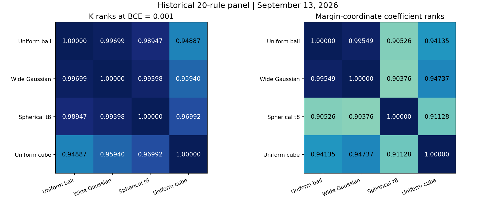
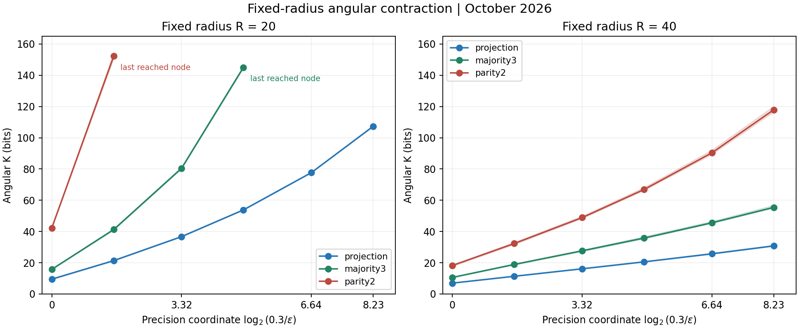

<a id="update-20261027"></a>

## 2026-10-27 增补：多测度共同收缩与固定半径角向对照

本补充在既有 E37 后增补证据，不替换旧正文，也不新增实验编号。这里区分 2026-09-13 的旧 20 规则自然测度面板，以及截至 2026-10-25 已有终态的 24 池固定半径球面对照。2026-10-27 只整理公开材料、复算轻量表并检查代码，没有新增训练或 SMC 采样。

### 1. 动机与结论范围

Neural K 的“体积”是明确参考测度下的事件质量。Gaussian 是一种方便的参考选择，但需要排查：收紧 loss 时的质量收缩和规则排序，是否全部由 Gaussian 径向尾部的权重惩罚造成？本补充关注不同测度下的共同现象及主要排序，不要求绝对 K 相等。

旧 E37 的代表性对照使用 `3 -> 16 -> 1 tanh`、球内均匀测度和 MSE 目标移动；本补充使用 `4 -> 16 -> 1 tanh`、完整真值表上的 BCE 阈值收紧。球内均匀测度与固定半径球面测度不同，移动 MSE 目标与收紧固定目标的 BCE 事件也不同，不能将这些曲线或响应系数直接拼成同一个定律。

本补充可支持的判断是：在已测的参考测度、架构、规则面板和有限 loss 窗口内，低 loss 收缩、规则相关的收缩差异及较稳定的主要复杂度排序并非 Gaussian 独有。固定半径结果进一步表明，去除随 loss 变化的径向尾部机制后，仍有规则相关的角向收缩。

“正常测度”不是这里已经定义并证明普适性的数学类别。共同趋势不等于所有测度具有同一公式、同一系数、同一局部排序或无限深尾渐近形式，也不等于真实训练就是某个静态测度的条件采样。

### 2. 时间、协议与登记状态

本文是看到已完成结果后撰写的动机、协议和结论整理，**不是正式预注册**，不能用本文件的日期替代事前登记。旧自然测度面板保留当时在新测度采样前选定的规则；固定半径配置保留修复核心及实际调度的条件筛选，但不声称这份补充或全部分析窗口曾在独立登记平台预注册。

| 时间 | 材料与范围 | 本补充中的身份 |
|---|---|---|
| 2026-09-13 | 20 规则、宽 Gaussian / 球对称 t8 / 均匀立方体，共 60 个测度-规则作业 | 旧数据背景，不计为十月新增采样 |
| 2026-10-24 | 修复确定性 CUDA `kthvalue` 故障，保留科学计算参数 | 实现修复，不是科学结果 |
| 2026-10-25 | R20 / R40、projection / majority3 / parity2，共 24 池均有终态 | 新增固定半径证据：16 池全到、8 池停滞 |
| 2026-10-27 | 冻结源码搬入公开目录、轻量表复算、CPU 检查和双语整理 | 公开增补，不新增采样 |

原 96 池在确定性 CUDA `kthvalue` 处发生的故障是实现错误，不能作为低质量、无解或测度假说失败的科学证据。修复后的入口使用独立协议 `fixed_radius_angular_smc_independent_pilot_v2_cpu_kthvalue`，拒绝复用旧协议断点；本补充的 24 池不是把原 96 池的失败结果重新命名为成功。

### 3. 测量对象与两种精度坐标

输入是按 `0000` 到 `1111` 排列的全部 16 个 0/1 向量，标签固定。网络含 97 个标准化参数坐标；实际权重和 bias 都按所属层的 `1/sqrt(fan_in)` 缩放。第一层的 80 个坐标乘 `1/2`，输出层的 17 个坐标乘 `1/4`。球对称性、半径和二阶矩均在这套标准化坐标中定义，不宣称在实际权重坐标中具有相同的欧式旋转不变性。

令输出 logit 为 `g_theta(x_i)`，标签为 `y_i`，则平均 BCE、事件质量与 Neural K 定义为：

$$
L_f(\theta)=\frac{1}{16}\sum_{i=1}^{16}
\log\!\left(1+\exp\left((1-2y_i)g_\theta(x_i)\right)\right),
\qquad V_{\mu,f}(\epsilon)=\Pr_{\theta\sim\mu}[L_f(\theta)\le\epsilon],
\qquad K_{\mu,f}(\epsilon)=-\log_2 V_{\mu,f}(\epsilon).
$$

固定半径对照令 `theta = R U`，其中 U 在单位球面上均匀。归一化标准高斯向量仅用于生成均匀方向，不引入随 loss 变化的 Gaussian 径向权重。目标是归一化的球面质量，而不是球内 Lebesgue 体积：

$$
U\sim\operatorname{Unif}(S^{96}),\qquad
A_f(R,\epsilon)=\Pr[L_f(RU)\le\epsilon],\qquad
K_{R,f}(\epsilon)=-\log_2 A_f(R,\epsilon).
$$

独立池先在概率空间取算术平均，再取负对数。对完整的 m 个池，汇总为下式；不能直接平均 K，也不能丢弃未达池后只平均成功池：

$$
\widehat K_{\mathrm{pooled}}(\epsilon)
=-\log_2\!\left(\frac{1}{m}\sum_{j=1}^{m}2^{-\widehat K_j(\epsilon)}\right).
$$

旧自然测度面板的系数使用 margin 式坐标，单位是 bit / margin 坐标单位，窗口为 `0.01 -> 0.001`：

$$
a(\epsilon)=-\ln(\operatorname{expm1}(\epsilon)),\qquad
c_a=\frac{K(0.001)-K(0.01)}{a(0.001)-a(0.01)}.
$$

新增球面对照报告 log2 精度比坐标下的有限窗口系数，单位是 bit / log2 精度单位，窗口为 `0.03 -> 0.001`：

$$
\Delta K=K(0.001)-K(0.03),\qquad
c_{\log_2}=\frac{\Delta K}{\log_2(0.03/0.001)}
=\frac{\Delta K}{\log_2(30)}.
$$

这两个系数不能直接混合比较。冻结球面核心的辅助字段 `finite_window_dK_da_from_previous` 仍按 margin 坐标计算；本补充的表格和 `analyze_published.py` 明确重新计算 log2 精度比，不修改或重新解释该历史字段。有限窗口系数不是已证明的普适幂律指数。

### 4. 旧 20 规则自然测度背景

本节全部来自 2026-09-13 的既有数据。面板由旧 36 规则集合的 4 个锚点、12 个分层区间各原来第一个样本，以及 `0x01EF`、`0x2ABE`、`0x2FF4`、`0x09A0` 四个近似或反转案例组成，没有按新测度结果选取。每个测度-规则作业使用 8 个 replica、每个 2048 粒子、每层 24 次更新，float32，无 TF32 / AMP；三种当时新增测度的 60 个作业全部达到 BCE `0.001`。

参照是在 97 维标准化坐标中半径 72 的均匀球。宽 Gaussian、球对称多元 Student-t8 和均匀立方体与其匹配平均平方范数：

$$
\sigma=\frac{72}{\sqrt{99}}\approx7.236272,
\qquad \mathbb E\|\theta\|^2=97\sigma^2\approx5079.273.
$$

$$
\begin{aligned}
\text{wide Gaussian:}\quad &\theta=\sigma Z,\quad Z\sim N(0,I_{97});\\
\text{spherical t8:}\quad &\theta=\sigma\sqrt{6/G}\,Z,\quad G\sim\chi^2_8,\quad G\perp Z;\\
\text{uniform cube:}\quad &\theta_i\overset{\mathrm{iid}}{\sim}
\operatorname{Unif}[-\sqrt{3}\sigma,+\sqrt{3}\sigma].
\end{aligned}
$$

t8 全向量共享同一个 G，不能替换成各坐标独立 t 分布。宽 Gaussian 与 t8 没有半径硬界，R72 只是二阶矩标尺；立方体保持坐标置换和符号翻转，但不保持任意旋转。旧单位 Gaussian 的尺度不同，不属于上述二阶矩匹配组。原计划中的独立 Laplace 在正式新测度扫描前改为球对称 t8，没有运行 Laplace 规则扫描。

以下 K 排序均取 BCE `0.001`，系数排序均使用本补充定义的旧坐标 `c_a`。比较参照为匹配尺度的均匀球：

| 测度 | K 排序 Spearman | 系数排序 Spearman | K 同序对 | 系数同序对 |
|---|---:|---:|---:|---:|
| 宽 Gaussian | 0.99699 | 0.99549 | 188/190 | 188/190 |
| 球对称 t8 | 0.98947 | 0.90526 | 184/190 | 168/190 |
| 均匀立方体 | 0.94887 | 0.94135 | 173/190 | 172/190 |

宽 Gaussian 与均匀球的主要排序很接近；t8 保留接近的 K 排序，但后段曲线变平，系数更接近。立方体有更多局部换序，但它同时改变方向性和径向分布，不能把换序的因果贡献全部归给方向偏置。190 对并非独立实验，也不代表全 65536 个函数的总体概率。

相对于均匀球，宽 Gaussian 和 t8 的反向点估计中，没有一对同时满足两种测度的 replica 取值区间均分离；立方体有 8 对 K 和 4 对系数满足这一诊断。replica 区间不是正式置信区间，区间不分离也不证明同序，且本轮未对所有局部换序逐一做独立更新核复测。

| 规则 | 均匀球 `c_a` | 宽 Gaussian `c_a` | 球对称 t8 `c_a` | 均匀立方体 `c_a` |
|---|---:|---:|---:|---:|
| 常数 | 0.600 | 0.598 | 0.609 | 0.628 |
| copy / 取反 | 1.962 | 1.907 | 1.435 | 2.668 |
| parity2 | 5.716 | 5.046 | 1.975 | 6.948 |
| parity4 | 12.488 | 8.828 | 2.163 | 9.938 |

t8 下 parity2 与 parity4 的平均系数接近，不意味着质量相同：BCE `0.001` 时，K 分别约为 33.119 和 46.702，仍相差约 13.58 bit。该窗口内相邻节点的 margin 坐标斜率分别从约 2.248 降至 1.753、从约 2.520 降至 1.857，不能将其描述为与均匀球相同的稳定直线。

三种当时新增测度下，所测 19 个非常数规则在 `0.01 -> 0.001` 窗口均比常数收缩更快。这是本面板相对于常数的比较，也是系数表的同一份证据，不是任意规则对都保持同序或无限深尾持续强化偏置的证明。



图：2026-09-13 旧 20 规则面板，左为 BCE `0.001` 的 K 排序相关，右为 `0.01 -> 0.001` 的 margin 坐标系数排序相关。中英文共享此英文轴图；图中数据不是十月新增采样。

### 5. 新增固定半径协议

固定半径采用同一 `4 -> 16 -> 1 tanh` 网络、标准化坐标和完整真值表。按真值表行顺序编码，projection 为 `0xFF00`，majority3 为 `0xFCC0`，parity2 为 `0x0FF0`；分别表示复制第一位、前三位多数和前两位异或。半径为 20 和 40，每条件 4 个独立池，共 24 池。

| 配置项 | 固定值 |
|---|---|
| 架构 / 维数 | `[16]` / 97 |
| 正式粒子 / 独立 pilot 粒子 | 1024 / 256，每池 |
| dtype / TF32 / AMP | float64 / 关闭 / 关闭 |
| 确定性算法 | `torch.use_deterministic_algorithms(True)` |
| BCE 节点 | `[2.0, 1.0, 0.7, 0.3, 0.1, 0.03, 0.01, 0.003, 0.001]` |
| pilot 目标存活比例 | 0.5 |
| 每层更新步数 | 56 |
| eta 固定循环乘子 | `[1.0, 0.3, 0.1, 0.03, 0.01, 0.003, 0.001] / sqrt(97)` |
| micro-batch / 节点审计参数数 | 2048 / 16 |
| 基础 seed | 2026102301；各池按条件身份的固定 hash 派生 |
| 每池层数 / 连续停滞预算 | 2048 / 32 |
| 最小相对进展 | `1e-10` |
| 每池累计预算 / 单次全局预算 | 1800 / 14400 秒，在完整 level 边界检查 |

提议为归一化后的 `u + eta Z`，保持球面半径；其转移密度只依赖方向内积，相对于均匀球面可逆，再按 BCE 约束拒绝。eta 使用固定循环，不根据正式粒子在线调参。独立 pilot 选择中间门槛，正式粒子累计实际存活比例；核可逆和半径保持都不意味着非凸条件分布已充分混合。

修复仅把门槛选择改为 `torch.kthvalue(pilot_losses.detach().cpu(), order).values`，保持输入 dtype、k 值、随机流和确定性设置。冻结核心默认还有更大条件面板；公开入口通过 [24 池配置](fixed_radius_20261027/fixed_radius_config.json) 选择本次报告的条件，不改采样器科学参数。源码来源与哈希见 [来源清单](fixed_radius_20261027/SOURCE_MANIFEST.json)。

全局预算或中断可以在完整 level 边界续跑；已经终止的科学未达池不自动重试。`stalled_levels_budget`、`level_budget`、`replica_time_budget`、`analytic_loss_lower_bound` 或 `zero_evaluation_survivors` 都保留为未达，不能记成真实零质量；`internal_error` 和数值审计错误则单独报错。改变科学配置、源码或环境应使用新结果目录，不接续不兼容的历史断点。

### 6. 固定半径结果

R40 的三条规则全部 4 池都达到 BCE `0.001`。下表使用概率合并后的 K，窗口是 `0.03 -> 0.001`：

| 规则 | K(0.03) / bit | K(0.001) / bit | ΔK / bit | `c_log2 = ΔK/log2(30)` |
|---|---:|---:|---:|---:|
| projection | 16.12 | 30.78 | 14.66 | 2.99 |
| majority3 | 27.63 | 55.44 | 27.81 | 5.67 |
| parity2 | 48.88 | 117.92 | 69.04 | 14.07 |

最深节点的四池 K 范围依次为 30.60 至 31.28、55.00 至 56.79、116.55 至 120.20 bit；这些池间差异没有改变三条曲线的主要分离，但范围不是置信区间。整个 loss 收紧过程半径不变，质量下降不能通过移向更远的 Gaussian 径向尾部解释，仍须考虑满足联合输出约束的方向区域收缩。

窗口上端 `0.03` 已低于 `ln(2)/16 ≈ 0.0433`。对完整真值表上的无权平均 BCE，只要有一个样本符号错误或 logit 为零，该样本就贡献至少 `ln(2)`，因此此窗口强迫全部 16 点符号正确。这避免了把高 loss 下可能重叠的 full-target 事件误当成互斥 hard function cell 的问题。

| 半径 | 规则 | 全部节点达到的池数 | 最深已达预定节点 | 终态 |
|---:|---|---:|---:|---|
| 20 | projection | 4/4 | 0.001 | 完成 |
| 20 | majority3 | 0/4 | 0.01 | 4 池停滞 |
| 20 | parity2 | 0/4 | 0.1 | 4 池停滞 |
| 40 | projection | 4/4 | 0.001 | 完成 |
| 40 | majority3 | 4/4 | 0.001 | 完成 |
| 40 | parity2 | 4/4 | 0.001 | 完成 |

24 池均有终态，其中 16 池完成全部节点，8 池达到 `stalled_levels_budget`；`completed_with_failures` 只表示调度已结束且保留了未达池，不表示所有科学目标完成。R20 的 majority3 最后支持阈值约为 0.00395，parity2 为 0.0708 至 0.0734；这些不是已达预定节点，也不是已证明的全局最小 loss。

R20 的 projection 在 `0.03 -> 0.001` 窗口由 K = 36.70 增至 107.32 bit，ΔK = 70.61 bit；R40 同一规则的 ΔK 只有 14.66 bit。因此改变半径并非总是只改变一个与 loss 无关的截距。R20 的 majority3 与 parity2 不能给出这个完整窗口的系数，未达节点不补零、不插值、不外推。



图：曲线为概率合并后的 K，淡色带为四池 K 的最小值到最大值，不是置信区间。横坐标是 `log2(0.3/epsilon)`，只显示 `epsilon <= 0.3` 的已达节点；正文主窗口 `0.03 -> 0.001` 的横向长度仍是 `log2(30)`。R20 两条未达曲线止于最后已达预定节点，不将停滞支持阈值伪装成完整节点估计。中英文共享此英文轴图。

### 7. 核验强度与尚未解决的问题

2026-10-25 的历史独立审计读取 24 个审计文件中的 200 条记录、3200 组参数，用 NumPy float64 复算 51200 个输出，并检查缩放、半径、标签、BCE、预测符号与约束可行性。最大 logit 差异为 `7.11e-15`，最大 BCE 差异为 `4.44e-16`，最大相对半径误差为 `4.44e-16`，没有审计警告。本补充保留这一 [历史核验摘要](fixed_radius_20261027/data/measure_review.json)，不将其称作 2026-10-27 重新读取原参数后得到的结果。

这些检查比只看最终表格更强，但不是充分混合证明。历史测度导出包缺少逐层存活日志，不能独立重建整条体积记账；本公开轻量包也不包含原始审计参数数组、完整粒子或大 checkpoint。因此公开脚本可复核表格、坐标、终态和排序，或从先验重新运行协议，但不能仅凭随包摘要重做全部历史参数审计或承诺跨硬件逐 bit 复现。

R20 的未达可能涉及固定半径对 margin 的限制，也可能涉及有限提议、混合困难和局部探索；当前结果没有把这些原因完全分开。未达既不是零体积证明，也不是无解证明。独立池的一致性、接受率、短刷新和数值审计都不能单独排除共同混合偏差。

对于球对称参考测度，可形式上分解为角向质量与完整径向密度的积分；径向密度必须包含 Jacobian。这里只测两个球面，没有进行该连续积分，也没有用稀疏半径点拟合未知的深尾：

$$
V_{\mu,f}(\epsilon)=\int_0^\infty A_f(r,\epsilon)\rho_\mu(r)\,dr,
\qquad \rho_\mu(r)\propto r^{96}p_\mu(r).
$$

因此，最稳妥的结论是：**多种已测参考测度共享一定的收缩现象和主要排序稳健性；具体质量、局部排序、收缩形状与速度仍依赖测度。固定半径证据排除了“全部现象仅来自 Gaussian 径向尾部”的解释，但没有建立所有正常测度共享同一公式、系数或无限深尾规律的定理。**

### 8. 公开复现入口与依赖

所有必要运行源码都位于 `fixed_radius_20261027/`。球面核心和旧自然测度的三份必要源码按原字节复制，旧 E37 的 README 与冻结源码没有覆盖。旧自然测度的 20 规则面板、来源面板、科学配置和轻量排序表也随包公开；仅清理与运行无关的本机路径并记录来源，不依赖框架外临时脚本或本机结果 ZIP。

运行依赖为 Python、NumPy、PyTorch；重画图另需 Matplotlib。[requirements.txt](fixed_radius_20261027/requirements.txt) 记录本次轻量核验环境中的 NumPy `2.4.1`、PyTorch `2.11.0`、Matplotlib `3.10.9`；实际检查使用 Python `3.13.5` 和 PyTorch `2.11.0+cu130`，只执行 CPU 运算。它不是原云端环境的完整锁文件，正式重跑需安装适配设备的 CUDA 版 PyTorch 并核对环境，不自动降级为 CPU 长实验。

以下命令均在 `fixed_radius_20261027/` 目录内运行。两个运行入口顶部均设 `RUN_SAMPLING = False`，默认只导入、核对来源和展示配置，不创建采样结果；分析命令只消费随包轻量数据。复制入口到 Notebook 时，须保留完整复现目录，并将顶部 `BUNDLE_DIR` 指向它（默认 `.`）；入口会忽略 Notebook 内核的命令行参数，不要求提供命令行选项，也不是内嵌全部依赖的单文件包：

```bash
python -E -s -B run_fixed_radius.py
python -E -s -B run_natural_measures.py
python -E -s -B validate_lightweight.py
python -E -s -B analyze_published.py --figures --write-summary
python -E -s -B check_publication.py
```

将顶部 `RUN_SAMPLING` 显式改为 `True` 即可无命令行参数启用采样；也保留 `--run` 命令行方式，`--check` 可强制只检查。顶部 `DEVICE`、`OUTPUT_DIR` 和球面入口的 `RUN_HOURS`、旧面板入口的 `MAX_SECONDS` 可配置设备、输出和预算；命令行显式选项优先。以下是后续复现命令，**本次没有执行**；应先确认所选 GPU 空闲。球面入口默认 `cuda:0`，输出限定在本增补目录 `runs/` 的子目录；重跑同一路径仅续接兼容的未终止状态：

```bash
python -E -s -B run_fixed_radius.py --run --device cuda:0 --hours 4 --output runs/fixed_radius
python -E -s -B run_natural_measures.py --run --device cuda:0 --max-seconds 120 --output runs/natural_measures
```

旧自然测度入口复用冻结采样器、种子和全部 60 个测度-规则作业，`--max-seconds 120` 是其原每作业调用预算；未完成状态保留后可再次调用。它不是新增固定半径结果的计算入口，也不会读取旧本机数据目录。冻结源码本身保留历史默认值，应通过公开入口运行，不直接执行冻结文件的主程序。

公开落点包括：[球面运行入口](fixed_radius_20261027/run_fixed_radius.py)、[旧面板运行入口](fixed_radius_20261027/run_natural_measures.py)、[轻量复算和绘图](fixed_radius_20261027/analyze_published.py)、[独立 CPU 测试](fixed_radius_20261027/test_lightweight.py)、[逐节点曲线](fixed_radius_20261027/data/measure_curves.csv)、[24 池终态](fixed_radius_20261027/data/measure_terminal_status.csv)、[旧规则表](fixed_radius_20261027/historical_20260913/rules.csv)和[复算摘要](fixed_radius_20261027/analysis/recomputed.json)。

### 9. 本次验证与待办

2026-10-27 的轻量检查实际完成了 11 个 Python 文件的 `py_compile`、NumPy / PyTorch / Matplotlib 及全部必要冻结模块的导入检查、15 个来源文件的 hash 核对和 11 项纯 CPU 单元检查，全部通过。测试覆盖确定性分位数的全部次序、dtype 与随机流不变、先 detach/cpu 再 kthvalue、独立 NumPy 前向、半径保持、概率合并、未达保留、故障分类、两种精度坐标、面板身份和默认入口不采样。详细结果见 [VALIDATION.json](fixed_radius_20261027/validation/VALIDATION.json)。

Windows 虚拟环境执行器曾因 `_ctypes` 的 DLL 加载失败而无法导入 PyTorch；本次改用基础解释器加载同一已安装环境的库完成检查，没有修改安装或调用框架外运行脚本。该环境问题与历史 CUDA `kthvalue` 故障不同，也不是科学失败。本次没有执行 GPU 验收、训练、新 SMC 或深尾混合验证。

后续需要另行授权的工作包括：完整参数审计数据与逐层存活日志的公开归档、更强的独立核及预算复核、R20 未达原因的区分、更多半径下的连续径向积分，以及更广规则和测度面板的外部验证。页面顶部跳转、旧正文与本补充的拼接和站点构建由集成流程负责；本补充不改构建、主文、总账、理论或其他实验。
