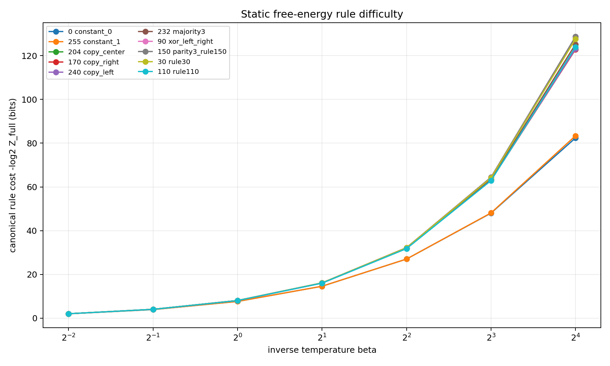
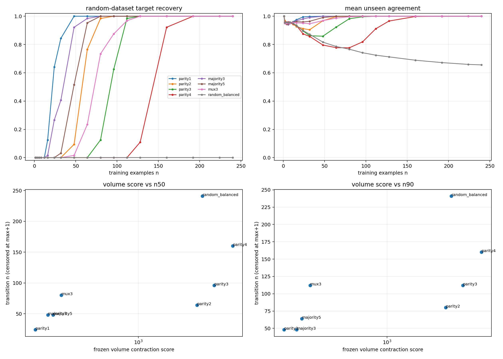
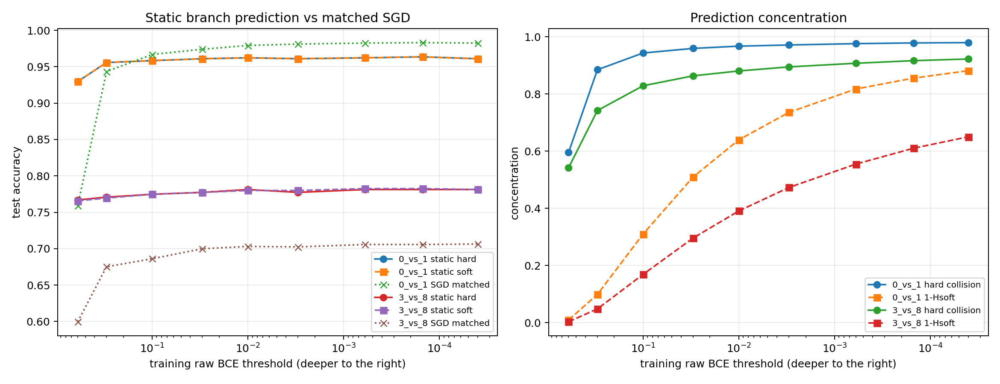

# From Training-Set Constraints to the Neural K-profile: How This Research Got Here, Step by Step

> This is a research narrative; it does not aim for submission format. Its job is to make the conceptual turns, the experimental objects, the measurement methods, the results, and the interpretation clear.
>
> For complete numbers, scripts, and boundaries, see the [experiment catalog](experiments/README.md); the earlier detailed version is preserved in the [evidence ledger](evidence_ledger_zh.md).

## State the final conclusion first

During training, a neural network is really required to do only one thing: lower the training objective. It does not know which "true rule" the data came from, and it receives no additional commands such as "please generalize," "please compress," or "please form concepts."

But different parameters implement the training set in different ways. Some implementations can barely answer a few training points correctly; some can reuse the same rule to process a large number of inputs. Some implementations need many mutually independent exceptions; others need only one shared computation. The network architecture and parameterization make these implementations occupy parameter regions of different sizes. As the training loss is driven further down, they also lose parameter volume at different rates.

Therefore, training loss is not merely a switch for "have the training samples been answered correctly." It is also a continuous resolution knob: the stricter the requirement, the more easily certain functions and implementations are eliminated, while other functions gain a relative advantage. This process is not monotone for every function, nor is it determined by a single complexity score. The more appropriate object is a curve: how much parameter volume a target still has at different loss precisions. We later called it the Neural K-profile.

The optimizer is a separate layer. Static volume tells us what the landscape contains and how large each part is; SGD or AdamW determines where one actually ends up from a random initialization, whether one is blocked by an entrance, and along which path one moves. The two are closely related, but they are not the same thing.

Below we present things in the order in which we actually arrived at these conclusions.

## What we saw before proposing this theory

This research did not start with 3-bit toy tasks. Over more than a year before that, the repository had already accumulated more than a hundred directions and experimental variants. Their reproduction completeness is not uniform: some saved formal curves, weights, and multi-seed results; some have only partial results; and some are just generators or failed attempts. So "a hundred-plus experiments" must not be read as a hundred-plus success stories that all meet publication standards.

But together they formed a family of phenomena that is hard to ignore.

- One- and two-dimensional cellular automata, including Rule30, Rule90, Rule110, multi-step evolution, inverse rules, and programmable rule code;
- multi-base addition, position shuffling, multiplication, logical expressions, modular arithmetic, and RSA data generators;
- trapping rain water, edit distance, graph propagation, mazes, Tower of Hanoi, Lights Out, and several dynamic-programming tasks;
- dials, geometric trajectories, refraction, rotation, and image transformations;
- MNIST coupled with rule execution, class-conditional rules, rule bits, masks, prefixes, and unseen rule combinations;
- pilots with multiple architectures including MLP, CNN, Transformer, ConvNeXt, Swin, and MLP-Mixer;
- and tasks that clearly failed or required scaffolding, such as Mod3, parity, recursion, and deep rules.

When the data is clean, an information pathway exists, and optimization can reach the target, ordinary neural networks can often recover exact deterministic transformations from far fewer samples than the full input space. In many sufficient-data tasks, train and validation decrease in sync from the very beginning, and in the end stay nearly completely correct on a huge unseen space. What the networks exhibit is not only traditional image-similarity interpolation, but also discrete rules, compositional semantics, and multi-step computation.

At the same time, the failure boundary is also very stable: certain representations couple information in ways that are very hard to optimize; when training samples are insufficient, the complete function does not converge; parity and Mod3 show clear entrance barriers; increasing network capacity sometimes improves and sometimes worsens things; and switching architectures on the same task changes the transition location and the preference order.

These experiments first gave us three facts that cannot be bypassed: neural networks can indeed learn a broad range of exact rules; data identifiability, network representational capacity, and optimization accessibility are not the same thing; and any theory must simultaneously explain large-scale success and structured failure. The later micro-scale Boolean and SMC experiments do not replace this body of results with a few toy phenomena; they are meant to dissect the mechanisms behind these results in a fully measurable space.

## 1. The initial question: can the initialization prior alone explain post-training function selection

At the beginning we faced a static picture that was both strong and tempting.

A randomly initialized neural network does not produce all functions uniformly. Certain simple functions have higher probability from the start. One can then imagine that training creates no new preference at all: it merely deletes the functions that do not fit the training samples. The relative probabilities of the remaining functions would still be determined by the initialization prior.

This explanation is very close to the function-prior line of work established by [Dingle, Camargo, and Louis (2018)](https://www.nature.com/articles/s41467-018-03101-6), [Valle-Pérez, Camargo, and Louis (2019)](https://arxiv.org/abs/1805.08522), [Mingard et al. (2019)](https://arxiv.org/abs/1909.11522), and [Mingard et al. (2021)](https://www.jmlr.org/papers/v22/20-676.html), and it can indeed explain many first-order generalization phenomena. The real question is: is it merely a good approximation, or is it the training mechanism itself?

To decide this, comparing test accuracy is not enough. We must know which complete function the network has actually selected before and after training.

### Experiment one: directly counting complete functions in 3-bit space

**What did we want to distinguish?**

If training is only hard filtering on the initialization prior, then once the training set is fixed, the distribution of complete functions produced by real training should be close to the distribution of "all random networks that answer the training samples correctly." And once all training samples are answered correctly, further training should no longer systematically change the outputs on unseen inputs.

**What exactly was done?**

[E01](experiments/experiment_01_static_conditioning_failure/README.md) uses 3-bit input and 1-bit output. There are only 8 complete inputs, so there are only 256 functions in total. Every network can be run on all eight inputs to obtain its exact complete truth table.

We first generated 1,048,576 untrained networks and measured the initialization function prior. Then, given a few very small training sets, we obtained function distributions in two ways:

1. without training, only filtering random networks for those that answer all training samples correctly;
2. actually training from many random initializations, and reading off the complete function at first fit, after 100 further steps, and after 1,000 further steps.

**What was measured?**

Not just accuracy, but a direct comparison of what fraction each of the 256 complete functions occupies, plus the TV distance between the two distributions, function rankings, and per-seed function changes.

**What happened?**

The real training distribution differed from the static hard-filtering distribution by far more than sampling noise. In some training sets, the function most preferred by the static distribution lost its advantage after real training, and another function became dominant instead. With the training set unchanged, after 100 more steps of optimization the distance between the two grew even further.

A more intuitive single-sample version uses a three-layer wide network. After an initialized network already answers that one training sample correctly, about 72% of such networks are still not the target constant function, so static filtering gives the target constant only about 28% probability. Real training, however, turned 128/128 networks into the target constant at the very first step. Even looking only at networks that already answered the training sample correctly at initialization, all of them migrated.

**What did this force us to change?**

The initialization prior still matters, but training is not just deleting incompatible functions. The optimizer moves parameters that already satisfy the training set from one complete function to another. We had to separate "static parameter mass" from "the optimizer's actual transport."

### Experiment two: after first fit, does the function really keep changing

Micro-scale Boolean tasks may be too special, so [E04](experiments/experiment_04_mingard_postfit_drift/README.md) placed the question in a setting with 7-bit input, 128 complete states, and a ten-layer tanh network. Six conditions trained 12,288 trajectories in total.

**How exactly was it measured?**

Unlike the original setup, which stops at the first zero training classification error, we let the networks keep optimizing for 100 and 1,000 more steps. At every moment the complete 128-bit output function was saved. The training set remained entirely classification-correct throughout.

**What was the result?**

After continued training, roughly 60% to 99.8% of the models changed their complete function. In conditions with larger initialization scale, each model flipped about 15 unseen inputs on average.

**How to interpret it?**

"The training set is entirely classified correctly" is only a very coarse threshold. BCE is still decreasing, logit margins are still changing, and the complete function is still migrating. Neither [the original Grokking work of Power et al. (2022)](https://arxiv.org/abs/2201.02177) nor post-interpolation training can be explained by a single hard filtering.

## 2. The first real theoretical turn: the key variable may not be time, but loss depth

After confirming that functions continue to change after interpolation, our first natural attribution was SGD dynamics: perhaps the optimizer wanders among functions and ends up more likely to stop at simple ones.

But there is a more basic fact here: whatever the optimizer does, the thing it is constantly doing is lowering the training loss. So the question can first be made static: **even with no training at all, looking only at parameter space itself, does the relative volume of different functions change in regions of lower training loss?**

If it does not change, then training to very low loss is almost redundant for function selection; the function odds are already fixed once the training labels are first satisfied. Conversely, if the low-loss regions of complex functions contract faster, then continuing to lower the loss by itself creates new function preferences.

### Experiment three: one sampling run, slicing parameter space layer by layer by raw BCE

[E06](experiments/experiment_06_loss_conditioned_prior_annealing/README.md) sampled 4,194,304 3-bit networks and saved each network's logits on the eight inputs. This way, without resampling for each training set, the raw BCE on any training set can be computed offline, and it is known which complete hard function each network belongs to.

**What exactly do we look at?**

First keep all networks whose hard predictions match the training samples; then gradually tighten the raw BCE threshold from high to low. Each time we enter a lower-loss tail, we recount the proportions of the 256 complete functions.

**What was the result?**

The two-sample condition gave a strong positive result: a symmetric threshold function that real SGD also prefers occupies only about 1.6% of all hard-exact networks, and rises to about 23% to 51% in the lowest-loss tail. This shows that loss indeed contains function-selection information beyond the hard constraint.

But the four-sample condition gave a counterexample at the same time: the total mass of the two leading functions first increased, then decreased again after entering a deeper tail, with other functions taking over. The real SGD distribution also does not equal the static distribution at the same loss.

**How was the theory changed this time?**

We keep "continuous loss rearranges function mass," but abandon "some pre-specified simple function increases monotonically from beginning to end." Different loss intervals may prefer different functions.

### Experiment four: how to avoid calling the winner simple only after seeing it

At this point a dangerous circular argument appeared: if whichever function the network selects is then declared "the function the network considers simple," any outcome can be explained.

[E10](experiments/experiment_10_raw_bce_rule_pair_competition/README.md) therefore constructed strictly ordered function pairs in advance.

**How were the function pairs constructed?**

The simple function is a projection, AND, or OR, representable by a single linear threshold unit. The complex function has the same training samples, the same training labels, and the same complete output balance; it only adds exceptions on unseen points, and a linear program can prove in advance that it is no longer linearly separable. Both functions fully satisfy the training set, so the comparison is not about which one can fit.

**What was measured?**

In the same batch of random networks, observe how the odds of the simple function relative to the complex function change as one enters lower raw BCE tails. To avoid false conclusions caused by only sporadic samples in the extremely low tail, the final analysis requires the expected counts of both functions to reach a reliability threshold.

**What was the result?**

All 12/12 reliable function pairs increased the odds of the simple function, and all were significant. GELU networks strengthened by about 10.6 times on average, tanh networks by about 5.1 times.

**What does it prove?**

It proves that on function pairs that can be strictly ordered before the experiment, lower raw BCE is indeed friendlier to the simple compatible function. It does not prove that all datasets and all loss intervals obey one permanent order.

## 3. The second theoretical turn: the so-called simple answer must be discussed relative to the training set

At this point it is still easy to treat the data generator as the rule that ought to win. But for a finite training set, the generator is only one of many compatible extensions.

### Experiment five: why ten AND samples learn a shortcut first

[E12](experiments/experiment_12_and_shortcut_static_geometry/README.md) studies the AND rule on 4-bit input. The training set has 10 samples, but the four local patterns of AND are covered very unevenly.

**What was originally expected?**

AND is short and fully consistent with the training set. If "low loss increasingly favors the simple rule obvious to humans" were a strong law, AND should increase all the way.

**What actually happened?**

Static sampling preferred a shortcut with an extra condition at intermediate loss, and real training also first flowed into this function in large numbers. The odds of different candidates swap order with loss.

**How was the intervention done?**

We replaced only one training sample so that the four pattern classes of AND were roughly balanced, keeping everything else as unchanged as possible. After resampling and long training, the mass of AND in the deep-loss region increased markedly, and about 64% of real training endpoints became AND.

**How to interpret it?**

The problem is not that the network "rejected the truly simple AND," but that the original training set did not express AND in a balanced way at all. Changing just one sample greatly changes both the static geometry and the training endpoints, which shows that the so-called simple function is determined jointly by the network's language and the training constraints.

### Experiment six: a function can first be rejected and then increase again as loss changes

[E14](experiments/experiment_14_weighted_rulebit_function_switch/README.md) constructs a weighted composite task: the vast majority of training samples follow Rule110, while a very small number of conflict regions require Rule30. The complete rule must handle both parts.

**Why do this experiment?**

It deliberately creates two loss scales. At high loss, learning only Rule110 eliminates almost all error; only when the loss is pressed very low do the few Rule30 conflicts become non-negligible.

**What was measured?**

The true composite function is not dominant in the higher-loss region; it increases markedly only after entering deep loss. It does not rise monotonically in one direction from initialization.

**What is the theoretical correction?**

The network is not always heading toward the complete rule the researcher knows. At each loss scale it first solves the part that can most reduce the training objective at that moment. Shortcuts, staged learning, and late rule takeover can all be reasonable outcomes.

## 4. The third theoretical turn: the static endpoint and the optimization entrance are two different problems

Parity gave us a good stress test. Humans can describe it in one sentence — "the XOR of all bits" — but an ordinary MLP starting from random initialization gets stuck on a plateau near 0.693 as the dimension increases.

There are two completely different explanations here:

1. low-loss parity solutions are inherently extremely rare and extremely unstable, so the network does not prefer them;
2. low-loss parity solutions exist and are stable; it is just hard for random initialization to cross the initial barrier.

### Experiment seven: first deliver the network in, then see whether it can stay

[E16](experiments/experiment_16_parity_reachability/README.md) first trains 12-bit and 14-bit parity on half of the truth table. As long as the training loss successfully leaves the initial plateau, test accuracy quickly rises to 96% to 99.9%, and keeps improving as the loss decreases further.

The more critical 16-bit experiment first provides extra decomposition information to deliver the network to a low-loss parity solution; then the auxiliary information is removed, the parameters are strongly perturbed, and only the original parity endpoint task is trained again. Wider networks are able to return to the parity solution.

**What does this show?**

At least in this setting, the main difficulty is the global entrance, not the nonexistence or local instability of a low-loss parity endpoint. Static volume and optimization accessibility must be separated.

### Experiment eight: at the same loss, do SMC and AdamW choose the same function

[E17](experiments/experiment_17_static_vs_optimizer/README.md) compares the low-loss distribution of constrained SMC with a large number of AdamW training endpoints on balanced AND data. It also selects a high-quality function from the deep SMC tail as initialization and then continues training it with AdamW.

**What was the result?**

Even at similar loss, the dominant functions of SMC and AdamW can differ. Starting from a deep-tail function selected by SMC, AdamW quickly leaves it and flows toward its own attracting region.

**How to interpret it?**

Static volume is like the first-order weight the terrain assigns to each solution; the optimizer additionally reweights based on entrances, gradients, connectivity, and history. When the data is very sufficient and the target function already occupies overwhelming volume across the entire relevant loss interval, optimizer differences may no longer change the hard rule; in under-constrained or rare tails, the dynamics may dominate.

## 5. How to directly measure the difficulty of one complete rule

A partial training set induces many candidate functions, and we often do not know in advance which one is the simple answer in the network's eyes. A cleaner approach is: give a rule's complete truth table, then directly measure how much parameter volume remains when the network is required to implement the entire rule to different loss precisions.

### Experiment nine: with the complete truth table, how do simple and complex targets separate

[E19](experiments/experiment_19_full_truth_rule_volume/README.md) uses 4-bit input, so each rule has 16 complete samples. The network is fixed as a two-layer tanh MLP. SMC is run separately for parity1 through parity4, majority3, and one preregistered random balanced function.

**What exactly is measured?**

For each rule, start from a higher loss and gradually tighten the threshold, recording what fraction of the parameter population survives each deeper level. Multiplying the survival rates of all levels gives the rule's low-loss parameter-volume curve.

**What was the result?**

Parity1 through parity4 maintain a strict order over the common measurable interval: the more bits participate in the XOR, the smaller the low-loss volume. More informative are majority3 and the random rule. At shallow loss their volumes are close; as the loss keeps decreasing, majority3 gradually gains a huge advantage, the gap growing from thousands-fold to about 10^18-fold.

**What does this tell us?**

Rule difficulty is not only reflected in the initialization probability. Two targets can be about equally easy at coarse fit and separate rapidly only when higher precision is demanded. Part of the reason a complex rule trains more slowly may be that the deep-tail region available to it is smaller and harder to hit.

This experiment also carries an important warning: parity2, which looks very short to humans, can be harder than the preregistered random function in this tanh MLP. Network complexity is not a direct copy of the length of a human logical formula; it depends on the representational language used by the architecture.

### Experiment ten: what exactly is the relationship between full-rule volume and candidate volume under a partial training set

A genuine methodological question arose here.

Full-rule volume measures "how much space there is for fitting all 16 points to a given loss." Function competition under a partial training set measures "when only 10 training points are required to reach a given loss, which complete function do the remaining parameters extend into." These are obviously not the same quantity. If there is no rigorous relationship between the two, we cannot use full-rule volume to explain candidate competition within a training set.

[E20](experiments/experiment_20_measure_closure/README.md) built a three-layer closure specifically for this.

**Layer one: leave-one-out on the constant function.** Train on 15 points labeled 0, holding out the last point. Both the complete constant function and the single-exception function that is 1 only on the held-out point can run full-rule SMC independently. At the same time, one can directly count in the particles of the 15-point training set: how many particles go to each of the two labels on the held-out point while satisfying the corresponding complete-loss condition. The volume ratios computed by the two routes close over seven measurable thresholds, with a maximum log residual of about 0.071.

**Layer two: four AND candidates.** For the ten training points of balanced AND, measure the four main complete candidate functions separately, then count conditional events from the same ten-point parent. The maximum closure residual is about 0.049.

**Layer three: tighten the margin further from a fixed hard function.** First fix both the training loss and the complete hard output, then gradually require the predictions on the six unseen points to move farther from the zero threshold. The internal volumes of the four hard functions still separate continuously.

**How to interpret it?**

Full-rule volume and fixed-training-set candidate mass are not the same number, but they belong to the same parameter measure and can be connected rigorously through conditional probability. Gaps of tens or even hundreds of orders of magnitude can also arise entirely in the logit and margin geometry after the hard truth table has already been fixed.

### Experiment eleven: can the information from adding samples one by one become an invariant

Early on we added samples to 3-bit rules one at a time and estimated the information gain by how surprised the current model was at each new label. Different addition orders gave different intermediate processes, and we could never find a reliable total.

[E22](experiments/experiment_22_static_free_energy_information/README.md) exhausted this completely.

**What exactly was done?**

In one run, save the logits of 2,097,152 networks on the eight inputs. Each input can be in one of three states — not added, label 0, label 1 — so there are 6,561 partial training sets in total. For the 256 complete rules, enumerate all 40,320 sample addition orders of each rule.

Each time a sample is added, compute how much it shrinks the remaining parameter mass, and call this change the generalized surprise of that step.

**What was the result?**

The surprise of each step varies with the order, but after summing the eight steps it depends only on the final rule. The maximum numerical error across all orders is about 10^-14 bit. Rule150, i.e. parity3, is the rule with the highest endpoint cost among all 256 rules under the hard criterion.

**How to interpret it?**

This does not say that real SGD is conservative along the path. It shows that within the same static parameter measure, per-sample prediction cost and complete-rule endpoint difficulty do come from the same potential function. It connects our early intuitions about agreement, surprise, and rule difficulty to [the prequential coding measurement of Blier and Ollivier (2018)](https://proceedings.neurips.cc/paper_files/paper/2018/hash/3b712de48137572f3849aabd5666a4e3-Abstract.html) and [the statistical-mechanics framework for neural networks of Levin, Tishby, and Solla (1989)](https://mlanthology.org/colt/1989/levin1989colt-statistical/).

*Figure 1: Static endpoint costs of some representative rules in E22. Shown here is how rule costs separate under increasing precision pressure in the same reference measure.*

## 6. The most important prospective verdict: can the volume curve predict how much training data is needed

Up to this point there is still a circularity risk: we define "hard" by small volume and then say hard functions have small volume, which produces no new knowledge.

The truly falsifiable approach is to first measure the full-rule volume, freeze the difficulty order, and then predict a separate independent experiment: how many samples are needed to recover this rule from random partial truth tables.

### Experiment twelve: first freeze the volume ranking, then train 9,736 data conditions

[E23](experiments/experiment_23_volume_to_data_transition/README.md) uses 8-bit input; the complete truth table has 256 states. The network is fixed as two layers of 16 tanh units each. There are eight targets: parity1 through parity4, majority3, majority5, MUX3, and one random balanced rule.

**What does stage A do?**

Give each rule only its complete truth table, and use SMC to measure how fast its volume contracts over a pre-specified loss interval. At this point no random training-set results are run or read. The ordering of the eight rules and the file hashes are frozen first.

**What does stage B do?**

For each rule and each sample size, randomly draw 64 training sets; each is trained with 24 paired initializations. Only when the model fits the training set, the target complete function becomes the main mode, and different seeds have clearly concentrated is that training set counted as a successful recovery. Then record how many samples are needed for the recovery rate to first reach 50% and 90%.

**What are the parity results?**

| Rule | Frozen volume-contraction score | Samples needed for 50% recovery | Samples needed for 90% recovery |
|---|---:|---:|---:|
| parity1 | 125.21 | 24 | 48 |
| parity2 | 3266.21 | 64 | 80 |
| parity3 | 4618.60 | 96 | 112 |
| parity4 | 6719.58 | 160 | 160 |

The four transition intervals do not overlap, and the rank correlation is 1. In other words, the full-rule volume strictly predicted the random-sample transition order of the parity family before training.

`n50/n90` is limited by the sample-size grid, but the original experiment already drew 64 random training sets at each identical $n$. For the target-aligned re-condensation branch after the agreement bifurcation, 0.99 subgrid interpolation and 2,000 bootstrap replicates give parity2 about 59.98, MUX3 about 69.47, parity3 about 88.94, and parity4 about 151.93, with random still right-censored at 240. The 95% intervals for parity2 and MUX3 are [58.77, 61.07] and [65.02, 72.40] respectively, already fully separated. This is a posterior refinement diagnostic and does not replace the preregistered main verdict, but it shows that repeating the randomization a few more times at the same $n$ and comparing agreement can make up for the coarse grid resolution.

*Figure 2: Top left, complete-function recovery rates of the different rules as the number of training samples increases; top right, agreement on unseen inputs; bottom, comparison of the frozen volume scores with n50/n90.*

**What about across all rules?**

The overall correlation is still high, but the preregistered shallow-secant score shows three misorderings relative to `n50/n90`: the order of MUX3 and parity2 does not match, and the random rule is also harder to recover than the shallow score predicted. The deeper profile resolves the misordering of random versus parity3/4; but the equal-variance Gaussian deep tail still shows MUX3's full-target volume significantly larger than parity2's, while uniform random training sets recover parity2 earlier. This exception shows that the full-target Neural K-profile and the random training-set recovery transition are related but different quantities: the latter also contains the fixed-$D$ competition denominator, effective pattern coverage, and optimizer accessibility.

A subsequent causal sampling intervention turned this distinction into a direct experiment. Under uniform, the `n50` of parity2/MUX3 is 64/80; after eight-cell balancing it becomes 56/72, with the order unchanged; after raising the MUX selector-conflict samples to 75% it becomes 72/56, a complete reversal of the order. MUX3's `n50/n90` moved earlier by 24/32 samples relative to uniform, while parity2's each moved 8 samples later, and the direction is stable across 500--40,000 steps. The transition point is therefore not a univariate function of full-target difficulty; whether samples effectively exclude the competing extensions specific to the current target is likewise a first-order factor.

Gaussian SMC at fixed `n=32` reproduced this again in the optimizer-free static conditional distribution: at `epsilon=0.02`, the parity2/MUX3 target mass is 0.266/0.000214 under uniform, 0.469/0.284 under cell, and 0.498/0.782 under conflict. Uniform-MUX3's agreement already reaches 0.959, yet it almost never selects the true target; its errors concentrate on the selector-conflict cells, and targeted enrichment raises the posterior target accuracy of those cells from 0.777 to 0.995. Thus the fixed-$D$ competition denominator was directly measured as a first-order static source of the transition reversal.

Further inspection of the complete curves shows that the random rule's contraction speed increases sharply as the loss deepens, successively overtaking parity2, parity3, and parity4. The more information from deeper loss intervals is used, the better the volume measurement agrees with the final sample transition. But MUX3/parity2 shows that not every misordering can be made to disappear by pushing the profile deeper: the full-target profile and the random training-set transition are different objects to begin with, and the latter also depends on competing extensions and sampling identification efficiency.

**How was the theory updated this time?**

A rule cannot be assigned a single permanent difficulty score. The initialization probability, the volume at some fixed loss, and the slope of some small segment each see only a part. The real object is an entire curve that varies with the required precision: a rule may be easy at coarse fit and suddenly become expensive at deep loss. We call this curve the Neural K-profile.

## 7. Deep-tail reversal: the hard function is already fixed, yet complexity can still swap order

E23 shows that the shallow slope is not enough, but leaves one question: after entering extremely low loss, does the function ordering stabilize? We did not know, and could not declare an answer by intuition.

### Experiment thirteen: first search among 54 rules for function pairs that could genuinely cross

[E24](experiments/experiment_24_deep_neural_k_crossing/README.md) uses 4-bit input, a single-hidden-layer tanh network, and a standard Gaussian reference measure. The targets include six structured rules, all 16 single-point exceptions of parity4, 16 double-point exceptions, and 16 random balanced functions.

SMC pushed from loss 0.7 all the way to 0.019, long past the boundary where "all output hard signs are correct."

**What was seen?**

Across all thresholds measured, parity4 was always the rule with the smallest absolute volume among the 54. Most random and exception rules also contracted more slowly. The only one that kept catching up was the single-point exception rule that flips the label of input 0000.

In the last few windows its absolute volume was still larger than parity4's, but its contraction speed was stably faster. Extrapolating at the then-current speed, the two curves should cross at a loss of about 0.0025.

### Experiment fourteen: let two rules share the same parent ensemble and directly see which overtakes

Two independent SMC runs may have different absolute normalization biases, so the second round no longer samples from scratch separately. The two rules fork from the same parent particle population and advance in parallel under the same loss thresholds, directly measuring the volume ratio.

**What was the result?**

The median volume ratio truly reversed at a loss of about 0.002308, very close to the previous round's extrapolation. At the deepest threshold, the median volume of the single-point exception rule was already about twenty million times smaller than parity4's. Seven of the eight replicas completed the absolute overtaking, and the local speeds of all eight replicas were still in the same direction. The preregistration required all eight replicas to overtake consecutively, which was not yet met, so the result is conservatively written as 7/8 rather than pretending it is fully finished.

This deep-tail ordering is also corroborated by independent real training: previously, when `0000` was held out from the parity4 truth table, the networks' majority prediction for the missing label leaned toward parity4 rather than the `flip0000` that only flips that point, although the preference did not reach 100%. After the deep-tail crossing, parity4's full-target volume is larger, consistent with the direction of the optimizer's leave-one-out preference.

The boundaries must be kept here: 4-bit full-rule SMC cannot by itself give the `n50/n90` of random training sets, and leave-one-out is not the full grokking transition. It is only a local prediction on the same conditional-measure chain at $n=15$. E20 is responsible for connecting full-rule volume to fixed-$D$ candidate branches, and E23 directly contrasts the full profile with the random training-set transition. E24 is therefore circumstantial evidence for the consistency of the two complexity readings, not a direct measurement of the 4-bit transition.

*Figure 3: Top left, the curve crossing the zero line marks the reversal of the median ordering of the two rules' absolute volumes; top right, after the crossing the single-point exception still contracts faster.*

**Why does this result matter?**

Both rules had each been 100% hard-exact long before, and the representational metrics near the crossing show no sudden jump. The relative complexity reordering comes from the accumulation of a long-term continuous contraction difference, not from a sudden change of hard function.

So the hard truth table is still too coarse. Inside the same hard function, from barely crossing zero to a large margin, from one representation to another, there is still a great deal of continuous structure. Neural K must be a profile, not a hard function ID, a prior probability, or a single contraction speed.

## 8. Can this method leave the Boolean truth table

If function volume could only be used in 3-bit and 4-bit spaces, it would be more like a pretty toy. So we moved the same idea to MNIST.

### Experiment fifteen: first confirm whether the same four images are actually enough for different tasks

[E25](experiments/experiment_25_mnist_static_prediction/README.md) average-pools 28×28 images to 7×7 and uses a tanh MLP with only 1,633 parameters. It compares two binary classification tasks, 0/1 and 3/8. Training samples grow from 4 to 512, and each condition uses four random training sets and eight seeds.

With only four balanced samples, 0/1 already reaches a median test accuracy of 98.31% at the lowest validation loss, while 3/8 only reaches 69.66%. By the operational criterion of validation accuracy at least 95%, 0/1 crosses at four samples, while 3/8 needs 512 samples.

So the same network, sample count, and training budget can correspond to completely different data sufficiency. This is exactly right for testing whether static volume only tells stories on simple synthetic rules.

### Experiment sixteen: without retraining, directly compare the two label branches of one unseen image

The second stage fixes two training sets of four images each, and nine training-loss thresholds. SMC first samples all parameters that can fit these four images to the corresponding loss.

Facing an unseen image, this parameter population is then split into two branches: one predicting label 0, the other predicting label 1. Whichever branch retains more parameter mass is the label the static method predicts. The soft version instead compares the average probabilities given by the two branches.

This step trains no new classifier and does not add the test image to the training set. It only asks: given the low-loss parameter space of the fixed training set, which label does it naturally support more for this new sample?

**What was the result?**

The static hard accuracy of 0/1 rises from 92.97% at shallow loss to a peak of 96.35%; 3/8 rises from 76.69% to about 78.13%. Four training images already make static parameter volume strongly predictive for hundreds of unseen images.

*Figure 4: Left, comparison of static hard/soft branches with matched-loss SGD; right, the prediction distribution keeps concentrating as loss deepens.*

Soft NLL is more interesting. As the training-loss threshold decreases, the unseen-image NLL first improves, reaches a minimum, and then worsens. The static minimum region of 0/1 is one preregistered loss-grid cell away from the real AdamW validation minimum; the static minimum region of 3/8 directly covers the real training turning point.

This experiment used validation when choosing the tasks and the loss coverage range, so it is a calibrated confirmation experiment, not a fully blind prediction on a brand-new digit pair. The real next step is to freeze the current rules and run a blind test on a different set of digits.

**Why is accuracy still there while NLL has already worsened?**

Per-image analysis shows that deep loss still corrects a small number of borderline images from wrong to right, while making the persistently wrong images more confident. Hard accuracy, probability calibration, and agreement can therefore turn at different locations.

With the same four samples, the low-loss parameter-mass disadvantage of 3/8 relative to 0/1 grows from about half a decimal order of magnitude at shallow loss to about 55 orders of magnitude in the deep tail. This is in exactly the same direction as the identification gap between four samples and 512 samples. At this point, rule volume, real-image prediction, and the required data amount are connected in the same experiment for the first time.

Two follow-up experiments pushed this real-image bridge further. [E26](experiments/experiment_26_mnist_balanced_label_volume/README.md) no longer chooses between two options image by image; instead it compares complete partitions among the 126 balanced label combinations of two blind-test panels. The natural 0/1 partition ranks last at shallow loss, becomes top 1 in both panels at loss 0.6, and occupies about 99.97% of the normalized volume at 0.3. This result depends on the 5:5 ratio and one anchor, so it is a constrained unlabeled partition, not general clustering.

[E28](experiments/experiment_28_mnist50k_hmc_adam/README.md) enlarges the training set to the full 50k MNIST and puts all 4,266 network parameters into HMC. The ensemble accuracies of static HMC, plain Adam, and MAP Adam are 99.03%, 98.95%, and 98.82% respectively; HMC and plain Adam should statistically be judged at the same level. The 480 HMC samples are still 480 different complete test functions, yet they agree highly on the vast majority of individual images. This shows that at real scale a function ensemble can be "still dispersed as complete functions, yet already condensed in pointwise prediction."

## 9. What the agreement side line finally told us

Our early overfitting experiments trained many random initializations and then compared their predictions on a large number of probe inputs. If different seeds give almost the same answer on some input, that point is said to have high agreement; if the complete probe truth tables are also largely identical, the function distribution has truly converged.

At first we tended to think of the low-agreement overfitting state as "the network found some special simple rule that humans cannot read." We later realized there is no evidence for this claim. The more direct meaning of low agreement is: the complete function has not converged at all yet; many extensions are still competing.

[E27](experiments/experiment_27_grokking_agreement/README.md) further examined the time interval between hard fit and grokking. On the four Mod97 data levels, when all seeds had already memorized the training set, the unseen agreement was still only 0.027--0.033; it had not stabilized on some shared wrong function. Afterward, agreement mainly rose as the seeds jointly recovered the correct target, with the remaining errors still all different. In this experiment, grokking is therefore not "a wrong consensus suddenly swapped for a correct consensus," but dispersed residual functions gradually sharing more of the target skeleton.

Conversely, high agreement also does not equal recovering the external generation rule presupposed by the researcher. With only one training sample, networks may very consistently choose the constant function, with agreement close to 1, which has nothing to do with the hidden generator. But the constant function is itself an extremely short and human-readable rule, so this phenomenon does not refute the readability conjecture later; it only shows that agreement measures the rule jointly selected by the training set and the network protocol, not the teacher in the researcher's mind.

### Experiment seventeen: what are the high-consensus functions without a teacher, in the end

[E18](experiments/experiment_18_consensus_symbolicity/README.md) randomly generates training sets on 8-bit input, training 64 seeds per training set. It first finds candidates whose complete functions are highly concentrated, then re-confirms them with up to 4,096 fresh seeds, and runs a symbolic-complexity audit on the final functions.

After a large-scale scan of 8,192 random training sets, 46 strict high-consensus endpoints were obtained. A unified post-hoc audit found that all of them can be written as signed linear thresholds; the looser high-consensus candidates are also all linearly separable. No high-consensus random lookup-table function was found.

This is not a preregistered "all threshold functions" hit, because the threshold structure was discovered uniformly only after seeing the candidates. But the experiment at least shows that in this MLP protocol, the functions that a small number of random samples can stably condense do fall within a family of short rules that humans can write down rigorously.

### Experiment eighteen: can we actively make functions condense, or deliberately keep them from condensing

[E21](experiments/experiment_21_agreement_complexity_frontier/README.md) starts from a very small random training set; each round it first finds the unseen input on which the current committee disagrees most, then tries labels 0 and 1 separately.

If the label that makes the final agreement higher is chosen, the function distribution condenses rapidly; if the label that makes agreement lower is chosen, the bifurcation can be sustained. When the strategy is later switched back to pro-condensation, the network still converges, but the longer the bifurcation was maintained earlier, the more samples re-convergence needs on average, and the final function gradually moves from a simple linear threshold toward more complex quadratic polynomial thresholds.

This experiment gives agreement two fairly solid identities: it can measure how much the current training set has narrowed the complete function, and it can serve as a feedback signal for active sampling. It does not tell us which label is the truth; labels still have to be provided by an external oracle.

We therefore keep an explicit but unproven conjecture: **in a suitably large problem space, if a small number of training samples can make the complete-function agreement approach 1, then this training set usually corresponds to some human-readable rule that can be extracted as a short program.** What this conjecture really tests is whether neural-network complexity and human symbolic complexity are roughly aligned, not whether high agreement equals correctness.

Its deeper implication is: if this correspondence can be repeated across tasks and architectures, neural networks and humans may not happen to like the same batch of functions by chance; rather, both are exploiting robust compressible structures such as locality, symmetry, compositionality, and computation reuse. This does not require a unique absolute encoding language, but it may mean that multiple effective representational languages give broadly similar orderings to a batch of "objectively easy-to-compress" regularities. Counterexamples such as parity show that this alignment can only be partial and architecture-relative.

The initial hundred-plus deterministic-rule experiments provide breadth evidence in the same direction: when the data does come from an exact, reusable rule and the samples and optimization accessibility are sufficient, networks can often push both the unseen-sample loss and the cross-seed function disagreement very low. They did not all use the strict fresh-seed symbolic audits of E18/E21, so they cannot independently prove this conjecture, but they show that high-precision rule recovery and function condensation do not appear only in the later micro-scale verdict tasks.

## 10. How to now understand those earlier phenomena in a unified way

### 10.1 Direct generalization

When data is abundant and coverage is balanced, extensions that do not follow the common rule are already largely excluded at relatively high loss. As soon as the network begins to lower the training loss, the generator-rule direction gains the advantage, so train and validation loss decrease in sync from the start.

Most of our first hundred-plus synthetic tasks sit in this region. These experiments are not examples cherry-picked after the theory appeared, but raw facts the theory must explain: across a large number of different rules, architectures, and input-output setups, networks can recover the complete mapping from finite samples. They show that "when data is sufficient, the rule direction can overwhelm other extensions" is a real, stable, reproducible phenomenon.

### 10.2 Grokking

Near the data transition, the training set already permits recovering the rule, but the rule has not yet overwhelmed all shortcuts and memorization schemes at shallower loss. The network first fits the training samples by whatever currently lowers the training objective most easily; as the raw loss is pressed further down, the earlier scheme gradually becomes insufficient, the rule implementation takes over, and validation performance rises with a delay.

This does not require the network to be secretly chasing the true rule from the first step. An early shortcut can be the most reasonable choice at the loss scale of that time. Grokking is more like function competition changing hands at deep loss, not the network suddenly "understanding the truth."

### 10.3 Why adding data turns grokking into direct learning

Every added sample consistent with the target rule excludes a batch of competing extensions. With few samples, the target rule's advantage is only visible at very deep loss; as samples increase, this advantage gradually extends toward shallower loss. Eventually the network descends along the rule direction from early in training, and no obvious memorization plateau is seen.

A boundary must be kept here: under purely hard conditions, adding consistent samples indeed only excludes competing functions; under a fixed raw BCE threshold, a new sample also changes the average loss and the margin requirement, so one cannot unconditionally claim that the target function's proportion strictly increases at every loss cross-section. We treat this as a macro trend supported by experiments, not as a proven continuous theorem.

### 10.4 Overfitting and the classical U-shape

Any finite training set can only constrain the extrapolated function to finite precision. Crossing some grokking threshold only means that the target rule already dominates under the current requirement; it does not mean that pressing the loss arbitrarily small will never cause divergence.

When details that the training set cannot distinguish begin to dominate the remaining error, the static branch can keep condensing, but it condenses toward a training-set-specific direction. Validation NLL worsens before hard accuracy, because the model can keep the classification boundary roughly correct while becoming more and more confident on the persistently wrong points.

Adding data — especially samples on which the current models disagree strongly — pushes the train/validation separation point to deeper loss. It does not give finite data infinite constraint precision all of a sudden.

### 10.5 Label noise and early stopping

[E09](experiments/experiment_09_mnist_hidden_noise_long_training/README.md) fixedly replaces 80% of the MNIST training labels with wrong labels, without telling the network which samples are contaminated. Both CNNs first learn the digit structure consistent across samples; at this point test accuracy is about 92% to 94%, and memorization of the wrong labels has barely begun.

As the noisy train loss is further reduced, the networks gradually fit the non-reusable sample-level residuals, and test accuracy drops to about 23% to 32%. The role of early stopping is clear here: stop at the position where the shared regularity still dominates and the wrong labels have not yet taken over the remaining loss.

So whether "continued training is healthy" is not decided by time alone, but depends on whether the training set contains constraints that conflict with the external target, and on how deep the current loss has already gone.

### 10.6 Feature learning, computation reuse, and compression

Feature learning is not a synonym for generalization; this measurement distinction was directly inspired by [Göring et al. (2025)](https://arxiv.org/abs/2507.19680). [E05](experiments/experiment_05_ntk_sufficient_feature_learning/README.md) first uses [the NTK proposed by Jacot, Gabriel, and Hongler (2018)](https://arxiv.org/abs/1806.07572) to prove that a fixed kernel is already sufficient to solve Rule110, then observes real finite networks. Even though a fixed-kernel solution already exists, the network still reorganizes its hidden representation, changing the gating and the empirical NTK.

[E08](experiments/experiment_08_shared_intermediate_pressure/README.md) further constructs two tasks that require a common intermediate computation. When sharing the intermediate representation is allowed, the network can reach the same low loss with smaller capacity and fewer samples; the deeper the shared computation, the greater the benefit; the wider the network, the easier it is to keep two separate sets of computation, and the weaker the sharing benefit.

This gives an unmysterious explanation for "why compression appears." Networks do not compress in pursuit of elegance; they compress because within finite capacity, reusing features and intermediate computations often makes it easier to keep lowering the loss. Compression, concepts, and shared representations are economical implementations under this pressure.

### 10.7 Symbolic semantics and OOD composition

In the rule-bit OOD experiments, the same control bit has to be reused across many tasks. Learning it as a stable semantics and then reusing the same interpreter is more economical than keeping an independent lookup-table program for each combination.

This provides a natural bridge for why connectionist networks develop approximately symbolic macro-structure: symbols need not be written into neurons in advance; they can also form because of cross-task reuse. Our OOD experiments prove that networks can indeed compose unseen rules, and the computation-reuse experiments provide mechanistic evidence for why doing so favors low loss; they have not yet proven that the human brain and LLMs use exactly the same microscopic mechanism.

### 10.8 Capability emergence

For a capability to appear, at least three things are needed: the network capacity suffices to represent it, the data suffices to distinguish it from competing schemes, and training actually enters the loss region where it dominates. Evaluation in the end often uses a discrete threshold, cutting a continuous probability change into "can" and "cannot."

Therefore, many emergences can be understood as apparent sudden changes jointly caused by capacity, data, loss depth, and the readout threshold. This picture is compatible with large models gaining capabilities by compressing tokens and concept relations, but this paper has not directly measured a complete Neural K-profile on an LLM.

### 10.9 Why dead bits need no extra patch

If some binary input dimension is always 0 in the training set, its weight into the first layer does not participate in the current computation, equivalent to a free direction; if it is always 1, it can be merged into the bias. The two kinds of constant bits are inherently not equivalent in parameter space.

The training set does not show this bit varying, so it also does not require the network to remain unchanged in this direction. Once architecture, encoding, and parameter mass are all inside the framework, dead-bit behavior is naturally reflected in the volume, with no need to separately stipulate that "the neural network should ignore it."

[E29](experiments/experiment_29_dead_bit_loss_resolved/README.md) gives a direct quantitative test. The dead column keeps variance about 1 in both static SMC and no-decay Adam, but when the loss drops to about 0.001, the strictly correct mass of the five functions on the standard z=1 flip reaches 99.59%--100%; the average difference from truly matched-loss Adam is only 0.0010. The robustness does not come from identifying and deleting the dead weights, but from the effective branch margin overwhelming prior-scale perturbations as the loss deepens. Explicit L2 presses the dead column to 0, while the standard temperature-1 posterior fails because contraction is too shallow with 8 samples; the stronger z=2 extrapolation re-exposes the static-versus-optimizer difference.

## 11. The final theoretical framework: the formulas only now

The preceding sections have explained what each quantity is meant to answer. Now we write them together in minimal form.

### 11.1 Fixing a neural reference protocol

Combine the network architecture and parameterization, the input-output encoding, the parameter reference measure, and the per-sample loss:

$$
\Pi=(\mathcal A,\varphi,\mu,\ell).
$$

Given a training set:

$$
D=\{(x_i,y_i)\}_{i=1}^{n},
\qquad
L_D(\theta)=\frac1n\sum_{i=1}^{n}\ell(h_\theta(x_i),y_i).
$$

All parameters below some training loss form the sublevel set:

$$
A_D(\epsilon)=\{\theta:L_D(\theta)\le\epsilon\}.
$$

Architecture, encoding, loss, and data determine this terrain; the reference measure determines how we meter its different regions.

### 11.2 Under a fixed training set, how much mass each complete function still has

On the complete finite input or a fixed probe, record the network's hard output as a function. The parameter mass that function $f$ has below a given training loss is:

$$
\Omega_{\Pi,D}(f;\epsilon)
=
\mu_\Pi\{\theta:L_D(\theta)\le\epsilon,\ h_\theta=f\}.
$$

After normalization we get the static function distribution:

$$
Q^{\mathrm{static}}_{\Pi,D,\epsilon}(f)
=
\frac{\Omega_{\Pi,D}(f;\epsilon)}
{\sum_g\Omega_{\Pi,D}(g;\epsilon)}.
$$

If all functions were only multiplied by the same loss factor, their relative odds would not change. Our experiments directly rule out this strong proposition.

### 11.3 Full-target volume and the Neural K-profile

If the function's complete truth table is available, define the parameter mass that implements the entire rule to a given precision:

$$
V^{\mathrm{full}}_\Pi(f;\epsilon)
=
\mu_\Pi\{\theta:L_{D_{\mathrm{full}}(f)}(\theta)\le\epsilon\}.
$$

The corresponding protocol-relative code length is:

$$
K^N_\Pi(f;\epsilon)
=
-\log_2V^{\mathrm{full}}_\Pi(f;\epsilon).
$$

The whole curve is the Neural K-profile. Writing $s=-\log\epsilon$ for the ever-deepening loss scale, the local contraction rate can be written as:

$$
\kappa_f(s)=\frac{dK^N_\Pi(f;e^{-s})}{ds}.
$$

The volumes, local slopes, and curvatures of different functions can all cross, so any single prior probability or shallow slope is only part of the profile.

### 11.4 The real training distribution induced by the optimizer

Given an initialization distribution and a training algorithm, training to time $t$ amounts to mapping the initialized parameters to new locations through the dynamics:

$$
Q^{\mathrm{opt}}_{\Pi,D,t}
=
(T_{\Pi,D,t})_\#\mu_\Pi.
$$

Static volume affects it, but so do entrances, gradients, connectivity, optimizer state, batch noise, and history. Therefore $Q^{\mathrm{opt}}$ must not be treated as a synonym of $Q^{\mathrm{static}}$.

### 11.5 Label branches and free energy on unseen samples

For an unseen input $x$, the hard-branch mass predicting label $y$ in the fixed training set and loss parent is:

$$
P_{\mathrm{hard}}(y\mid x,D,\epsilon)
=
\frac{\mu_\Pi\{\theta\in A_D(\epsilon):h_\theta(x)=y\}}
{\mu_\Pi(A_D(\epsilon))}.
$$

The partition function and free energy in canonical form are:

$$
Z_{\Pi,D}(\beta)
=
\int \exp[-\beta nL_D(\theta)]\,d\mu_\Pi(\theta),
\qquad
F_{\Pi,D}(\beta)=-\frac1\beta\log Z_{\Pi,D}(\beta).
$$

The generalized surprise caused by adding a new sample is the free-energy difference between two training-set states. When accumulated along any sample order, the intermediate terms cancel, leaving only the difference between the complete-rule endpoint and the empty-training-set starting point.

### 11.6 An operational sample complexity

For rule $f$, randomly draw $n$ training samples, fixing the network, optimizer, training budget, and recovery criterion. The minimum number of samples needed for the recovery probability to first reach $q$ is defined as:

$$
n_q^\Pi(f)
=
\min\left\{n\in\mathcal G,\ n<N:
\Pr_{D_n\sim f}[\mathrm{Recover}_\Pi(f\mid D_n)]\ge q
\right\}.
$$

E23's `n50/n90` is an instance of this quantity. They are crossings on a preregistered sample-size grid, and the actual transition is only localized within an adjacent grid interval; bootstrap intervals should be reported. If no crossing has occurred by $N-1$, it can only be recorded as right-censored; the complete-data fit at $n=N$ only checks reachability and does not count as a generalization transition. The 4-bit space has only 16 states, and the hardest rules often hit this ceiling directly, so it is unsuitable for finely defining `n50/n90`. This quantity is not machine-independent Kolmogorov complexity, but it can serve as a reproducible identification sample complexity in the current neural language when the space is large enough.

### 11.7 The whole framework ultimately needs only two static empirical principles

1. The parameter-to-function map is highly non-uniform; a fixed neural reference protocol inherently prefers certain functions.
2. Tightening the training loss makes different functions and their internal implementations contract at different, scale-dependent speeds.

The training set determines the competition set and the constraint weights, the Neural K-profile describes how static volume changes, and the optimizer determines the real transport. Grokking, direct generalization, overfitting, and feature reuse are all explained on these three layers.

## 12. What is the relationship between this framework and existing theories

The parameter-to-function map and the simplicity prior come from the core contributions of [Dingle et al. (2018)](https://www.nature.com/articles/s41467-018-03101-6), [Valle-Pérez et al. (2019)](https://arxiv.org/abs/1805.08522), [Mingard et al. (2019)](https://arxiv.org/abs/1909.11522), [Mingard et al. (2021)](https://www.jmlr.org/papers/v22/20-676.html), and [Mingard et al. (2025)](https://www.nature.com/articles/s41467-024-54813-x). We accept this static foundation, but add continuous loss, and use real training to show that hard conditioning of the initialization prior is not the complete dynamics.

[Solomonoff's (1964) algorithmic probability](https://mlanthology.org/misc/1964/solomonoff1964misc-formal/), [Kolmogorov's (1965) descriptive complexity](https://www.mathnet.ru/eng/ppi68), [Grünwald's (2004) MDL tutorial](https://arxiv.org/abs/math/0406077), and [the prequential coding experiments of Blier and Ollivier (2018)](https://proceedings.neurips.cc/paper_files/paper/2018/hash/3b712de48137572f3849aabd5666a4e3-Abstract.html) all connect probability mass, description length, and predictive coding. Neural K is formally close to them, but depends on a concrete neural protocol; it does not claim to equal machine-independent Kolmogorov complexity, nor does it establish a neural coding theorem.

More specifically, MDL's two-part code length is "describing the hypothesis" plus "encoding the remaining error"; in this framework, the `-log` full-target volume is the implementation code length of the current neural language at the specified precision, and the per-sample free-energy increment is the predictive-coding cost. The training program itself usually still only optimizes loss and does not secretly add a second program-length objective. MDL-style preference comes from the architecture's reference measure and the loss geometry, and [E22](experiments/experiment_22_static_free_energy_information/README.md) and [E23](experiments/experiment_23_volume_to_data_transition/README.md) connect it respectively to order-independent endpoint code length and independent sample-identification thresholds.

The statistical-mechanics connection is not ours first either. Levin, Tishby, and Solla already wrote fixed-architecture networks as a Gibbs ensemble in their 1989 [*A Statistical Approach to Learning and Generalization in Layered Neural Networks*](https://mlanthology.org/colt/1989/levin1989colt-statistical/), connecting prediction, free energy, and predictive MDL. What we add is function-level, loss-resolved experiments on modern nonlinear networks: complete functions, fixed-training-set candidate cells, margin cores, optimizer transport, and the data transition are placed in the same measurement chain.

[The Flat Minima of Hochreiter and Schmidhuber (1997)](https://doi.org/10.1162/neco.1997.9.1.1), [the Entropy-SGD/local entropy of Chaudhari et al. (2017)](https://arxiv.org/abs/1611.01838), [Watanabe's (2009) Singular Learning Theory](https://doi.org/10.1017/CBO9780511800474), and [the Local Learning Coefficient of Lau et al. (2025)](https://proceedings.mlr.press/v258/lau25a.html) likewise emphasize that one cannot look only at a single optimal parameter point. Our difference is that we insist on function resolution and loss resolution, and do not directly equate a parameter norm, Hessian flatness, or some local minimum with complete-function volume.

## 13. What cannot yet be claimed

We cannot yet analytically derive a specific Neural K-profile from the network architecture. Why an ordinary MLP assigns its current volumes to parity, 3/8, or shared programs remains a deeper mathematical question.

We have not proven that any two profiles ultimately cross only finitely many times, have not proven that all high-agreement functions are human-readable, and have not proven that static volume determines all optimizer endpoints.

MNIST currently has only two binary tasks, and the tasks and loss ranges were calibrated; the next step must switch to a brand-new digit pair for a truly blind test. The orders of magnitude in deep-tail SMC also need more particles, replicas, and independent implementations to cross-check.

The current evidence comes mainly from finite Boolean rules, cellular automata, modular arithmetic, tiny MLPs, and two MNIST binary classifications. It can support a unified candidate framework, but cannot directly declare it proven that all Transformers, LLMs, or real pattern-recognition tasks obey the same quantitative law.

## 14. Summary

This research began by asking: is the initialization function prior plus hard filtering by the training set already enough to explain why neural networks generalize? The experiments answer "not enough," but the initialization prior has not been discarded either. It is still an important zeroth-order term; continuous training loss continues to rearrange function mass, and the optimizer additionally imposes path-dependent transport on top of the static geometry.

The new object really needed is not a universal complexity score, but a Neural K-profile. It allows the same function to present different difficulties at different precisions, allows a shortcut to legitimately dominate at intermediate loss, and allows internal implementations to keep changing after the hard function is fixed. It can also prospectively predict how much data is needed in controlled experiments, and gives static predictions for unseen images and the overfitting turning point on MNIST.

In this language, the network does not need to know the true rule in the researcher's mind. It only keeps lowering the loss under the current network language and training-set constraints. When data is sufficient, this process points toward reusable rules very early; when data is critical, it appears as grokking; when data is insufficient or noisy, it keeps condensing toward training-set-specific extensions. Generalization is not another hidden objective; it is that the training set, the network language, the loss depth, and the optimization path jointly select a transferable function.

## Post-submission increment: E31--E37

After the short paper was submitted, seven more groups of experiments with their own protocols and result boundaries were completed. They do not change the historical numbering of E01--E30; instead they enter the same research archive as consecutive new evidence units.

E31 introduced a framework-level correction that places the **joint output distribution** upstream of the loss: the architecture, parameterization, encoding, and reference measure first induce a continuous joint distribution over outputs on multiple examples; BCE, MSE, and amplitude regularization then define different cross-sections or selection events on that distribution, thereby changing the retained mass of each function cell. The specific loss still affects function selection through the geometry of its cross-section, but there is no unique compression mechanism carried by the name BCE itself. The theory and experiments should therefore be stated in terms of how a specified loss/amplitude event reallocates function mass within the joint output distribution.

| ID | Experiment | New conclusion |
|---|---|---|
| [E31](experiments/e31.html) | Loss and magnitude alignment | raw MSE can also produce rule recovery; magnitude alignment can promote generalization in higher mean-CE regions; the key variable is the output joint distribution, not the name BCE. |
| [E32](experiments/e32.html) | Random memorization scaling | The complexity of random-label memorization increases approximately linearly with sample count, providing an external calibration for the empirical link between Neural K and capacity. |
| [E33](experiments/e33.html) | Cross-architecture joint output volume | Finite-architecture protocols beyond the MLP also show rule-dependent joint output volume curves, but the coefficients and local orderings depend on the architecture and the measure. |
| [E34](experiments/e34.html) | Conditional rule duels | The independently frozen 4-bit Neural K total order predicted 75/75 population preferences in 8-bit conditional rule duels; this is a protocol-relative external prediction, not a universal softmax law. |
| [E35](experiments/e35.html) | Mod97 frozen-function duels | When the real complete functions before and after grokking compete in new networks, the conflict points almost all favor the completed rule, but full recovery is still not high, showing this is a function-population preference rather than per-network copying. |
| [E36](experiments/e36.html) | Peleg/G&C independent verification | Reproduces gradient-free static sampling under the original small-sample MNIST protocol, and shows that after tightening raw BCE, static samples can reach test levels close to SGD. |
| [E37](experiments/e37.html) | Measure robustness and Gaussian alignment | Rechecks Gaussian endpoint effects with uniform Euclidean measure inside a fixed-norm ball, testing complexity ordering, endpoint response, and the boundary of correspondence with real training. |

The architecture pre-training estimator, the MDL--grokking conditional derivation, and the measure-robustness recheck belong to the supplementary material of the same period; the Peleg/G&C independent check is listed as [E36](experiments/e36.html), and the measure recheck as [E37](experiments/e37.html). They are collected in the [post-submission increment overview](post-upload.html).

## Appendix: E01--E37 evidence map

The main text only expands the experiments that carry the key turns. The other experiments have not been deleted; below we explain what each number actually measures.

| ID | What the experiment does | The question it answers |
|---|---|---|
| [E01](experiments/experiment_01_static_conditioning_failure/README.md) | Compares the complete-function distributions of initialization hard filtering and real training in an exhaustively enumerable Boolean space | Whether training is only deleting incompatible prior functions |
| [E02](experiments/experiment_02_rule_bit_invariance/README.md) | Trains with the rule bit fixed, then flips that bit and adds different numbers of counterfactual samples | Whether the network automatically recovers the invariant semantics presupposed by the researcher |
| [E03](experiments/experiment_03_function_posterior_dynamics/README.md) | Tracks the complete functions of initializations that already satisfy the training set through one update step and long-term training | Whether function transport comes only from fixing training errors, and whether it exists across widths |
| [E04](experiments/experiment_04_mingard_postfit_drift/README.md) | Extends training past the first zero error in a 7-bit ten-layer network | Whether the complete function is really frozen after interpolation |
| [E05](experiments/experiment_05_ntk_sufficient_feature_learning/README.md) | First proves that a fixed NTK suffices to solve the task, then measures whether the finite network's representation still changes | Whether feature learning happens only when the fixed kernel is insufficient |
| [E06](experiments/experiment_06_loss_conditioned_prior_annealing/README.md) | Reconstructs the complete-function distribution of 4.19 million networks by raw BCE depth | Whether continuous loss has a function-selection effect beyond hard filtering |
| [E07](experiments/experiment_07_function_wandering_matched_loss/README.md) | Tracks the per-function jumps of 4-bit networks after interpolation and compares with the matched-loss static distribution | Whether the same loss determines the same function distribution |
| [E08](experiments/experiment_08_shared_intermediate_pressure/README.md) | Compares matched tasks that can or cannot share a common intermediate computation | Why reusing representations helps reach deeper loss |
| [E09](experiments/experiment_09_mnist_hidden_noise_long_training/README.md) | Long-trains two CNNs under 80% hidden wrong labels | How rule learning and noise memorization happen one after another during training |
| [E10](experiments/experiment_10_raw_bce_rule_pair_competition/README.md) | Compares function pairs with identical training constraints and strictly ordered linear separability | How to avoid calling any winner a simple function after the fact |
| [E11](experiments/experiment_11_rule30_gradient_alignment/README.md) | Compares the train/validation gradient alignment of Rule30 at different sample sizes under the same loss | Whether adding data extends the rule direction to deeper loss |
| [E12](experiments/experiment_12_and_shortcut_static_geometry/README.md) | Scans the static odds of AND and the shortcut, and changes only one sample as a balancing intervention | How training-set coverage changes the winner in different loss regions |
| [E13](experiments/experiment_13_and_shortcut_sgd_intervention/README.md) | Long-trains the original and balanced AND datasets | Whether the static reordering is reflected in real SGD |
| [E14](experiments/experiment_14_weighted_rulebit_function_switch/README.md) | Constructs a weighted task with an overwhelming majority of Rule110 and a tiny minority of Rule30 | Whether a single complete function can first be suppressed and then increase with loss |
| [E15](experiments/experiment_15_mod97_function_distribution/README.md) | Records complete functions and pointwise marginals simultaneously in modular-arithmetic grokking | Whether marginal predictions can condense onto the target before the complete functions have collided |
| [E16](experiments/experiment_16_parity_reachability/README.md) | Performs parity holdout, half-space generalization, and perturbation recovery after scaffold removal | Whether low-loss endpoint preference and the random-initialization entrance are independent |
| [E17](experiments/experiment_17_static_vs_optimizer/README.md) | Compares low-loss SMC, multiple optimizers, and retraining from SMC starting points | Whether static volume equals the optimizer endpoint distribution |
| [E18](experiments/experiment_18_consensus_symbolicity/README.md) | Searches for teacher-free high-complete-function-consensus training sets and runs symbolic audits | Whether high agreement systematically corresponds to human-extractable short rules |
| [E19](experiments/experiment_19_full_truth_rule_volume/README.md) | Runs multi-rule SMC directly on complete 4-bit truth tables | How the low-loss volumes of different complete targets separate |
| [E20](experiments/experiment_20_measure_closure/README.md) | Aligns three kinds of volume via constant leave-one-out, four AND candidates, and a margin bridge | Whether full-target volume and fixed-training-set candidate mass can be rigorously connected |
| [E21](experiments/experiment_21_agreement_complexity_frontier/README.md) | Actively selects maximum-disagreement inputs and uses labels to control condensation or bifurcation | Whether agreement can become a tool for active sampling and the complexity frontier |
| [E22](experiments/experiment_22_static_free_energy_information/README.md) | Exhausts all 3-bit partial training sets, rules, and sample orders | Whether per-sample surprise can accumulate into a path-independent endpoint cost |
| [E23](experiments/experiment_23_volume_to_data_transition/README.md) | First freezes the full-rule volume ranking, then trains 9,736 random data conditions | Whether volume measurement can prospectively predict the data transition |
| [E24](experiments/experiment_24_deep_neural_k_crossing/README.md) | Scans 54 deep-tail rules, then compares two candidates in a shared parent ensemble | Whether the absolute volume ranking in the hard-exact deep tail can reverse |
| [E25](experiments/experiment_25_mnist_static_prediction/README.md) | First calibrates two MNIST tasks, then predicts unseen images with static branches | Whether Neural K measurement generalizes to real data and the NLL U-shape |
| [E26](experiments/experiment_26_mnist_balanced_label_volume/README.md) | Blind-tests the static volume of the natural MNIST 0/1 partition among 126 balanced label combinations | Whether low-loss volume can recover the natural grouping from very little prior label information |
| [E27](experiments/experiment_27_grokking_agreement/README.md) | Re-analyzes Mod97 per-seed trajectories, measuring agreement only on unseen inputs before and after hard fit | Whether a shared wrong function has already formed before grokking |
| [E28](experiments/experiment_28_mnist50k_hmc_adam/README.md) | Compares whole-network HMC, plain Adam, and MAP Adam on 50k MNIST | Whether a static finite-width ensemble can reach the natural-task performance of a real optimizer |
| [E29](experiments/experiment_29_dead_bit_loss_resolved/README.md) | Compares dead-bit static profiles, no-decay Adam, L2, NNGP, and the temperature-1 posterior | When unconstrained directions keep their prior, whether deep-loss margins can restore counterfactual stability |
| [E30](experiments/experiment_30_weight_decay_static_landscape/README.md) | Compares the static complete-function mass of three explicit L2 coefficients under approximately matched BCE | Whether a regularization term written into the loss can be understood in the same static-terrain language |
| [E31](experiments/e31.html) | Compares raw MSE, BCE magnitude alignment, and rule recovery and grokking under different target magnitudes | How the loss form and the output magnitude jointly select the output joint distribution |
| [E32](experiments/e32.html) | Measures how memorization complexity varies with sample count across multiple random-label tasks | Whether the memorization burden can serve as an external calibration of function complexity and capacity |
| [E33](experiments/e33.html) | Measures rule joint output volume in different finite-architecture protocols | Whether the volume-contraction phenomenon goes beyond a single MLP protocol |
| [E34](experiments/e34.html) | Uses the frozen 4-bit Neural K order to predict 8-bit conditional rule duels | Whether an independent complexity ranking can predict function-population preferences across tasks |
| [E35](experiments/e35.html) | Lets the real complete functions before and after Mod97 grokking compete in new networks | Whether the completed rule has extra preference at the function-population level |
| [E36](experiments/e36.html) | Reproduces Peleg/G&C and applies raw-BCE constraints to static samples | Whether tightening continuous loss can eliminate the generalization gap between shallow random interpolation and SGD |
| [E37](experiments/e37.html) | Compares Gaussian with uniform Euclidean measure inside a fixed-norm ball | Whether Gaussian alignment with training depends on density penalties or on a more robust complexity ordering |

\n
