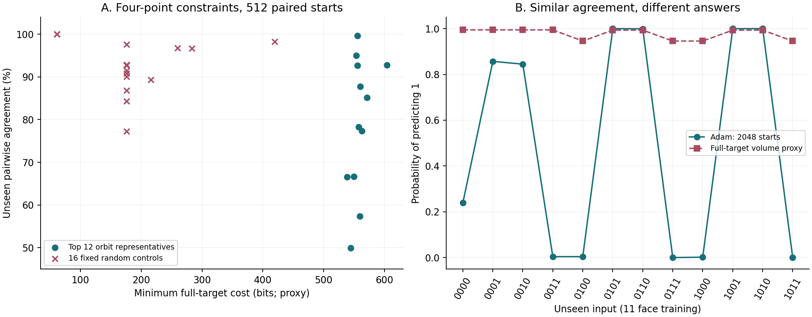
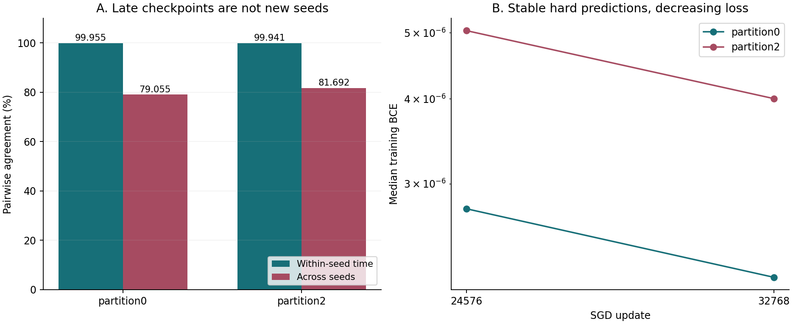

# Prediction Consensus, Complexity, and Distributional Boundaries

<!-- P01 -->
Bilingual addendum dated 2026-11-06, consolidating four-point XOR-face, four-sample census, and wide-CNN time-ensemble evidence after commit `3834fb3f6555c7c58218462502635b16b9b377f9` of 2026-10-27. E18/E21/E29/E36 provide background only. This addendum performs short CPU analysis of existing results, with no new training or SMC. [Simplified Chinese](README_zh.md)

## 1. Main Observations and Conjecture Revision

<!-- P02 -->
This update makes the agreement conjecture more precise rather than rejecting it. Positive evidence of readable rules at high-consensus endpoints in E18/E21 still motivates studying the connection between neurally preferred complexity and human-compressible structure. Four-point constraints can combine a high **minimum full-extension cost proxy** with high training agreement; XOR itself remains readable, so this example does not directly refute that connection. Other high-cost four-point constraints can have only about one-half pointwise agreement, showing that proxy cost and confidence in extensions differ. The static complexity of the four-point low-BCE event has not been directly measured, and random sampling, prespecified-teacher sampling and actively constructed witnesses must be distinguished.

<!-- P03 -->
Each of the two late wide-CNN cohorts contains 16 initializations: time agreement is 99.955%/99.941%, whereas cross-seed agreement is 79.055%/81.692%. Predictions barely change while BCE falls by approximately 20%. This does not support replacing a multi-initialization ensemble with late checkpoints from one trajectory under this protocol; it does not prove disconnected parameter regions either. Even similar time and cross-seed agreement in other experiments would not establish ergodicity, stationarity, or equality of function distributions.

## 2. Quantities That Must Remain Separate

<!-- P04 -->
Let the reference measure be an explicitly specified parameter distribution $\mu$, the training set $D$, the unseen evaluation set $T$, and the hard prediction function $h_\theta$. The fixed-dataset static conditional distribution, full-target catalogue proxy, first-arrival training distribution, and temporal occupation distribution are four distinct objects. Standard mathematical notation is used below; $H_D$ denotes correct classification of every training label.

<!-- F01 -->
$$
Q_{D,\epsilon}(f)=\frac{\mu(h_\theta=f,\ H_D,\ L_D\leq\epsilon)}{\mu(H_D,\ L_D\leq\epsilon)},\qquad
K_D(\epsilon)=-\log_2\mu(H_D,\ L_D\leq\epsilon).
$$

<!-- P05 -->
The four-point catalogue quantities instead use the minimum full-target cost over 4096 compatible complete 16-point functions and a proxy obtained by normalizing full-target costs. Equal numerical thresholds do not make four-point mean BCE and 16-point mean BCE the same event; the 12 unseen outputs have no amplitude constraint in actual training. The primary node, 0.004, is below $\ln(2)/16$, so each full-target event lies inside its corresponding hard cell, but these events still do not constitute the fixed-four-point conditional distribution. No new fixed-D low-BCE static sampling was performed for these four-point datasets.

<!-- F02 -->
$$
K_{\mathrm{full}}(f;\epsilon)=-\log_2\mu(L_{16,f}\leq\epsilon),\quad
K_{\min}^{\mathrm{full}}(D;\epsilon)=\min_{f\in\mathcal F(D)}K_{\mathrm{full}}(f;\epsilon),\quad
\widetilde Q_D(f)=\frac{2^{-K_{\mathrm{full}}(f;\epsilon)}}{\sum_{g\in\mathcal F(D)}2^{-K_{\mathrm{full}}(g;\epsilon)}}.
$$

<!-- P06 -->
For a binary unseen input, $p_j$ is the probability of predicting 1. Pointwise agreement compares two models at each input and then averages across inputs; complete collision requires equality of their entire unseen prediction vectors. Finite-sample statistics use distinct model pairs, excluding self-pairs; $k_j$ counts models predicting 1 and $n_v$ counts complete vector $v$. Since all training labels are correct in the four-point experiments, collision on the 12 unseen bits also equals collision on the complete 16-bit table. A CNN prediction vector on 2048 probes is not a complete function on all possible images.

<!-- F03 -->
$$
A_T=\frac1m\sum_{j=1}^m[p_j^2+(1-p_j)^2],\qquad
\widehat A_T=\frac1m\sum_{j=1}^m\frac{k_j(k_j-1)+(N-k_j)(N-k_j-1)}{N(N-1)},\qquad
\widehat C_T=\frac{\sum_v n_v(n_v-1)}{N(N-1)}.
$$

<!-- P07 -->
Accuracy requires external labels. Here it always denotes ensemble-mean single-model accuracy, not majority-vote accuracy. Averaging pointwise correctness probabilities exactly equals this mean without requiring independent test inputs. However, similar means can result from cancellation across inputs, and similar per-image marginals do not determine the joint distribution across images. Representativeness of a mean for a typical single model requires inspecting cross-seed variance; inferring error from agreement needs additional conditions such as calibration. Related record (source: `research/notes/20261030_function_mass_accuracy_bridge_zh.md`)

<!-- F04 -->
$$
\mathbb E_Q[\operatorname{Acc}_T(h)]=\frac1m\sum_j Q(h(x_j)=y_j),\qquad
|\mathbb E_Q\operatorname{Acc}_T-\mathbb E_P\operatorname{Acc}_T|
\leq\frac1m\sum_j|Q(h(x_j)=1)-P(h(x_j)=1)|.
$$

## 3. Four-Point XOR Faces and Dead Bits

<!-- P08 -->
Inputs are ordered by integers 0 through 15 and encoded as **0/1** `abcd`, not -1/+1. Bit $i$ of a function ID is its output at input $i$. The prespecified teachers are XOR of the last two bits (`0x6666`) and copying the last bit (`0xAAAA`). The 11 face follows up a known min-max witness; the 00 face is a paired intervention added after the preliminary 11-face results, not a blind prediction.

<!-- T01 -->
| Condition | Four training inputs, in label order | XOR labels | Copy labels | Fixed input columns | Unseen inputs |
|---|---|---|---|---|---:|
| 11 face | 1100, 1101, 1110, 1111 | 0, 1, 1, 0 | 0, 1, 0, 1 | a=1, b=1 | 12 |
| 00 face | 0000, 0001, 0010, 0011 | 0, 1, 1, 0 | 0, 1, 0, 1 | a=0, b=0 | 12 |

<!-- P09 -->
The network is `4 -> 16 tanh -> 1`, with 97 raw trainable coordinates initialized independently from a standard Gaussian. Hidden weights and biases are divided by 2, output weights and bias by 4; logits greater than or equal to 0 predict 1. Four streams, `2026110401/2026110402/2026110403/2026110404`, generate 512 models each, giving 2048 initializations per condition with identical starting parameters shared across teachers and faces. Full-batch Adam uses learning rate 0.01, no decay, a 30000-update budget, and checks every 10 steps. The primary readout is each model's first checked four-point mean BCE at or below 0.004. All four conditions reach 2048/2048; 8192 trajectories are not 8192 independent initializations. Historical training used an RTX 3080, CUDA1, float32, TF32 disabled, and Torch 2.11.0+cu130.

<!-- T02 -->
| Primary-node condition | Pointwise agreement (%) | Unseen accuracy (%) | Complete collision (%) | Teacher recovery | Distinct unseen tables |
|---|---:|---:|---:|---:|---:|
| 11 XOR | 92.56 | 95.43 | 35.51 | 1125/2048 | 15 |
| 00 XOR | 99.64 | 99.82 | 96.14 | 2008/2048 | 7 |
| 11 copy | 99.26 | 99.62 | 94.93 | 1995/2048 | 4 |
| 00 copy | 99.97 | 99.98 | 99.71 | 2045/2048 | 4 |

<!-- P10 -->
For XOR, the paired 00-minus-11 unseen accuracy difference is +4.39 pp, with the original whole-initialization bootstrap 95% interval of +4.13 to +4.63 pp. Exact teacher recovery differs by +43.12 pp, with interval +40.77 to +45.36 pp. This audit recomputes point estimates and transcribes intervals from the original paired analysis without a new bootstrap. Median primary-node steps are 900/870. At 30000 steps, the 11-face XOR condition recovers 1228/2048 teachers, the 00-face condition 2048/2048, and both copy conditions recover all teachers. Unseen labels do not select checkpoints. The second mode at the 11-face primary node is `0x6667`, 397/2048, differing from global XOR only at `0000`. Original paired report (source: `research/xor_face_agreement_20261104/REPORT_ZH.md`)

<!-- P11 -->
The hidden preactivation is `(w_a*a+w_b*b+w_c*c+w_d*d+bias)/2`. On the 00 face, both fixed input columns are zero, so their data gradients are identically zero; with no-decay Adam, their saved endpoint changes are exactly 0. The weights retain their initial random values rather than being removed. The 11 face identifies only `w_a+w_b+bias`: their data gradients are equal, not dead. For XOR, fixed-column update RMS is 1.85934, and RMS discrepancy from the bias update is approximately 1.08e-4. The initial effective bias-component variance also changes from 1/4 to 3/4, so the effect cannot be attributed solely to gradient activity. Input complementation with bias compensation does not preserve the independent Gaussian-coordinate prior under this 0/1 encoding.

<!-- P12 -->
E29 (source: `research/neural_k_framework/experiments/experiment_29_dead_bit_loss_resolved/RESULTS_AND_CONCLUSION.md`) uses one fixed-zero bit, three varying bits, and 8 training points, not the present two fixed bits and 4 points. Its actual fixed-D constrained SMC uses 4 pools of 2048 particles and Adam uses 512 paired initializations. Under the standard 0-to-1 shift with strictly matched loss, XOR exact-correct mass is 1 for both. This supports robustness of the active branch to prior-scale perturbations, not dead-weight contraction. Explicit L2 contracts that column, while a stronger 0-to-2 shift exposes differences again. The temperature-1 likelihood posterior, hard-fit conditioning, and low-BCE sublevel distribution must also remain distinct.

## 4. Full-Target Proxy: Frequency Failure and Ranking Success

<!-- P13 -->
The historical catalogue expands 1992 orbits into 65536 complete functions, with 8 first-pass pools per orbit and median K aggregation. Both XOR faces have all 4096 compatible completions at 0.004. Most dominant orbits lack independent high-budget rechecks. Preparation used historical local caches and summaries without reopening historical ZIPs. It recomputed the 11-face candidate normalization and pointwise votes from the cache; for the 00 face it checked existing proxy summaries against pointwise statistics without claiming a fresh expansion of every raw orbit.

<!-- T03 -->
| XOR face | Minimum full-target K (bits) | Proxy mode | Proxy-mode mass (%) | Proxy mass for XOR | Adam selecting proxy mode | Pointwise vote MAE (pp) |
|---|---:|---|---:|---:|---:|---:|
| 11 | 604.28 | 0x6FFF | 89.57 | 1.14e-15 | 0/2048 | 48.63 |
| 00 | 555.83 | 0xFFF6 | 98.37 | 3.24e-30 | 0/2048 | 49.82 |

<!-- P14 -->
Both proxy modes predict 1 outside the training face, whereas both training modes are global XOR. The 11-face proxy has 95.76% pointwise agreement, apparently close to training's 92.56%, but their predicted answers differ substantially: vote MAE is 48.63 pp and estimated unseen-table TV is near 1. This TV compares a finite-catalogue proxy with an empirical training distribution, not a measured fixed-D static posterior with Adam. Splitting the 11-face pools into first/last halves gives default-1 masses of 92.73%/85.79%; averaging volumes first gives 90.26%. Directional stability does not exclude shared mixing bias. Deeper nodes including 0.0025 cover only 4094/4096 candidates; missing values are not zero mass.

<!-- P15 -->
A separate readout is the cost per BCE halving in the prespecified 0.01-to-0.0063 window. Computing slopes within pools before taking their median gives global XOR 84.52 bits and rank 1 among the compatible candidates of both faces; default-1 completions have 92.49/87.82 bits. XOR has rank 1 in 7/8 pools for the 11 face, with worst rank 3, and rank 1 in 8/8 pools for the 00 face. Matching the training mode by rank does not predict recovery frequencies of 54.93% or 98.05%. Anchoring the slopes at measured K and extrapolating to 0.004 still assigns 87.14%/99.06% mass to the wrong default-1 completion.

<!-- F05 -->
$$
c_f(\epsilon_{\rm hi},\epsilon_{\rm lo})=
\frac{K_{\mathrm{full}}(f;\epsilon_{\rm lo})-K_{\mathrm{full}}(f;\epsilon_{\rm hi})}{\log_2(\epsilon_{\rm hi}/\epsilon_{\rm lo})}.
$$

## 5. Four-Sample Census and Actual Training Panel

<!-- P16 -->
The primary census assigns equal weight to all `C(16,4)*16=29120` unordered datasets formed by sampling four distinct inputs without replacement from 16 inputs and assigning four independent fair labels. Each row means that at least one compatible completion exists: coverage percentages are not additive and do not imply Adam selects that completion. There are 70 functions of at most two variables: 2 constants, 8 signed single-bit functions, 48 AND/OR-type functions, and 12 XOR/XNOR functions.

<!-- T04 -->
| Compatible explanation family | Datasets | Coverage (%) |
|---|---:|---:|
| Constant | 3640 | 12.50 |
| Constant or signed single bit | 15480 | 53.16 |
| Above or two-literal AND/OR | 26296 | 90.30 |
| Arbitrary function of at most two variables | 27840 | 95.60 |
| Affine linear threshold | 28920 | 99.31 |

<!-- P17 -->
Two other sampling schemes are reported separately. Among 10920 datasets with exactly two positive labels, AND/OR or simpler explanations cover 8416 (77.07%) and the at-most-two-variable family covers 9960 (91.21%). Among 1820 input samples from a prespecified global XOR teacher, 1640 (90.11%) admit a non-XOR constant, single-bit, or AND/OR explanation, and 1736 (95.38%) admit an at-most-two-variable completion different from the teacher. Minimum required input support of 0/1/2/3 bits occurs in 3640/11840/12360/1280 datasets; no four-point dataset requires all four bits to fit.

<!-- P18 -->
The minimum-full-completion cost proxy has median 175.64 bits and P90/P95/P99 of 259.38/289.72/373.28. Its maximum is 604.28, attained by 12 datasets in one class: a complete XOR/XNOR face with two bits fixed at 1. The 200 highest-cost datasets are exactly all nonseparable four-point datasets, ranging from 538.66 to 604.28; the remaining datasets reach at most 425.81. An independent midpoint criterion verifies alternating labels on nonseparable rectangles: 2/3/4 varying bits account for 48/96/56 datasets. Coordinate permutations and global output complementation yield 907 classes; input complementation is not treated as a prior symmetry. The combinatorial enumeration is exact, while costs remain finite-budget catalogue estimates.

<!-- P19 -->
Historical counts from 16777216 Gaussian prior draws additionally provide **direct four-point hard-fit event hits**, not a full-target proxy. Hard costs range from 11.10 to 12.90 bits for nonseparable datasets and reach at most 9.49 for separable datasets; even the least-hit event has 2191 hits. These are not low-BCE costs, and every dataset uses the same prior sample batch. The census slope convention takes the difference of median K at 0.0063 and 0.004: the separable/nonseparable boundary is 64.59/78.74 bits. Taking within-pool slopes before the median changes it to 64.25/78.87. Neither should be conflated with 84.52 from the previous section's different window.

<!-- P20 -->
Before training, selection combined the 12 most costly inequivalent classes, structural boundary cases, and 16 random controls drawn with seed `2026110427`, yielding 30 distinct conditions. The top 12 classes were subsequently found to cover all 200 nonseparable datasets, but only one representative per class was trained. Every condition shares the same 512 initializations from the first earlier stream and uses the same network and Adam protocol. First BCE-at-or-below-0.004 states are saved every 10 steps; a condition stops when all models qualify, with a 30000-step cap. All 30 reach 512/512, totaling 15360 paired trajectories. Per-model steps and hard predictions for the two old faces exactly match the earlier records, so they are not independent replications. Arbitrary four-point datasets receive no post-hoc "correct teacher" beyond the prespecified teacher controls.

<!-- T05 -->
| Four points and labels | Fixed bits | Minimum full-completion K (bits) | Agreement (%) | Collision (%) |
|---|---|---:|---:|---:|
| 1100:0 1101:1 1110:1 1111:0 | a=1,b=1 | 604.28 | 92.79 | 37.48 |
| 0001:0 0111:1 1001:1 1111:0 | d=1 | 571.69 | 85.15 | 11.15 |
| 0000:0 0111:1 1000:1 1111:0 | None | 560.52 | 87.75 | 15.02 |
| 0100:0 0111:1 1000:1 1011:0 | None | 559.78 | 57.37 | 0.61 |
| 0000:0 0001:1 0010:1 0011:0 | a=0,b=0 | 555.83 | 99.64 | 96.14 |
| 0110:0 0111:1 1000:1 1001:0 | None | 555.71 | 92.70 | 41.33 |
| 0101:0 0110:1 1001:1 1010:0 | None | 544.57 | 49.95 | 0.22 |

<!-- P21 -->
Agreement ranges from 49.95% to 99.64% among the 12 costly representatives, with a descriptive class-size-weighted mean of 80.44%. The 16 random controls average 92.80%, ranging from 77.27% to 100%. This is not a training census of all 29120 datasets and supports no population-wide inference across datasets or architectures. Both high and low consensus occur without any fixed bit, so dead bits cannot explain all outcomes. The lowest-consensus example has 349 distinct unseen tables and a mode of only 6/512. Original census report (source: `research/four_sample_shortcuts_20261104/REPORT_ZH.md`)

<!-- P22 -->
The lowest-consensus witness satisfies `a!=b` and `c!=d`, with observed labels `a XOR c`. Swapping `a,b` or `c,d` and then globally complementing the output preserves the training constraint and symmetric Gaussian prior. Every unseen input is fixed by at least one such swap, forcing equal static conditional label masses at that input. Ideal-arithmetic, full-batch, permutation-equivariant Adam also admits the corresponding initialization pairing, without assuming Adam is static sampling. Population pointwise agreement is 50%; the distinct-pair estimate from 512 models can fall slightly below 50%. This does not make all 4096 complete tables equiprobable. Three other representatives have 8 unseen inputs forced to equal label mass by analogous symmetries. This audit independently verifies the per-input symmetry certificates.

<!-- P23 -->

The left panel separates costly representatives from fixed random controls; the right shows pointwise votes from 11-face training and the full-target proxy. The cost axis is not K of the four-point training event, and the curves do not represent identically conditioned distributions.

## 6. Wide CNN: Three Time and Loss Conventions

<!-- P24 -->
The two conditions already known to exhibit discrepancies, `partition0_n32_s0` and `partition2_n32_s0`, each use 32 MNIST training images and 2048 fixed probes. Labels partition digit categories into 5 versus 5 classes, not iid random labels on images. The inherited CNN W8 has convolutional channels 24/64 and fully connected layers `1024 -> 480 -> 336 -> 2`, totaling 693378 parameter slots including fixed-zero biases, with ReLU/pooling and no dropout. The 16 initializations are the first 16 from the original `U[-0.2,0.2]` stream, with a shared fixed minibatch sequence. SGD uses learning rate 0.001, batch size 2, no momentum, decay, or schedule, and can leave the prior box. The two cohorts are not 32 independent training datasets either.

<!-- P25 -->
Historical training used an RTX 3080, CUDA1, float32, and TF32 disabled. Cold-start overhead made the 256-step benchmark select a conservative 8192-step budget; actual runtime alone then motivated continuation to 32768 updates, or 2048 epochs. Neither test accuracy nor agreement with SMC selected the budget. Training loss is recorded every 16 steps, probes every 256, and checkpoints every 4096. The final-quarter window is 24576 through 32768, giving 33 correlated checkpoints per seed. The first 8192 steps are preserved array-exactly after continuation. The original report gives cumulative execution/recording times of 308.45/310.87 seconds, excluding environment cold start and the initial benchmark.

<!-- T06 -->
| Comparison object | Initialization or particle budget | Actual readout | Object it cannot replace |
|---|---|---|---|
| Existing deep-node SMC | 4 pools per condition, 2048 particles each; 32/96 updates and refreshes | Fixed-dataset cumulative BCE sublevel set, down to 1e-5 | Optimizer first-crossing distribution |
| Existing SGD deep-node comparison | 128 initializations per condition; lr=0.001 | Per-update first qualification; at 1e-5, 128/128 | Later endpoints from 16 initializations |
| Current final low loss | 16 initializations per condition; 32768 updates | partition0 has 16/16 and partition2 has 15/16 below 1e-5 | Unbiased static samples under the same bound |
| Current late time ensemble | 33 checkpoints per seed; 24576 to 32768 | Within-seed across-time and within-time across-seed statistics separately | Independent new seeds or equilibrium sampling |

<!-- P26 -->
CNN class 1 requires a two-logit difference greater than 0, with ties classified as 0 to match argmax; the Boolean experiments use greater than or equal to 0. The script preserves both conventions. Time agreement pairs distinct checkpoints within a seed, then averages over seeds and probes. Cross-seed agreement pairs distinct seeds at a time, then averages over times and probes. Both use the finite-count formula from Section 2, but correlated times do not justify independent-sample confidence intervals. The current first qualifying saved probe every 256 steps is not the old per-update matched-loss crossing: for example, both nominal 0.003 nodes are first saved at step 256, with actual mean BCE already 5.63e-5/1.33e-4.

<!-- T07 -->
| Late-window metric | partition0 | partition2 |
|---|---:|---:|
| Final mean accuracy (%) | 80.109 | 78.333 |
| Final cross-seed accuracy SD (pp) | 2.535 | 2.011 |
| Within-seed late accuracy SD, averaged over seeds (pp) | 0.0290 | 0.0319 |
| Time agreement (%) | 99.955 | 99.941 |
| Cross-seed agreement (%) | 79.055 | 81.692 |
| Probe fraction ever changing prediction (%) | 0.1495 | 0.1617 |
| Probe fraction flipping at least twice (%) | 0 | 0 |
| Median BCE at late-window start | 2.756e-6 | 5.037e-6 |
| Median final BCE | 2.185e-6 | 4.001e-6 |
| Median per-seed final/start BCE ratio | 0.8045 | 0.8036 |
| Cross-seed share of per-image prediction variance (%) | 99.78 | 99.67 |

<!-- P27 -->
Only about 3 probes per seed change prediction during the late window, while pairs of different seeds still disagree on approximately 18% to 21% of images. The variance decomposition is an equally weighted identity of the saved time-by-seed-by-probe binary array, not an accuracy-variance decomposition or significance test. Final BCE ranges are 3.90e-7 to 3.43e-6 and 1.74e-6 to 1.05e-5; the latter still contains one seed above the original deepest threshold. Observations every 256 steps cannot exclude transient flips that revert between records. Stable hard predictions, continuing margin improvement, finite precision, and finite-time failure to mix do not directly imply topological disconnection. Original time-ensemble report (source: `research/wide_cnn_time_ensemble_20261101/REPORT_ZH.md`)

<!-- P28 -->

The left panel compares the two explicitly distinct agreement statistics. The right connects only the start/end median BCE of the late window; it implies neither monotonic intervening loss nor a stationary distribution.

## 7. Optimizer Differences Do Not Exempt SMC Comparisons

<!-- P29 -->
The existing E36 validation extension (source: `research/neural_k_framework/experiments/experiment_36_peleg_g_and_c_validation/VALIDATION_EXTENSION_20261027.md`) provides background, not new experiments in this audit. At BCE at or below 1e-5, enhanced SMC mean accuracy is 75.59%/75.16%, versus 79.68%/77.25% for SGD at lr=0.001, retaining approximately 4.08/2.09 pp of predictive discrepancy for that specified protocol. Actual mean BCE is approximately 9.2e-6/9.4e-6 for SGD and 6.8e-6/7.0e-6 for SMC, so lower average SGD loss does not explain its higher accuracy. The current final 80.109%/78.333% cannot replace the old matched-node values, nor can cohort indices be directly paired across the two studies.

<!-- P30 -->
Different SGD, Adam, STP, and step-size protocols produce different distributions, so a single static distribution cannot exactly equal all of them. This does not cancel a discrepancy for a specified SGD protocol. Static sampling within the initialization box versus optimizer paths that may leave it, first arrival versus cumulative sublevel sets, actual loss distributions, finite seeds, and finite SMC mixing must all remain explicit. None is yet established as the causal explanation. Reproducibility across pools does not rule out shared systematic bias. The present temporal data neither remeasure SMC function mass nor determine complete-function reweighting, and they do not repair the original comparison.

## 8. Related Experiments and Open Questions

<!-- T08 -->
| Related experiment | Relationship to this addendum |
|---|---|
| E18 | Consensus and interpretability: retain protocol-relative evidence without a universal interpretability theorem |
| E21 | Consensus-complexity frontier: compare fixed-four-point costly-proxy witnesses, low-consensus outcomes, and sampling distinctions |
| E29 | Dead-bit mechanisms and shift limits: the 11/00 two-fixed-bit intervention is not a rerun of the original 8-point experiment |
| E36 | Wide-CNN protocol boundaries: separate first crossings, endpoints, and time ensembles while retaining the discrepancy |

<!-- P31 -->
E18's short symbolic endpoints and E21's structured consensus frontier remain findings under particular 8-bit protocols, not certification that every high-consensus function is human-interpretable. E21's actively selected labels also do not measure random-sample complexity for a prespecified teacher. The present four-point witness has local XOR structure; it is not certified random memorization and cannot establish reliable identification of many high-complexity targets from very few samples. E18 background (source: `research/neural_k_framework/experiments/experiment_18_consensus_symbolicity/RESULTS_AND_CONCLUSION.md`), E21 background (source: `research/neural_k_framework/experiments/experiment_21_agreement_complexity_frontier/RESULTS_AND_CONCLUSION.md`), Cost and consensus record (source: `research/notes/20261030_ait_correspondence_discussion_zh.md`)

<!-- P32 -->
Open questions include actual fixed-D low-BCE mass and contraction coefficients for these four-point datasets; deep-tail catalogue omissions and high-budget mixing calibration; separate contributions of initial effective bias and gradient pathways in fixed-value interventions; representativeness across datasets, architectures, and optimizers; per-image and joint static-versus-optimizer comparisons for wide CNNs, matching actual loss and parameter support, and long-run mixing with persistent perturbations; vote calibration and single-model accuracy concentration. These questions remain unresolved by this package.

## 9. Recalculation, Hashes, and Audit Levels

<!-- P33 -->
[results.json](results.json) contains compact values and the training points/statistics for all 30 conditions. [SOURCE_SHA256.json](SOURCE_SHA256.json) and the [plain-text hash list](SOURCE_SHA256SUMS.txt) identify source files, separately listing filenames and transcribed hashes of three historical ZIPs without local-machine directories. Sources outside this package appear only as path text, not as downloadable public attachments; complete private notes are not included. Original NPZs, model weights, and per-model trajectories are not distributed. Full `recompute` requires local original results and the corresponding source files in the original repository layout. Downloading this package does not reproduce thousands of model-training runs or the original sampling. Hashes establish file identity, not global SMC mixing or universal scientific conclusions.

<!-- P34 -->
During preparation, the local CPU audit independently recomputed both faces' primary predictions, small-network endpoint/panel forwards, all 30 training summaries, explanation-family coverage and midpoint separability for 29120 datasets, and both CNN trajectory statistics and continuation prefixes; see [VALIDATION.json](VALIDATION.json). CNN large-weight forwards, original image-data identity, historical SMC archives, and paired bootstrap intervals relied on existing audits and were not repeated. The public-package check in [PUBLIC_VALIDATION.json](PUBLIC_VALIDATION.json) uses only packaged files: it recalculates recoverable agreement/accuracy from saved vote counts and checks key summaries, bilingual tables, formulas, hash-list formatting, and image links. It does not recalculate collision rates without joint counts or revalidate original data and current source-file hashes.

<!-- P35 -->
The `--public-only` mode of [recompute.py](recompute.py) needs only the Python standard library. It reads no outside sources and loads neither NumPy, Matplotlib, nor Torch. `render` uses NumPy/Matplotlib to redraw both figures from the packaged JSON without raw data; both public images are files in this directory. `check` requires local source files to verify their hashes; `recompute` additionally requires NumPy/Matplotlib and unpublished original arrays. Both require the original repository layout. No mode downloads data, installs dependencies, or launches training or SMC. The commands below first cover the public package, followed by those requiring local sources.

```text
python -B recompute.py --public-only
python -B recompute.py render
```

```text
python -B recompute.py check
python -B recompute.py recompute
```

<!-- P36 -->
Public evidence consists of the bilingual READMEs, [results JSON](results.json), [source manifest](SOURCE_SHA256.json), [source hash text](SOURCE_SHA256SUMS.txt), [analysis script](recompute.py), [local audit record](VALIDATION.json), [public-package check](PUBLIC_VALIDATION.json), [four-point analysis figure](small_data_consensus.png), and [wide-CNN analysis figure](wide_cnn_ensembles.png). Figures and conclusions retain the distinctions between a cost proxy and $K_D$, matched-loss crossings and endpoints or temporal samples, and multiple seeds and correlated checkpoints.
