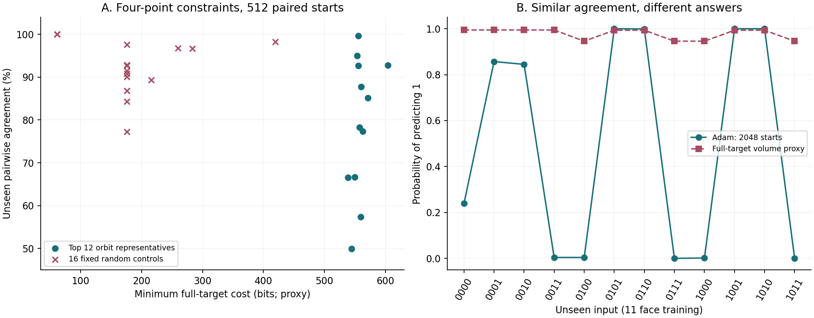
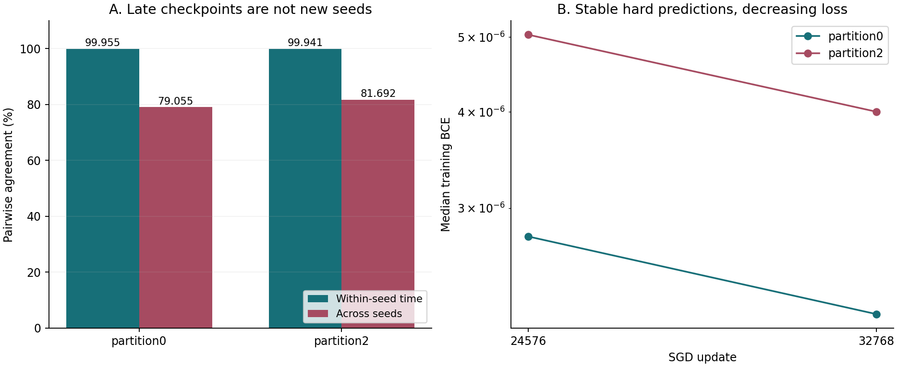

# 预测共识、复杂度与分布边界

<!-- P01 -->
2026-11-06 双语增补，整理 2026-10-27 提交 `3834fb3f6555c7c58218462502635b16b9b377f9` 之后的四点 XOR 面、四样本普查与宽 CNN 时间系综证据。E18/E21/E29/E36 只作背景。本增补对已有结果进行短 CPU 分析，不包含新增训练或 SMC。[English](README_en.md)

## 1. 主要观察与猜想修订

<!-- P02 -->
本轮是把agreement猜想修订得更严谨，而不是否认它。E18/E21中高共识终点对应可读规则的正证据，仍支持研究神经偏好的复杂度与人类可压缩结构之间的联系。四点约束可以同时具有高的**最低完整延拓成本代理**与高训练agreement；XOR自身仍是可读规则，因此这个例子不直接反驳上述联系。其他高成本四点约束也可只有约一半的逐点一致率，说明成本代理与延拓确信度不能等同。这里没有直接测得四点低BCE事件的静态复杂度；随机抽样、预设教师抽样与主动构造见证也须区分。

<!-- P03 -->
宽 CNN 的两组晚期轨迹各含 16 个初始化：时间 agreement 为 99.955%/99.941%，多 seed agreement 为 79.055%/81.692%。预测近乎不动而 BCE 仍下降约 20%，不支持用这一协议的单轨迹后期 checkpoint 替代多初始化系综；也不证明参数区域不连通。即使其他实验中两种 agreement 接近，也不足以证明遍历性、平稳性或相同函数分布。

## 2. 必须分开的量

<!-- P04 -->
令参考测度为明确指定的参数分布 $\mu$，训练集为 $D$，未见评价集为 $T$，硬预测函数为 $h_\theta$。固定训练集的静态条件分布、全目标目录代理、首次到达训练分布和时间占用分布是四个不同对象。下面使用标准数学记号；$H_D$ 表示训练标签全部答对。

<!-- F01 -->
$$
Q_{D,\epsilon}(f)=\frac{\mu(h_\theta=f,\ H_D,\ L_D\leq\epsilon)}{\mu(H_D,\ L_D\leq\epsilon)},\qquad
K_D(\epsilon)=-\log_2\mu(H_D,\ L_D\leq\epsilon).
$$

<!-- P05 -->
本次四点目录量则定义为相容的 4096 个完整 16 点函数中最小的全目标成本，以及由全目标成本归一化的代理。相同的阈值数值不使四点平均 BCE 与 16 点平均 BCE 成为同一个事件；未见的 12 点在真实训练中没有幅度要求。主节点 0.004 小于 $\ln(2)/16$，故各完整目标事件位于对应 hard cell 内，但它们仍不是固定四点条件分布。本轮没有针对这些四点重新进行 fixed-D 低 BCE 静态采样。

<!-- F02 -->
$$
K_{\mathrm{full}}(f;\epsilon)=-\log_2\mu(L_{16,f}\leq\epsilon),\quad
K_{\min}^{\mathrm{full}}(D;\epsilon)=\min_{f\in\mathcal F(D)}K_{\mathrm{full}}(f;\epsilon),\quad
\widetilde Q_D(f)=\frac{2^{-K_{\mathrm{full}}(f;\epsilon)}}{\sum_{g\in\mathcal F(D)}2^{-K_{\mathrm{full}}(g;\epsilon)}}.
$$

<!-- P06 -->
对二分类未见点，$p_j$ 是输出 1 的概率。逐点 agreement 先在每个点比较两个模型，再跨点平均；完整碰撞要求两个模型的整个未见预测向量相同。有限样本使用不同模型对，不含自身配对；$k_j$ 为输出 1 的模型数，$n_v$ 为完整向量 $v$ 的计数。四点实验所有训练标签正确，所以 12 位未见向量碰撞也等于 16 位完整表碰撞。CNN 的 2048 张 probe 向量不是全部可能图像上的完整函数。

<!-- F03 -->
$$
A_T=\frac1m\sum_{j=1}^m[p_j^2+(1-p_j)^2],\qquad
\widehat A_T=\frac1m\sum_{j=1}^m\frac{k_j(k_j-1)+(N-k_j)(N-k_j-1)}{N(N-1)},\qquad
\widehat C_T=\frac{\sum_v n_v(n_v-1)}{N(N-1)}.
$$

<!-- P07 -->
准确率需要外部标签，本文均指单模型准确率的系综均值，不是多数投票准确率。逐点正确概率平均严格等于该均值，不要求测试点独立；但均值接近可由不同点的误差抵消，逐图边际接近也不确定跨图联合分布。平均准确率是否代表典型单模型，需要检查跨 seed 方差；从 agreement 推断错误率还需要校准等额外条件。相关记录（来源：`research/notes/20261030_function_mass_accuracy_bridge_zh.md`）

<!-- F04 -->
$$
\mathbb E_Q[\operatorname{Acc}_T(h)]=\frac1m\sum_j Q(h(x_j)=y_j),\qquad
|\mathbb E_Q\operatorname{Acc}_T-\mathbb E_P\operatorname{Acc}_T|
\leq\frac1m\sum_j|Q(h(x_j)=1)-P(h(x_j)=1)|.
$$

## 3. 四点 XOR 面与 dead bits

<!-- P08 -->
输入按整数 0 至 15 排列，编码为 `abcd` 的 **0/1**，不是 -1/+1；函数 ID 的第 $i$ 位对应输入 $i$ 的输出。预定教师为末两位 XOR（`0x6666`）及复制末位（`0xAAAA`）。11 面是已知 min-max 见证的后续检验；00 面是看到 11 面初步结果后追加的配对干预，不是盲预测。

<!-- T01 -->
| 条件 | 四个训练输入，按标签顺序 | XOR 标签 | 复制标签 | 固定输入列 | 未见点数 |
|---|---|---|---|---|---:|
| 11 面 | 1100, 1101, 1110, 1111 | 0, 1, 1, 0 | 0, 1, 0, 1 | a=1, b=1 | 12 |
| 00 面 | 0000, 0001, 0010, 0011 | 0, 1, 1, 0 | 0, 1, 0, 1 | a=0, b=0 | 12 |

<!-- P09 -->
网络为 `4 -> 16 tanh -> 1`，97 个原始可训练坐标独立标准 Gaussian 初始化；隐藏层权重与偏置除 2，输出层权重与偏置除 4，logit 大于等于 0 判为 1。四个随机流 `2026110401/2026110402/2026110403/2026110404` 各生成 512 个模型，每个条件共 2048 个初始化，教师与面之间共享相同起始参数。全批 Adam，学习率 0.01，无衰减，预算 30000 更新，每 10 步检查，主读数为各模型首次被检查到四点平均 BCE 小于等于 0.004。四个条件均 2048/2048 达标；8192 条轨迹不是 8192 个独立初值。原训练使用 RTX 3080、CUDA1、float32、TF32 关闭、Torch 2.11.0+cu130。

<!-- T02 -->
| 主节点条件 | 逐点 agreement（%） | 未见准确率（%） | 完整碰撞（%） | 教师恢复 | 不同未见表数 |
|---|---:|---:|---:|---:|---:|
| 11 XOR | 92.56 | 95.43 | 35.51 | 1125/2048 | 15 |
| 00 XOR | 99.64 | 99.82 | 96.14 | 2008/2048 | 7 |
| 11 copy | 99.26 | 99.62 | 94.93 | 1995/2048 | 4 |
| 00 copy | 99.97 | 99.98 | 99.71 | 2045/2048 | 4 |

<!-- P10 -->
XOR 的 00 面减 11 面，配对未见准确率差为 +4.39 pp，原整初始化 bootstrap 95% 区间为 +4.13 至 +4.63 pp；教师完整恢复差为 +43.12 pp，区间 +40.77 至 +45.36 pp。本轮复算点估计，区间转录原配对分析，不新增 bootstrap。主节点训练步数中位数为 900/870。30000 步终点，11 面 XOR 恢复 1228/2048，00 面 XOR 恢复 2048/2048，两个 copy 条件也全部恢复；未见标签未参与 checkpoint 选择。11 面主节点第二众数为 `0x6667`，397/2048，仅在 `0000` 偏离全域 XOR。原配对报告（来源：`research/xor_face_agreement_20261104/REPORT_ZH.md`）

<!-- P11 -->
隐藏预激活是 `(w_a*a+w_b*b+w_c*c+w_d*d+bias)/2`。00 面的两列训练输入恒零，因此数据梯度恒零，无衰减 Adam 下保存终点的最大列变化确为 0；权重仍为初始随机值，不是被删掉。11 面只识别 `w_a+w_b+bias`，三项数据梯度相同而非 dead gradient；XOR 终点固定列更新 RMS 为 1.85934，与偏置更新差的 RMS 约为 1.08e-4。两面初始有效偏置分量方差也从 1/4 变为 3/4，不能把差异单独归因于“有无梯度”。输入翻转加偏置补偿不保持此 0/1 编码下独立 Gaussian 坐标先验。

<!-- P12 -->
E29（来源：`research/neural_k_framework/experiments/experiment_29_dead_bit_loss_resolved/RESULTS_AND_CONCLUSION.md`）是一个固定零位、三个变化位、8 个训练点，而不是本次两个固定位、4 个训练点。其实际 fixed-D 受限 SMC 为 4 池各 2048 粒子，Adam 为 512 配对初始化；标准 0 到 1 shift、严格 matched-loss 下，XOR 严格正确质量两者均为 1。那是有效分支对先验尺度扰动的鲁棒性证据，不是 dead 权重收缩；显式 L2 才收缩该列，0 到 2 的更强 shift 又暴露差距。温度 1 likelihood posterior、hard-fit 条件与低 BCE 子水平分布也不能混用。

## 4. 全目标代理：频率失败与排名命中并存

<!-- P13 -->
历史目录将 1992 个轨道展开为 65536 个完整函数，first-pass 每轨道 8 池，主口径为池间 K 中位数；两个 XOR 面在 0.004 的 4096 个相容延拓均无缺失。主导轨道大多未做独立高预算复测。整理时读取历史本地缓存与汇总，没有重新打开历史 ZIP。11 面的候选权重、归一化和逐点票率从缓存重算；00 面完整代理质量只核对现有汇总与逐点统计，不冒称重新展开全部原始轨道。

<!-- T03 -->
| XOR 面 | 最低完整目标 K（bit） | 代理众数 | 代理众数质量（%） | 代理给 XOR 的质量 | Adam 选择代理众数 | 逐点票率 MAE（pp） |
|---|---:|---|---:|---:|---:|---:|
| 11 | 604.28 | 0x6FFF | 89.57 | 1.14e-15 | 0/2048 | 48.63 |
| 00 | 555.83 | 0xFFF6 | 98.37 | 3.24e-30 | 0/2048 | 49.82 |

<!-- P14 -->
代理众数都在训练面外输出 1，真实训练众数却都是全域 XOR。11 面代理逐点 agreement 为 95.76%，看似接近训练的 92.56%，但两者预测内容相反得多，票率 MAE 达 48.63 pp，估计分布的未见表 TV 近 1。该 TV 是有限目录代理与经验训练分布的比较，不是已测到的 fixed-D 静态后验与 Adam 的 TV。11 面前四池/后四池得到面外全 1 质量 92.73%/85.79%，先平均体积的版本为 90.26%；方向稳定仍不能排除共同混合偏差。0.0025 等更深节点只覆盖 4094/4096，缺失不是零质量。

<!-- P15 -->
另一个读数是预先指定 0.01 到 0.0063 窗口的每次 BCE 减半收缩系数。先逐池求斜率、再取中位数时，全域 XOR 为 84.52 bit，两面相容候选均排第 1；面外全 1 分别为 92.49/87.82 bit。XOR 在 11 面有 7/8 池排名第 1、最差第 3，00 面为 8/8 池第 1。排名命中训练众数并不预测 54.93% 或 98.05% 的恢复频率；以实际 K 锚定斜率后外推至 0.004，仍给错误默认 1 延拓 87.14%/99.06% 的质量。

<!-- F05 -->
$$
c_f(\epsilon_{\rm hi},\epsilon_{\rm lo})=
\frac{K_{\mathrm{full}}(f;\epsilon_{\rm lo})-K_{\mathrm{full}}(f;\epsilon_{\rm hi})}{\log_2(\epsilon_{\rm hi}/\epsilon_{\rm lo})}.
$$

## 5. 四样本普查与真实训练面板

<!-- P16 -->
主普查等权枚举从 16 个输入无放回取四个不同输入、四标签独立公平的全部 `C(16,4)*16=29120` 个无序训练集。各行表示“至少存在一个相容延拓”，覆盖率不能相加，也不表示 Adam 选择该延拓。至多两变量函数共有 70 个：2 个常数、8 个带符号单 bit、48 个 AND/OR 类、12 个 XOR/XNOR。

<!-- T04 -->
| 相容解释族 | 训练集数 | 覆盖率（%） |
|---|---:|---:|
| 常数 | 3640 | 12.50 |
| 常数或带符号单 bit | 15480 | 53.16 |
| 上述规则或两文字 AND/OR | 26296 | 90.30 |
| 任意至多两变量函数 | 27840 | 95.60 |
| 仿射线性阈值 | 28920 | 99.31 |

<!-- P17 -->
另两种抽法分别报告：固定两正两负的 10920 组中，AND/OR 及更简单族覆盖 8416 组（77.07%），至多两变量族覆盖 9960 组（91.21%）；预先固定全域 XOR 教师的 1820 种取样中，1640 种（90.11%）允许非 XOR 的常数、单 bit 或 AND/OR，1736 种（95.38%）允许不同于教师的至多两变量延拓。最低所需输入位数 0/1/2/3 对应 3640/11840/12360/1280 组；没有必须依赖四位才能拟合的四点集。

<!-- P18 -->
完整延拓成本代理中位数为 175.64 bit，P90/P95/P99 为 259.38/289.72/373.28；最大 604.28，有 12 组并列，恰为两个固定 1 位加完整 XOR/XNOR 面的一类。最高 200 组恰为全部线性不可分四点集，范围 538.66 至 604.28；其余最高 425.81。独立中点判据复核不可分矩形的交错标签：变化位数 2/3/4 分别有 48/96/56 组。只以坐标置换和整体输出翻转归并，共 907 类；不把输入翻转当成先验对称。组合计数是精确的，成本仍是有限预算的目录估计。

<!-- P19 -->
历史 16777216 次 Gaussian 先验抽样还提供四点 **hard-fit 事件的直接命中数**，而非全目标代理：不可分组 hard 成本为 11.10 至 12.90 bit，可分组最多 9.49，最少事件仍有 2191 次命中。它不是低 BCE 成本，且所有训练集共享同一批先验抽样。普查的斜率口径使用 0.0063 到 0.004 两节点 K 中位数之差：可分/不可分分界为 64.59/78.74 bit；改成逐池先求斜率再取中位数为 64.25/78.87。不可与上一节不同窗口的 84.52 混写。

<!-- P20 -->
训练前按成本最高的 12 个非等价类、结构边界和随机 seed `2026110427` 抽取的 16 个对照选择，去重共 30 个条件；前 12 类事后发现覆盖全部 200 个不可分训练集，但每类只训练一个代表。每条件共享同一批 512 初值，复用前述第一个随机流，网络与 Adam 协议相同；每 10 步保存首次 BCE 小于等于 0.004 状态，全员达标即停，上限 30000 步。30 组均 512/512 达标，共 15360 条配对轨迹。两个旧面的逐模型步数和硬预测与原记录完全相同，不是独立复测。除预定教师控制外，不给任意四点集事后指定“正确教师”。

<!-- T05 -->
| 四点及标签 | 恒定位 | 最低完整延拓 K（bit） | agreement（%） | 碰撞（%） |
|---|---|---:|---:|---:|
| 1100:0 1101:1 1110:1 1111:0 | a=1,b=1 | 604.28 | 92.79 | 37.48 |
| 0001:0 0111:1 1001:1 1111:0 | d=1 | 571.69 | 85.15 | 11.15 |
| 0000:0 0111:1 1000:1 1111:0 | 无 | 560.52 | 87.75 | 15.02 |
| 0100:0 0111:1 1000:1 1011:0 | 无 | 559.78 | 57.37 | 0.61 |
| 0000:0 0001:1 0010:1 0011:0 | a=0,b=0 | 555.83 | 99.64 | 96.14 |
| 0110:0 0111:1 1000:1 1001:0 | 无 | 555.71 | 92.70 | 41.33 |
| 0101:0 0110:1 1001:1 1010:0 | 无 | 544.57 | 49.95 | 0.22 |

<!-- P21 -->
12 个高成本代表 agreement 范围为 49.95% 至 99.64%，按类型大小加权的描述性均值为 80.44%；16 个随机对照均值 92.80%，范围 77.27% 至 100%。这不是 29120 组真实训练的普查，也不对跨数据集或架构作总体推断。没有固定 bit 的例子也同时存在高、低共识，所以不能把全部结果解释为 dead bits。表中最低共识例有 349 张不同未见表，众数仅 6/512。原普查报告（来源：`research/four_sample_shortcuts_20261104/REPORT_ZH.md`）

<!-- P22 -->
最低共识见证满足 `a!=b` 且 `c!=d`，已见标签为 `a XOR c`。交换 `a,b` 或 `c,d` 后再整体翻转输出，保持训练约束和对称 Gaussian 先验；每个未见点至少被其中一个交换固定，因此该点的两标签静态条件质量相等。理想数值、全批且置换等变的 Adam 也有对应初始化配对，无需假设 Adam 等于静态采样。总体逐点 agreement 为 50%，512 模型的不含自配对估计可以略低于 50%；这不意味着 4096 张整表等概率。另有三个代表各有 8 个未见点被同类对称强制五五开。本轮逐点重新验证对称证书。

<!-- P23 -->

图中左侧区分高成本代表和固定随机对照，右侧展示 11 面真实训练与全目标代理的逐点票率。横轴成本不是四点训练事件的 K，曲线不是两个相同条件分布。

## 6. 宽 CNN：三种时间与 loss 口径

<!-- P24 -->
两份已知存在偏差的 `partition0_n32_s0`、`partition2_n32_s0` 各含 32 个 MNIST 训练样本、2048 张固定 probe。标签是数字类别的 5 对 5 分组，不是 iid 图像随机标签。沿用 CNN W8：两卷积层 24/64 通道、全连接 `1024 -> 480 -> 336 -> 2`，共 693378 参数槽（含固定零 bias），ReLU/池化，无 dropout。16 初始化来自原 `U[-0.2,0.2]` 流的前 16 个，所有初始化共用固定批次序列；SGD 学习率 0.001，batch=2，无动量、衰减或调度，允许离开先验盒。两组也不是 32 个独立训练集。

<!-- P25 -->
原训练为 RTX 3080 CUDA1、float32、TF32 关闭。冷启动使 256 步测速保守选成 8192 步；后仅依实际运行时间续至 32768 更新，即 2048 epochs，不按测试准确率或与 SMC 的吻合选择预算。每 16 步记录训练 loss，每 256 步记录 probe，每 4096 步保存断点。最后四分之一窗口为 24576 至 32768，共 33 个相关 checkpoint/seed；续跑前 8192 步逐数组保持不变，原报告累计运行记录耗时 308.45/310.87 秒，不含环境冷启动与首次测速。

<!-- T06 -->
| 比较对象 | 初始化或粒子预算 | 实际读数 | 不可替代的对象 |
|---|---|---|---|
| 既有深节点 SMC | 每条件 4 池，各 2048 粒子；32/96 更新与刷新 | 固定训练集累计 BCE 子水平集，最深 1e-5 | 优化器首次穿越分布 |
| 既有 SGD 深节点对照 | 每条件 128 初始化；lr=0.001 | 逐更新首次达标；1e-5 为 128/128 | 后续 16 初始化终点 |
| 本次最终低 loss | 每条件 16 初始化；32768 更新 | partition0 为 16/16、partition2 为 15/16 低于 1e-5 | 同上限下无偏静态样本 |
| 本次后期时间系综 | 每 seed 33 checkpoint；24576 至 32768 | 同 seed 跨时间、同时间跨 seed 分别计算 | 独立新增 seed 或平衡采样 |

<!-- P26 -->
CNN 用两 logit 差大于 0 判为 1（tie 判 0，匹配 argmax），Boolean 实验用大于等于 0；脚本保留各自约定。时间 agreement 对同一 seed 的不同 checkpoint 配对，再对 seed 和 probe 平均；多 seed agreement 对同一时点的不同 seed 配对，再对时间和 probe 平均。公式与第 2 节的有限计数形式相同，但时间点相关，不能据此套独立样本置信区间。本次每 256 步保存的“首次达标”不是旧逐更新 matched-loss 穿越：例如名义 0.003 节点两组都首次存于 256 步，实际平均 BCE 已为 5.63e-5/1.33e-4。

<!-- T07 -->
| 晚期指标 | partition0 | partition2 |
|---|---:|---:|
| 最终平均准确率（%） | 80.109 | 78.333 |
| 最终准确率跨 seed SD（pp） | 2.535 | 2.011 |
| 单 seed 晚期准确率 SD，跨 seed 均值（pp） | 0.0290 | 0.0319 |
| 时间 agreement（%） | 99.955 | 99.941 |
| 多 seed agreement（%） | 79.055 | 81.692 |
| 曾改变预测的 probe 比例（%） | 0.1495 | 0.1617 |
| 至少翻转两次的 probe 比例（%） | 0 | 0 |
| 晚期起点 BCE 中位数 | 2.756e-6 | 5.037e-6 |
| 终点 BCE 中位数 | 2.185e-6 | 4.001e-6 |
| 逐 seed 终点/起点 BCE 比值的中位数 | 0.8045 | 0.8036 |
| 跨 seed 部分占逐图预测方差（%） | 99.78 | 99.67 |

<!-- P27 -->
晚期平均每 seed 仅约 3 张 probe 改变预测，不同 seed 的两两预测却仍在约 18% 至 21% 的图上不同。方差分解是保存的“时间乘 seed 乘 probe”二进制数组的等权恒等式，不是准确率方差分解或显著性检验。最终 BCE 范围为 3.90e-7 至 3.43e-6、1.74e-6 至 1.05e-5；后者仍有一个 seed 未达到原最深阈值。每 256 步观察一次不能排除记录间翻转后恢复；hard 预测稳定、继续改善 margin、有限精度和有限时间不混合，也都不能直接推出拓扑不连通。原时间系综报告（来源：`research/wide_cnn_time_ensemble_20261101/REPORT_ZH.md`）

<!-- P28 -->

左侧比较两种明确区分的 agreement，右侧只连接晚期起终点 BCE 中位数，不暗示中间 loss 单调或达到平稳分布。

## 7. SMC 比较不能被优化器差异豁免

<!-- P29 -->
E36 的既有验证扩展（来源：`research/neural_k_framework/experiments/experiment_36_peleg_g_and_c_validation/VALIDATION_EXTENSION_20261027.md`）是背景，不计作本次新增实验：在 BCE 小于等于 1e-5，增强 SMC 平均准确率为 75.59%/75.16%，SGD lr=0.001 为 79.68%/77.25%，保留约 4.08/2.09 pp 的指定协议预测偏差。实际平均 BCE，SGD 约 9.2e-6/9.4e-6，SMC 约 6.8e-6/7.0e-6，不能说 SGD 因落到更低平均 loss 才更准。本次最终 80.109%/78.333% 不能替换旧同节点的数值，也不能把两次 cohort 编号直接配对。

<!-- P30 -->
SGD、Adam、STP 和步长彼此不同，说明一个静态分布不可能同时精确等于所有优化器分布；这并不取消针对某个指定 SGD 协议的偏差。初始化盒内静态采样与可离盒的优化路径、首次到达与累计子水平集、实际 loss 分布、有限 seed 和 SMC 混合均应保留，尚不能凭这些差异断言某一个因素已解释差距。池间重复性不证明没有共同系统偏差。本次时间数据没有重新测出 SMC 函数质量或完整函数重加权，也没有修复原比较。

## 8. 关联实验与未决项

<!-- T08 -->
| 关联实验 | 与本增补的关系 |
|---|---|
| E18 | 高共识与符号可读性：保留协议内经验，不升级人类可读性定理 |
| E21 | 共识复杂度前沿：对照固定四点的高成本代理见证、低共识结果与抽样差别 |
| E29 | dead-bit 机制与 shift 边界：11/00 双固定位干预不是原 8 点实验重跑 |
| E36 | 宽 CNN 协议边界：区分首次穿越、终点和时间系综，保留未消失的偏差 |

<!-- P31 -->
E18 的短符号终点、E21 的结构化共识前沿仍是特定 8-bit 协议的发现，不认证所有高共识函数人类可理解。E21 主动选择标签的样本成本也不是预设教师的随机样本复杂度。本页四点见证是局部 XOR 结构，不能叫作已认证的随机记忆，更不能据此证明大量高复杂度目标都能由极少样本可靠识别。E18 背景（来源：`research/neural_k_framework/experiments/experiment_18_consensus_symbolicity/RESULTS_AND_CONCLUSION.md`）、E21 背景（来源：`research/neural_k_framework/experiments/experiment_21_agreement_complexity_frontier/RESULTS_AND_CONCLUSION.md`）、成本与共识记录（来源：`research/notes/20261030_ait_correspondence_discussion_zh.md`）

<!-- P32 -->
未决项包括：这些四点真正 fixed-D 低 BCE 的质量与收缩系数；完整目录深尾缺失和高预算混合校准；固定值干预中初始有效偏置与梯度通路的分别作用；跨数据集/架构/优化器的代表性；宽 CNN 的静态与优化分布逐图及联合比较、实际 loss 与参数盒匹配、持续扰动下的长期混合；投票校准和单模型准确率集中性。这些问题尚未由本包结果解决。

## 9. 复算、哈希与审计分级

<!-- P33 -->
[results.json](results.json)保存精简数值、全部 30 组训练点与统计；[SOURCE_SHA256.json](SOURCE_SHA256.json)和[文本哈希清单](SOURCE_SHA256SUMS.txt)记录来源文件身份，另列三个历史 ZIP 的文件名与转录哈希，不含本机目录。正文中的包外来源仅以路径文本标识，不代表可下载的公开附件；本包不收录完整私有笔记。原始 NPZ、模型权重及逐模型轨迹未随包发布。完整 `recompute` 需要原仓库布局中的本地原始结果及相应来源文件，下载本包不能原样复现数千模型训练或原始采样。哈希证明文件身份，不证明 SMC 全局混合或科学结论普遍成立。

<!-- P34 -->
整理阶段的本地 CPU 核验独立复算了两面全部主节点预测、小网络终点/面板权重前向、30 组训练统计、29120 组解释族覆盖与中点可分性、两份 CNN 全轨迹统计与续跑前缀，记录见 [VALIDATION.json](VALIDATION.json)。CNN 大权重前向、原图数据身份、历史 SMC 原包与配对 bootstrap 区间沿用已有审计，没有重复。公开包检查 [PUBLIC_VALIDATION.json](PUBLIC_VALIDATION.json)只使用包内文件：从保存票数核算可恢复的 agreement/准确率，核对关键汇总、双语表格、公式、哈希清单格式及图片链接；它不重算缺少联合计数的碰撞率，也不重新验证原始数据或来源文件的当前哈希。

<!-- P35 -->
[recompute.py](recompute.py)的 `--public-only` 模式仅需 Python 标准库，不读取包外来源、不加载 NumPy、Matplotlib 或 Torch。`render` 使用 NumPy/Matplotlib 从本包 JSON 重画两张图，不需要 raw；两张公开图片均是本目录文件。`check` 要求本地来源文件以核验其哈希，`recompute` 另需 NumPy/Matplotlib 及未发布原始数组，两者须在原仓库布局中运行。所有模式均不下载数据、不安装依赖、不启动训练或 SMC。以下先列公开包可执行的命令，再列需要本地来源的命令。

```text
python -B recompute.py --public-only
python -B recompute.py render
```

```text
python -B recompute.py check
python -B recompute.py recompute
```

<!-- P36 -->
公开证据由本双语 README、[结果 JSON](results.json)、[来源 manifest](SOURCE_SHA256.json)、[来源哈希文本](SOURCE_SHA256SUMS.txt)、[复算脚本](recompute.py)、[本地核验记录](VALIDATION.json)、[公开包检查记录](PUBLIC_VALIDATION.json)、[四点分析图](small_data_consensus.png)及[宽 CNN 分析图](wide_cnn_ensembles.png)组成。图表与结论保留成本代理不等于 $K_D$、matched-loss 穿越不等于终点或时间采样、多 seed 不等于相关 checkpoint 的区别。
