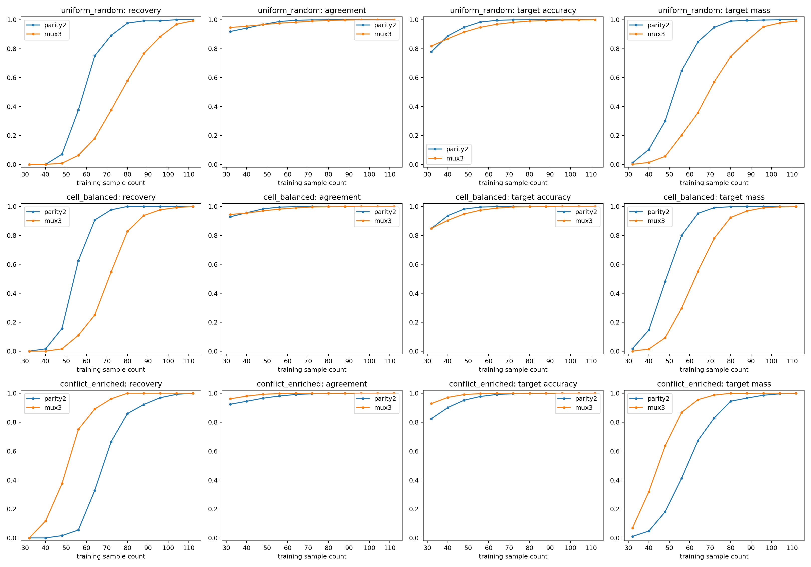
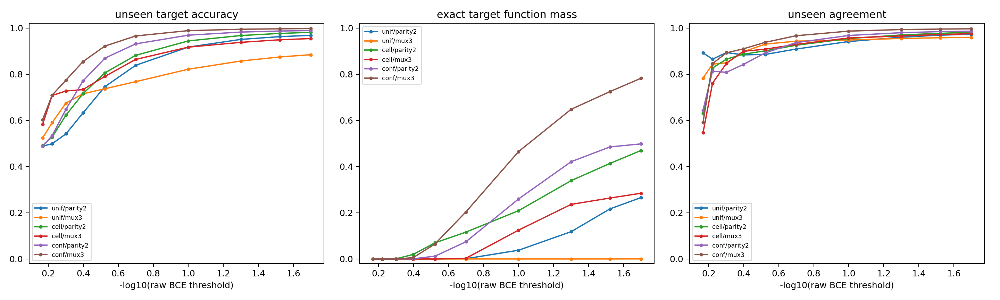
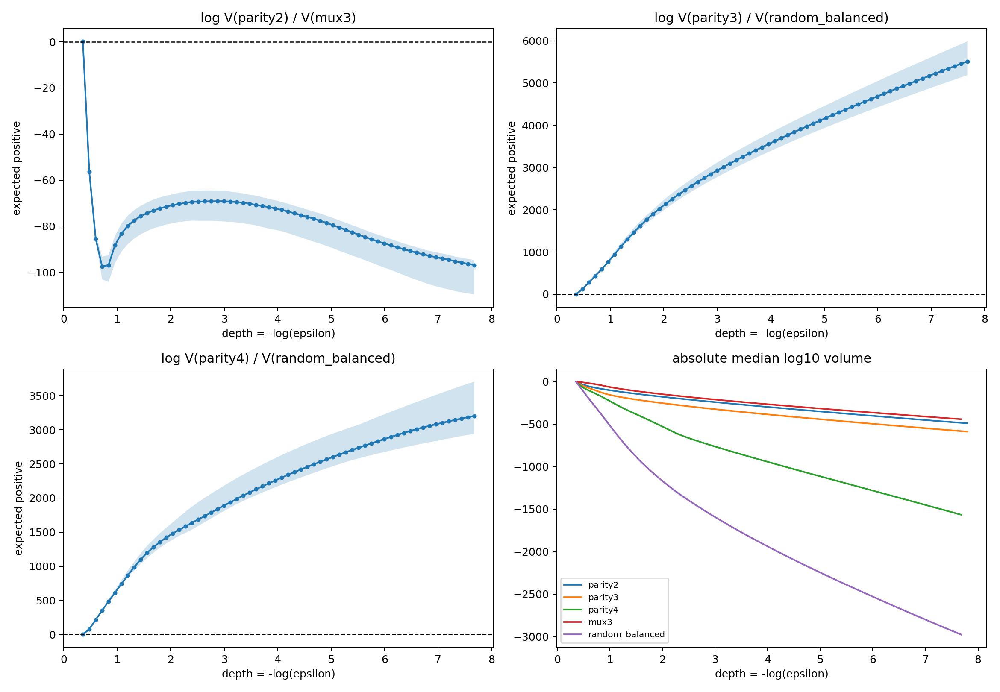

## Experiment overview {#overview}

## Purpose

E23 first used full-truth-table SMC to freeze the local volume contraction scores of eight 8-bit rules before reading any random-subset training results; it then trained 9,736 random dataset conditions to test whether static volume can prospectively predict the `n50/n90` sample transition. The three supplementary experiments of 2026-08-26 continued to track the only stable parity2/MUX3 cross-family misordering, and localized the missing variable to the fixed-$D$ competing-function denominator and sampling identification efficiency.

## The closed loop of the three supplementary experiments

1. **Multi-target Gaussian deep-tail SMC**: the shallow misordering of random relative to parity3/4 reorders in the deep tail; the full-target volume of MUX3, by contrast, remains far larger than that of parity2 throughout, showing that this discrepancy can no longer be attributed to not reading the profile deeply enough.
2. **Cell/conflict real-training intervention**: under both uniform and eight-cell-balanced sampling, parity2 recovers earlier; merely up-weighting the MUX selector-conflict samples flips `n50` from parity2/MUX3=`64/80` to `72/56`.
3. **Cell/conflict fixed-$D$ static SMC**: without an optimizer, the same ordering is reproduced. At `epsilon=0.02`, the parity2/MUX3 exact-target mass under uniform, cell, and conflict is `0.266/0.000214`, `0.469/0.284`, and `0.498/0.782`, respectively.

Therefore, the full-target Neural K-profile is a strong first-order predictor, but the grokking transition also depends on how a specific training set excludes target-relevant competing extensions; `n50/n90` is an independent protocol-relative identification/recovery complexity, not a universal synonymous definition of static Neural K.





## Run order

```bash
python experiment_8bit_rule_volume_preregister.py
python experiment_8bit_volume_to_data_transition.py
```

For the three misorderings between the stage-A shallow scores and the cross-family transition ordering, there is a separate preregistered five-branch shared-parent-ensemble deep-tail confirmation experiment. Because the original `Uniform[-1,1]` parameter cube has a nonzero BCE lower bound, this follow-up experiment uses an unbounded Gaussian reference measure with the same variance; it tests cross-protocol ordering robustness and is not a seamless continuation of the original volume curve:

```bash
python experiment_8bit_mismatch_joint_deep_bridge.py
```

The original stage B already included 64 random training sets per `n` and 24 seeds per set. The coarse-grid transition locations can be refined by re-coalescing the curves with continuous agreement:

```bash
python analysis_tools/analyze_agreement_subgrid_transitions.py \
  --result-dir /root/results_8bit_volume_to_data_transition
```

To determine whether the parity2/MUX3 cross-family misordering comes from full rule difficulty or from the number of relevant cells and the MUX copy shortcut, there is a separate causal data intervention with fixed AdamW:

```bash
python experiment_parity2_mux3_coverage_shortcut_intervention.py
```

It compares three nested sampling protocols — uniform random, eight-cell-balanced, and selector-conflict-enriched — and uses parity2 as the negative control for conflict enrichment.

To directly measure the static competition denominator under these three partial training sets, rather than relying on optimizer trajectories again, run:

```bash
python experiment_parity2_mux3_fixed_d_static_smc.py
```

This experiment fixes `n=32`, takes 8 datasets per protocol, and runs 48 fixed-D conditions in parallel under the same reference measure as the Gaussian full-target deep-tail experiment.

The existing uniform training runs do not need to be rerun; one can also test offline whether natural random coverage already predicts MUX3 recovery. This analysis reconstructs each training set, separately counts the samples that refute `copy x1` and `copy x2`, and performs block inference by dataset path:

```bash
python analyze_uniform_natural_conflict_coverage.py \
  --result-dir /root/results_parity2_mux3_coverage_shortcut_intervention
```

The results show that, at the same `n`, uniform datasets with more sufficient two-sided refutation are significantly more likely to recover MUX3, while the parity2 negative control shows no such relationship.

A further test of whether redundant input bits can act as fake selectors:

```bash
python analyze_uniform_nuisance_selector_competition.py \
  --result-dir /root/results_parity2_mux3_coverage_shortcut_intervention
```

This analysis preregisters the 10 nuisance literals formed by `x3...x7` and their negations. After controlling for the original copy shortcut, the results still find a small independent MUX3 signal, but the MUX3/parity2 difference does not reach the strong-verdict criterion; therefore, at present it only supports — without yet proving — the further conjecture that "increasing the input dimension widens the MUX3 disadvantage."

- [Experiment motivation and preregistration](MOTIVATION_AND_PREREGISTRATION.md)
- [Results and boundaries](RESULTS_AND_CONCLUSION.md)
- [Deep-tail misordering confirmation preregistration](DEEP_TAIL_FOLLOWUP_PREREGISTRATION.md)
- [Gaussian deep-tail follow-up results](DEEP_TAIL_FOLLOWUP_RESULTS.md)
- [Parity2/MUX3 coverage and shortcut intervention preregistration](COVERAGE_SHORTCUT_INTERVENTION_PREREGISTRATION.md)
- [Parity2/MUX3 coverage and shortcut intervention results](COVERAGE_SHORTCUT_INTERVENTION_RESULTS.md)
- [Parity2/MUX3 fixed-D static SMC preregistration](FIXED_D_STATIC_SMC_PREREGISTRATION.md)
- [Parity2/MUX3 fixed-D static SMC results](FIXED_D_STATIC_SMC_RESULTS.md)
- [Uniform natural-conflict coverage analysis preregistration](UNIFORM_NATURAL_CONFLICT_ANALYSIS_PREREGISTRATION.md)
- [Uniform natural-conflict coverage analysis results](UNIFORM_NATURAL_CONFLICT_ANALYSIS_RESULTS.md)
- [Uniform nuisance-bit fake-selector analysis preregistration](UNIFORM_NUISANCE_SELECTOR_ANALYSIS_PREREGISTRATION.md)
- [Uniform nuisance-bit fake-selector analysis results](UNIFORM_NUISANCE_SELECTOR_ANALYSIS_RESULTS.md)

## SHA256

```text
466a59d8e0a2243a9040d328dfef5e6f11c4ecb9893452b72024c6ecbe02fbb7  volume script
7b14e28ffd97a50da0af424e1bf755e72e82ad894e613cd129bcf00e5f742331  transition script
5df789c3976f59224b38ef63649a7ba9ce931cfa2c92c3d22098bd64d7e42f0c  Gaussian deep-tail script
234b87d39454d7fca35d7502ad76aa48329e8abece57f18aee8cbb81cd7812ce  coverage/conflict intervention script
fab1a8f12acb6c21d2396b0d9ecea8e6c4cfa23806d7f1ce513a5e7fb6a2c40d  fixed-D static SMC script
ed94c60979a2b019bca5ddbe951fca1d053e1cfddcda0d62ed5face819f43ffb  uniform natural-conflict analysis script
8e5f47b665d692d6960928a6b30542363bd14dca0f2302a58f29ede88f605896  uniform nuisance-selector analysis script
ebf266355364f25a0e694ea41863190cbf8a546025c1c49fda309fcb5c1172c5  volume ZIP
6e4075cae4fbd7072ab53f1e2764e65bbbf1934ced35f0301da965e8e0cd834d  transition ZIP
```

The raw ZIPs are located in `E:\Downloads` and are not included in the release package.

## Why this experiment was run, and how it was judged {#motivation}

## 1. Falsifiable question

If the low-loss mass of a complete rule under a fixed neural reference protocol really captures machine-relative difficulty, then it should predict another independent quantity: how many samples are needed to reliably recover that rule from a random partial truth table. To avoid choosing the complexity metric post hoc based on training results, the experiment is divided into fully separated stages A and B.

## 2. Stage A: frozen volume prediction

Fix the `8 -> 16 x 2 -> 1 tanh` network and eight balanced rules: parity1--4, majority3/5, MUX3, and random-balanced. Run SMC over the full 256 states, and take

$$
K_f^N(\epsilon)=-\log V_f^{full}(\epsilon)
$$

the secant slope over raw BCE `0.690 -> 0.670` as the frozen volume score. The larger the score, the harder the rule is predicted to be. Before any random-subset training begins, the predicted order and SHA256 are written to file.

The confirmatory primary verdict uses only nested parity, because its independent difficulty ordering is the clearest; all eight rules serve as a stress test, allowed to expose cross-family single-scalar failure.

## 3. Stage B: independently measuring the sample transition

For each non-full sample size and each rule, generate 64 random training sets, each trained with 24 paired initializations for 40,000 steps. A dataset is judged "recovered" only if it simultaneously satisfies the training fit rate, the target full-function mass, the target being the modal function, and the function collision threshold. `n50/n90` is defined as the smallest random sample size at which the isotonic recovery rate first reaches 50%/90%; `n=256` serves only as a full-data accessibility check.

Totals:

```text
19 non-full n x 8 rules x 64 datasets = 9,728
8 full-data eligibility conditions
24 seeds per condition
```

## 4. Verdicts

- Primary verdict: whether the parity volume ordering strictly predicts the `n50/n90` ordering;
- Secondary verdict: the rank correlation across the eight rules and explicit reversals;
- Diagnostics: save multi-threshold curves, and check whether local speed and absolute volume rankings change with loss.

## Results, interpretation, and limits {#results}

## 1. The confirmatory parity prediction hits exactly

On full data, all eight rules fit 100% and recover the target hard function. The frozen parity ordering and the independently measured sample transition are:

| Rule | volume score | `n50` | `n90` |
|---|---:|---:|---:|
| parity1 | 125.21 | 24 | 48 |
| parity2 | 3266.21 | 64 | 80 |
| parity3 | 4618.60 | 96 | 112 |
| parity4 | 6719.58 | 160 | 160 |

All four `n50` and `n90` grid intervals are mutually non-overlapping; Spearman is 1.0/1.0. This ordering was already stable from 5,000 steps onward and is not an artifact of the 40,000-step cutoff. This yields direct prospective evidence from full-target static volume to the identification sample size of random training sets.


## 2. The cross-family relationship is strong, but a shallow single scalar is not enough

Across all eight rules, the Spearman of volume score against `n50/n90` is 0.898/0.868; after removing the random rule, the seven structured rules give 0.955/0.927. The preregistered shallow secant score shows three misorderings relative to the transition ordering: MUX3/parity2, random/parity3, random/parity4. Random still has not recovered the full mapping by `n=240`.

The score frozen in stage A is only a shallow-loss secant. It is a strong first-order predictor, but not a sufficient statistic across arbitrary function families. The follow-up deep-tail experiment resolves the misordering of random relative to parity3/4, but MUX3/parity2 remains stably oriented — "full MUX3 volume is larger, yet the uniform data transition is later" — even in the Gaussian deep tail. This proves that the full-target profile and `n50/n90` are inherently correlated but distinct objects, with the fixed-training-set competition denominator, sample coverage structure, and optimizer accessibility in between.

## 3. The complexity ordering itself changes with loss

The local contraction rate of random-balanced accelerates sharply as loss deepens, and successively overtakes parity2, parity3, and parity4. The absolute volume ranking also crosses. When predicting `n50/n90` with deeper local windows, Spearman rises from about 0.73/0.71 to 0.97/0.95; when predicting with a single-section `-log V`, it also rises from about 0.83/0.77 to 0.95/0.93.

Thus what actually reverses is the ordering of volume and local speed inside the profile; the `n50/n90` transition itself does not reverse — instead, as an external operational quantity, it indicates that the shallow score was read too early.

This forces the complexity object to be revised from a single number to a full profile:

$$
K_f^N(\epsilon)=-\log V_f(\epsilon),\quad
s=-\log\epsilon,\quad
\kappa_f(s)=\frac{dK_f^N}{ds}.
$$

Local slope, curvature, and crossings all carry information; any shallow slice may miss deep-tail cost.

## 4. Agreement reproduces bifurcation and re-coalescence

For all rules at `n=1`, agreement is close to 1 while the target-function mass is 0. As n increases, parity first bifurcates and then re-coalesces to the target function in the order `parity1 -> parity4`; the agreement of random keeps dropping to about 0.656 and its target mass stays at 0 throughout. High agreement only means the current function distribution is narrow, not that it is externally correct.

Each same $n$ has already been randomly repeated over 64 training sets with 24 seeds each, so agreement can also refine the coarse grid of `n50/n90`. The posterior diagnostic starts from the agreement minimum of each curve, requires unseen target accuracy of at least 0.90, and performs an isotonic fit and linear sub-grid interpolation on mean unseen agreement=0.99. The 2,000-replicate dataset bootstrap results are:

| Rule | agreement=0.99 estimate | 95% bootstrap interval |
|---|---:|---:|
| parity2 | 59.98 | [58.77,61.07] |
| MUX3 | 69.47 | [65.02,72.40] |
| parity3 | 88.94 | [85.72,91.05] |
| parity4 | 151.93 | [149.65,153.81] |
| random-balanced | >240 | 100% right-censored |

On paired random subsets at the same `n=64`, parity2 agreement is on average 0.0106 higher than MUX3, with a paired-bootstrap 95% interval of [0.0078,0.0134]. This supports using the agreement of "several more random draws at the same n" to compare relative complexity, but this threshold and interpolation were diagnostics added after seeing the original data and must not masquerade as preregistered results.

## 5. The Gaussian deep tail leaves the only stable misordering to MUX3/parity2

The Gaussian SMC of the five-target shared-parent ensemble advances to a deepest common threshold of about `0.0004635`. The volume ratio and relative contraction speed of random-balanced relative to parity3/4 both support the operational transition direction in 8/8 replicas. Parity2/MUX3, in contrast, shows no crossing: at the deepest point

$$
\log\frac{V(\mathrm{parity2})}{V(\mathrm{MUX3})}\approx-96.9,
$$

i.e., the MUX3 full-target volume is about $10^{42}$ times larger. This result refutes the claim that "all cross-family misorderings will disappear simply by reading the full profile deeper."



## 6. Targeted sampling completely flips the real-training transition

With the network, AdamW, training budget, and target functions fixed, only the training sample distribution is changed:

| Protocol | parity2 `n50/n90` | MUX3 `n50/n90` |
|---|---:|---:|
| uniform | 64 / 80 | 80 / 104 |
| cell-balanced | 56 / 64 | 72 / 88 |
| conflict-enriched | 72 / 88 | **56 / 72** |

Cell balancing helps both rules, yet preserves the `copy x1/x2` shortcut at 75% accuracy, so MUX3 remains later. After raising selector-conflict samples to 75%, MUX3's `n50/n90` moves 24/32 samples earlier relative to uniform, while parity2 is delayed by 8 samples each. Both the 2,000-replicate paired bootstrap and the per-moment analysis from 500 to 40,000 steps preserve this direction.

## 7. Fixed-D static SMC reproduces the reversal and localizes the competing functions

With `n=32` fixed, Gaussian constrained SMC is run for three protocols, two targets, and 8 datasets per protocol. At `epsilon=0.1`, the groups are nearly all hard-fit, not strictly all: the mean train hard-exact mass for uniform-MUX3 is 0.989685. At the main comparison threshold `epsilon=0.02`, train hard-exact mass is 1 in all 48 conditions, and the exact-target mass is:

| Protocol | parity2 | MUX3 |
|---|---:|---:|
| uniform | 0.266 | 0.000214 |
| cell-balanced | 0.469 | 0.284 |
| conflict-enriched | 0.498 | **0.782** |

Uniform-MUX3 agreement has already reached 0.959, yet it almost never selects the true target; the conflict-MUX3 target is the modal function in 8/8 datasets. Decomposed by unseen semantic cells, uniform achieves a target accuracy of 0.993 on ordinary cells but only 0.777 on selector-conflict cells; conflict raises the conflict cells to 0.995.

Therefore the transition reversal in real training already exists in the fixed-$D$ static competition denominator; AdamW is not a necessary condition for producing the qualitative ordering. The optimizer still affects magnitudes and local effects such as parity2.

## 8. Final stratification and boundaries

- parity is the preregistered confirmatory family; the cross-family curve diagnostics include post hoc analyses;
- `n50/n90` are interval crossings on a sample-size grid, not infinite-precision points; close rules must be examined together with adjacent grid points and bootstrap intervals;
- targets without an $n<N$ crossing can only be recorded as right-censored; the `n=256` full data serves only as an accessibility control;
- `n50/n90` is a protocol-relative operational threshold, not a machine-independent sample complexity;
- the full-rule profile strongly predicts the data transition, but does not by itself determine all cross-family orderings;
- `n50/n90` should be called a protocol-relative identification/recovery sample complexity, not a synonymous scalar of full-target Neural K;
- most fixed-$D$ deep-tail lineages drop to about 1--2 per replica, so absolute target-mass decimals are only rough estimates; the primary verdict relies on external controls across loss, 8 datasets, replicas, targeted interventions, and real training;
- why the profile has its specific shape remains a microscopic mathematical question that this paper explicitly does not solve.
