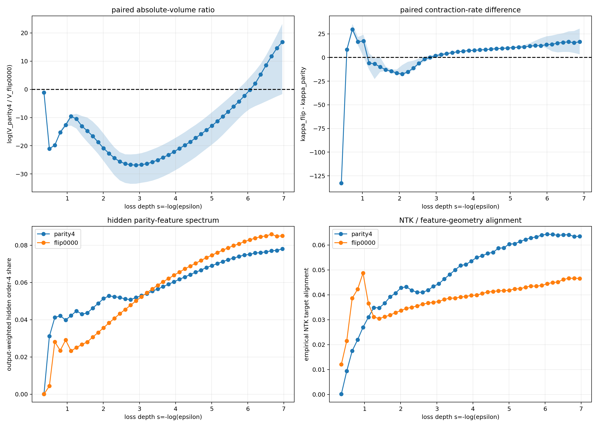

## Experiment overview {#overview}

## Purpose

E24 first pushes the Gaussian reference volumes into the hard-exact region on 4-bit, 54 complete rules, then selects the only single-point-exception rule still catching up with parity4. Two branches are then advanced in parallel from a shared parent ensemble, directly measuring whether the volume ratio reverses at deeper loss.

## Run order

```bash
python experiment_4bit_deep_volume_flow.py
python experiment_parity4_flip0000_joint_deep_bridge_lockstep.py
```

`experiment_parity4_flip0000_joint_deep_bridge.py` retains the full entry point of the same experiment; the lockstep version is a frozen implementation for observing the crossing synchronously and stopping at shared thresholds.

- [Motivation and preregistration](MOTIVATION_AND_PREREGISTRATION.md)
- [Results and boundaries](RESULTS_AND_CONCLUSION.md)

## SHA256

```text
8a0f603cd83220e58faccba9f16451611d30db52d159bb48b11f2edeffba954a  deep panel script
5e97d88619f6faa2d45b3eba4da46542e911c96941821a849b53912c3a1b5c91  joint script
45de3e1fdfb03163e73db7ba5b00a83010e7bdb2c86cebf1f1d7e2b6f73f13b2  lockstep script
935971c32e35d3cf0a8280629806fe2a1d12ccef48d507949badf99d87443bbe  deep panel ZIP
db3b99d03e3369888d4e973f177d944ea1f5925b0a817aaa52dea35b727b3ad7  joint bridge ZIP
```

The raw ZIPs are located in `E:\Downloads` and are not included in the release package.

## Why this experiment was run, and how it was judged {#motivation}

## 1. Question

E23 shows that both the local contraction speed and the absolute volume ranking change with loss. The next falsifiable questions are:

1. whether the ranking changes are merely shallow-loss noise;
2. whether the curves can still cross after entering the hard-exact region;
3. whether a single hard function ID is sufficient to define the complexity state.

## 2. 54-rule deep-tail panel

Fixed `4 -> 16 -> 1 tanh`, 97 parameters, standard Gaussian neural coordinates, and prior-preserving pCN. The targets include 6 structured rules, 16 parity4 single-exception rules, 16 balanced double-exception rules, and 16 random balanced rules. 8 replicas x 8,192 particles advanced through 25 thresholds, from BCE 0.700 to 0.01913; the sufficient hard-exact boundary is `ln(2)/16=0.04332`.

A pre-registered rule selects the candidate whose absolute volume is closest to parity4 at the deepest common threshold and whose local contraction rate is reliably faster, followed by shared parent ensemble validation, so that independent SMC normalization shifts cannot create spurious crossings.

## 3. Shared-parent-distribution verdict

The candidates are:

```text
parity4          = 0x6996
parity4_flip0000 = 0x6997
```

After the common parent distribution, 8 replicas x 32,768 particles are advanced synchronously. Define

$$
R(\epsilon)=\log\frac{V_{parity4}(\epsilon)}{V_{flip}(\epsilon)}.
$$

`R>0` means the single-point exception has the smaller volume. The strict stopping criterion requires that, for five consecutive windows, all 8/8 replicas simultaneously satisfy `R>0` and have a positive relative local contraction rate; the median crossing and this strict criterion must be reported separately.

## Results, interpretation, and limits {#results}

## 1. The 4-bit panel isolates the only chaser

54/54 targets completed. At the deepest five thresholds, the absolute volumes and speed rankings of the six structured rules are stable; parity4 is the smallest-volume target in the panel at all 25 thresholds. The 16 random, 16 double-exception, and 15/16 single-exception rules all failed to catch up with parity4.

The only candidate, `flip0000`, is still about `exp(13.65)` larger than parity4 at `epsilon=0.01913`, but its last-window contraction rate is 159.49 versus parity4's 152.75, with the eight-replica intervals completely non-overlapping. Extrapolation of the independent curves places the crossing at about `epsilon=0.0025`.

## 2. The shared bridge confirms an absolute-volume reversal

Under the shared parent ensemble, the median volume ratio crosses zero at

$$
\epsilon_{cross}\approx0.002308
$$

in high agreement with the independent extrapolation. At the deepest threshold `epsilon=0.000952`, the median `R=16.82`, i.e. the flip volume is about `2.0e7` times smaller than parity4. 7/8 replicas have already reversed absolutely, the local relative contraction rates of all 8/8 replicas are positive, and the gap is still widening after the crossing.

The preregistered strict stopping criterion requires 8/8 replicas to reverse absolutely for five consecutive windows, which is currently not met; therefore one can only write "the median and 7/8 replicas have reversed, and all replicas continue in the same direction", not "the all-replica robust criterion has passed".

The post-crossing ranking points in the same direction as the earlier leave-one-out training preference: when `0000` is held out from the parity4 truth table, the majority prediction for the missing label favors parity4 rather than `flip0000`, although it does not reach 100%. This constitutes corroborating evidence of consistency between full-rule deep-tail volumes and fixed-$D$ local predictions.

It is not a direct measurement of the 4-bit grokking phase transition. Leave-one-out corresponds to only one fixed training-set branch at $n=15$; random-training-set recovery rates and `n50/n90` must be scanned separately as in E23. The role of E24 is to prove that the profile itself reorders, and to test the first half of the E20 conditional-measure chain.



## 3. The crossing is not a hard function switch

The two were each 100% locked to different hard functions from very early on, and the crossing occurs in the hard-exact deep tail. The representation and margin indicators vary smoothly near the crossing point, with no synchronized discrete jump. This shows that the relative-complexity reordering can arise from the accumulation of a persistent continuous contraction-rate difference, without requiring a sudden phase transition in the hard ID or any representation indicator.

## 4. Theoretical verdict

1. `K^N_f(epsilon)` is not a fixed ordering determined by prior probability or a single slope;
2. the continuous logit, margin, and representation realizations inside a hard function ID are necessary state variables;
3. the deep-tail cost of a single non-reusable exception can manifest later than the architectural-mismatch cost of parity;
4. complexity should be profile-first, with local slope and curvature as derived quantities;
5. this static result does not prove that SGD undergoes feature learning at the crossing point; it only characterizes the geometric pressure it faces.
