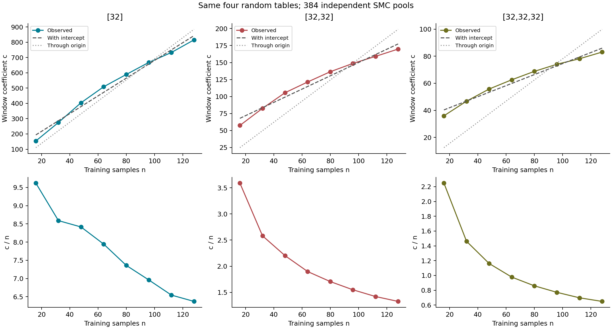
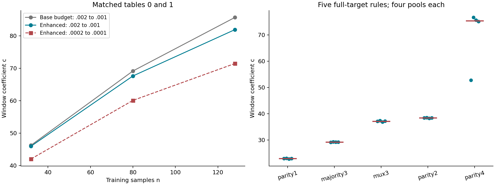
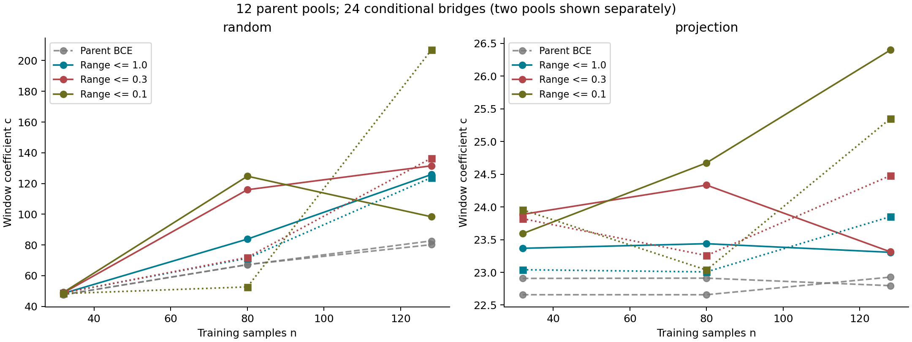
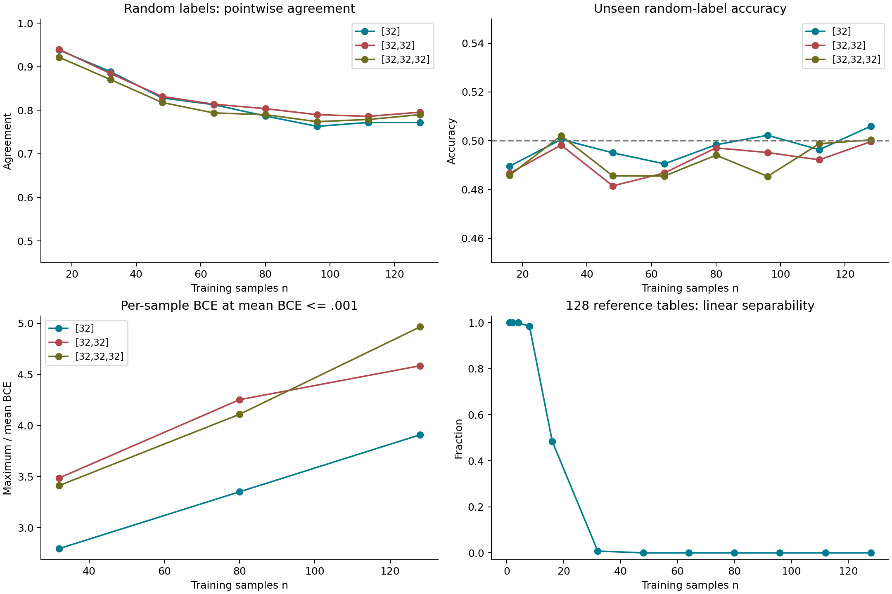

<a id="update-20261027"></a>

## E32: 2026-10-27 Memory Calibration Extension

This section is appended to the historical E32 page; the original text and historical code remain unchanged. It retrospectively organizes completed measurements: settings frozen at the time are documented, but later interpretations or diagnostics are not presented as a formal prospective preregistration. No new training or SMC was run for this release; further experiments have been deferred rather than pursued to obtain a more attractive linear relationship.

### 1. Motivation: Independent Calibration, Not Linearity by Definition

The original purpose of testing linear random-memory scaling was to independently calibrate the complexity interpretation of the volume-contraction coefficient. With inputs known, the source information in independent fair random labels grows on average with sample count. Approximately proportional growth of the coefficient within one architecture would therefore provide external support, rather than using the coefficient to justify itself.

This is a testable calibration conjecture, not a defining axiom. Even successful linear scaling would not establish equality with classical Kolmogorov complexity. Curvature instead requires separating compatible finite-sample structure, neural representation cost, the loss section, precision allocation, and sampling bias. Average information from a random source and parameter-space constraint cost for an individual training set are different objects.

### 2. Objects, Measure, and Primary Statistic

The task uses 8-bit inputs and 1-bit labels. Four complete random label tables over 256 inputs, together with their input permutations, are shared across architectures; n takes 16, 32, 48, 64, 80, 96, 112, and 128 as nested prefixes of the same permutation. The generator is NumPy default_rng, with seed 202609112301 + 1000003 × dataset_id, generating the permutation before the labels. The public generator checks original array hashes byte for byte, without duplicating random data.

The comparison uses tanh hidden layers [32], [32,32], and [32,32,32]. Each architecture has four tables, eight n values, and four independent pools per condition, totaling 384 primary pools. The base budget uses 2048 particles, 2 adaptation sweeps, and 12 production mutation sweeps, with independent random streams, thresholds, and proposal scales across pools. The two-layer set of 128 pools combines 40 completed local pools with 88 cloud pools restarted from the prior, without joining partial pools across hardware. An additional 4-pool single-layer rerun is not included in the primary means.

The reference measure is standard-normal neural coordinates, with both weights and biases scaled by the square root of the corresponding fan-in. Sampling forward passes use float32 with TF32 disabled; accumulated log mass uses float64, and spot checks use an independent float64 forward pass. The fixed-training-set event, its mass cost, and the primary window coefficient are defined as:

\[
E_D(\epsilon)=\left\{\theta:\frac{1}{n}\sum_{i=1}^{n}\log(1+\exp[-y_i^\pm z_\theta(x_i)])\leq\epsilon\right\},\quad
K_D(\epsilon)=-\log_2\mu(E_D(\epsilon)),
\quad
c_n=\frac{K_D(0.001)-K_D(0.002)}{\log_2(0.002/0.001)}.
\]

Here the signed label is ±1, BCE uses natural logarithms, and K is measured in bits. The coefficient c is the contraction rate of fixed training constraints over a finite loss window, not total K or the complexity of the entire 256-point function. Differences are computed within each pool, followed by the median of four pools within each table and the mean across four tables; missing endpoints are never replaced by zero. Different n values share nested data and are not independent dataset replicates. Absolute values across architectures are not treated as one common scale.

### 3. Complete Primary Matrix: Clear Growth, Unestablished Proportionality

| n | [32] | [32,32] | [32,32] Between-table SD | [32,32,32] |
|---:|---:|---:|---:|---:|
| 16 | 153.93 | 57.45 | 5.48 | 35.98 |
| 32 | 274.87 | 82.62 | 7.33 | 46.78 |
| 48 | 403.95 | 105.67 | 5.15 | 55.76 |
| 64 | 508.54 | 121.45 | 3.51 | 62.58 |
| 80 | 588.87 | 136.49 | 3.91 | 68.80 |
| 96 | 668.14 | 148.72 | 5.06 | 74.07 |
| 112 | 732.95 | 159.07 | 5.71 | 78.14 |
| 128 | 815.48 | 169.82 | 8.77 | 83.07 |

All three architectures show within-architecture growth as memory load increases, without relying on a single training table. Diminishing late increments remain after the two-layer endpoint is completed. For three layers, the increase from n=16 to 32 is about 10.80, whereas the increase from 96 to 112 is only about 4.07. This differs from the stronger expectation that every random label contributes the same fixed cost.

The following descriptive recalculation uses the eight unrounded means above, fitting an affine line c=an+b and a through-origin model c=qn separately. Both R² columns use the same centered total sum of squares; they must not be mixed with software-reported uncentered R² for no-intercept models. A negative value is not a calculation error. These are neither independent-sample inference nor proof of model validity.

| Architecture | a | b | Affine R² | q | Through-origin R² | c/n: n16 | c/n: n128 |
|---|---:|---:|---:|---:|---:|---:|---:|
| [32] | 5.799237 | 100.795924 | 0.985239 | 6.910957 | 0.939645 | 9.620697 | 6.370939 |
| [32,32] | 0.976971 | 52.321094 | 0.971258 | 1.554042 | 0.544537 | 3.590618 | 1.326739 |
| [32,32,32] | 0.407453 | 33.809558 | 0.973278 | 0.780353 | -0.053273 | 2.248605 | 0.649010 |

High affine R² supports a coarse approximately linear description over the finite interval, but does not establish strict proportionality; even one layer has systematic residuals. The intercept is a fitted parameter within this interval and should not be extrapolated into the actual cost at n=0. The main figure shows both fits and c/n so that curvature is not concealed by high R² alone.



The earlier cross-depth relationship c_two=2.372920 c_three−28.224598 was not refitted here. Across all 32 conditions, the median relative error is 1.49% and the maximum is 3.65%; for the four previously missing n128 conditions, these are 1.62% and 2.14%. This supports a regular response relationship within the current fixed family, not a universal conversion, validity across loss windows, or equivalence to algorithmic information. The three-layer reference remains the base-budget result, not a mixture with enhanced-budget estimates.

### 4. Enhanced Sampling and Actual-Fitting Supplement

The enhanced three-layer measurement uses original tables 0 and 1, n=32, 80, and 128, with four pools per condition, totaling 24 pools. The budget increases to 4096 particles and 48 production sweeps, extending to BCE=0.0001. The comparison below is restricted to the same two tables; subtracting the new two-table mean from the old four-table mean would be inappropriate.

| n | Base c: .002→.001 | Enhanced c: .002→.001 | Relative change | Enhanced c: .0002→.0001 |
|---:|---:|---:|---:|---:|
| 32 | 46.26 | 45.96 | -0.6% | 42.03 |
| 80 | 69.15 | 67.62 | -2.2% | 60.09 |
| 128 | 85.65 | 81.88 | -4.4% | 71.44 |

Curvature does not disappear under the enhanced budget, and c varies with the selected loss window. At n128, for tables 0 and 1, median K(.001) falls from 1512.43 to 1461.38 and from 1611.63 to 1561.49, respectively, about 50 bits each, implying large mass ratios. This must not be dismissed as a small percentage change or described as precisely converged absolute volume. The three anchors do not replace the eight-point primary curve with a new universal fit.

An additional 36 groups with 576 completed training trajectories compare three networks, three sample counts, two tables, and two Adam learning rates. All reach BCE=0.0001. At n128, the median steps to that node across 32 initializations pooled over two tables are shown below. Optimization uses raw parameters, initialization follows the Gaussian parameterization above, and training uses full-batch BCE without weight decay.

| Hidden layers | Parameters | Adam lr=.001 | Adam lr=.003 |
|---|---:|---:|---:|
| [32] | 321 | 9757 | 5966.5 |
| [240] | 2401 | 5616.5 | 3193.5 |
| [32,32,32] | 2433 | 1955 | 855.5 |

Three layers reach low loss faster under this optimization protocol, so they should not be described as an anomalous network unable to fit random labels; they are also faster than the roughly parameter-matched single layer. However, steps are not equal FLOPs, parameter matching does not control all representational and optimization differences, and this table alone cannot explain static curvature. The maximum per-sample BCE divided by mean BCE in static particles at n=32, 80, and 128 is about 4.04, 6.10, and 8.21. Since maxima themselves depend on n, this is only a clue about precision allocation.

### 5. Five-Rule Calibration and parity4 Disagreement

The same three-layer tanh architecture is calibrated on complete 256-point targets with 4096 particles, 48 sweeps, and four pools per rule, totaling 20 pools. In the table, K is the median of poolwise K values and c is the median of poolwise endpoint differences; neither substitutes for averaging masses before taking the negative logarithm.

| Rule | Median K(.001) | Median primary c | Minimum primary c | Maximum primary c | Median deep-window c: .0002→.0001 |
|---|---:|---:|---:|---:|---:|
| parity1 | 251.116 | 22.919 | 22.746 | 22.987 | 22.865 |
| majority3 | 355.898 | 29.209 | 29.103 | 29.314 | 27.967 |
| mux3 | 514.995 | 37.121 | 36.849 | 37.363 | 34.800 |
| parity2 | 557.598 | 38.397 | 38.276 | 38.481 | 36.308 |
| parity4 | 1205.160 | 75.355 | 52.723 | 76.646 | 66.469 |

The primary ordering remains parity1 < majority3 < mux3 < parity2 < parity4, so memory curvature cannot simply be attributed to a complete loss of simplicity bias. However, parity4 pool 0 has K(.001)=1124.95 and c=52.72, whereas the other three pools have K around 1205–1210 and c around 75–77. Mass-pooled K is about 1126.95, almost entirely dominated by pool 0 and far from the median 1205.16. An unchanged ordering does not remove concerns about mixing or multimodality.



### 6. Margin-Range Bridges: Completion Does Not Establish Restored Linearity

For random labels from the same original table and a projection positive control, the parent mean-BCE event is retained while constraining the signed-margin range across training samples. Three n values, two label types, and two parent pools per condition give 12 parent pools; separate bridges at two BCE endpoints give 24 conditional branches. Parents use 2048 particles and 48 production sweeps; bridges use 2 adaptation sweeps, 64 mutation sweeps, and 96 node-refresh sweeps. The primary range bound is δ=.1; δ=1 and .3 are wider intermediate nodes in the original setup.

\[
A_{D,\epsilon,\delta}=E_D(\epsilon)\cap\{\max_i m_i-\min_i m_i\leq\delta\},\qquad
K_A=K_D-\log_2 P(\max_i m_i-\min_i m_i\leq\delta\mid E_D),\quad m_i=y_i^\pm z_\theta(x_i).
\]

| Labels | n | Parent c: pool0 / pool1 | δ=.1: pool0 / pool1 | δ=1: pool0 / pool1 | δ=.3: pool0 / pool1 |
|---|---:|---|---|---|---|
| random | 32 | 47.649 / 47.628 | 49.200 / 48.364 | 48.505 / 48.868 | 48.885 / 48.796 |
| projection | 32 | 22.907 / 22.658 | 23.592 / 23.955 | 23.367 / 23.040 | 23.886 / 23.820 |
| random | 80 | 67.163 / 67.233 | 124.751 / 52.711 | 83.820 / 71.351 | 115.966 / 71.919 |
| projection | 80 | 22.911 / 22.658 | 24.673 / 23.036 | 23.438 / 23.007 | 24.333 / 23.257 |
| random | 128 | 82.658 / 80.198 | 98.368 / 206.870 | 125.837 / 123.856 | 131.516 / 136.492 |
| projection | 128 | 22.796 / 22.927 | 26.398 / 25.351 | 23.306 / 23.851 | 23.313 / 24.479 |

All parents and branches have finished, but at large n the between-pool differences for the primary δ=.1 greatly exceed the parent-pool differences. Their midpoint cannot be presented as a high-precision result, nor can alignment be said to have restored linearity. Some wider-tube readings are more stable, but selecting a different δ after observing the primary result would not establish success. Projection-control c remains around 23–26, showing that an amplitude constraint need not make every task scale proportionally with n.

This is a finite-width margin-range tube, not the exact equal-amplitude limit or the variance-regularized score used in other f/g experiments. Nested constraints necessarily increase total K, but the difference between endpoint-specific additional costs may be negative and must not be clipped to zero. Bridges inherit parent errors and have their own conditional-sampling errors. These results establish neither restored linearity nor unavoidable nonlinearity in an ideal equal-amplitude limit.



### 7. What Counts as Memory: Two Candidate Criteria and One Mechanistic Conjecture

The first candidate criterion searches for the largest K among datasets with the same sample count, aiming at constraints with the least exploitable correlation. This can define the hardest training set relative to an architecture and protocol, but “largest K means purest memory” has not been proved. Data consistency and target realizability must be required first, so that infinite cost from an impossible event is not mistaken for pure memory. A symbolically short rule can be expensive for a network, and maximizing noisy estimates can amplify measurement error.

The second candidate criterion is minimal predictive tendency on unseen inputs, as an indicator of less reusable structure. Pointwise probabilities, joint output structure, and information added relative to the prior must be distinguished: pointwise probabilities near 1/2 do not guarantee an unstructured joint distribution, and high agreement can reflect a shared interpolation preference rather than a true rule. The first criterion measures fitting rarity, whereas the second measures continuation preference; their equivalence has not been proved.

The third point is not a competing definition, but a mechanistic conjecture linking the first two: as continuous precision increases, if more complex candidates lose relative mass, the cheapest compatible candidate may dominate the training event. When ε<ln(2)/n, ensuring agreement with the training labels, for mutually exclusive candidate masses q_D(f) partitioned by complete symbolic outputs within the actual fixed-D event, one may write:

\[
K_D=-\log_2\sum_{f\sim D}q_D(f)
=C_{\min}-\log_2\!\left(1+\sum_{f\ne f_\star}2^{-[C_f-C_{\min}]}\right),
\qquad C_f=-\log_2q_D(f).
\]

Lowest-cost dominance requires gaps large enough to overcome candidate multiplicity; inspecting the minimum alone is insufficient. The C_f here is not automatically K_full(f): fixed-D constrains continuous loss only on observed samples and does not require complete-target precision on all unseen inputs. The full-target min-max below is a finite-catalogue exploration of this mechanism, not actual fixed-D mass.

### 8. Completed Training and Dataset Diagnostics

The agreement check covers 120 groups with 32 initializations each, totaling 3840 trajectories: three depths, four original tables, eight n values, plus one projection0 positive-control table. Adam uses lr=.003, full batches, and no weight decay, recording actual loss at the first crossing of BCE=.001. The last 128 points in each table's permutation form a fixed common unseen probe. Endpoints are shown below, with complete per-n summaries in the public compact tables. Pointwise agreement differs from collision probability of an entire probe function, and model pairs are not independent replicates.

| Hidden layers | n | Random pointwise agreement | Random probe collision | Random unseen accuracy | projection0 unseen accuracy |
|---|---:|---:|---:|---:|---:|
| [32] | 16 | 0.9383 | 0.0071 | 0.4896 | 0.9375 |
| [32] | 128 | 0.7718 | 0.0000 | 0.5060 | 1.0000 |
| [32,32] | 16 | 0.9399 | 0.0040 | 0.4867 | 0.9690 |
| [32,32] | 128 | 0.7956 | 0.0000 | 0.4996 | 1.0000 |
| [32,32,32] | 16 | 0.9219 | 0.0010 | 0.4858 | 0.9636 |
| [32,32,32] | 128 | 0.7900 | 0.0000 | 0.5004 | 1.0000 |

Random datasets can have high agreement at small n while unseen random-label accuracy remains around 50%. Sequential scoring first charges 16 bits for the first 16 labels, then uses models trained on the preceding prefix to predict the next 16 points, with fixed smoothing (positive votes+0.5)/(model count+1). All totals across three architectures and four tables exceed the fair-coin baseline of 128 bits, ranging from 210.20–258.62 bits; projection0 scores are 24.49, 21.32, and 20.01 bits. A shared interpolation preference does not automatically predict subsequent random labels, nor does this exclude computation sharing within observed constraints.

The per-sample loss check covers 45 groups and 720 trajectories: four random tables plus one projection0 table, three architectures, n=32, 80, and 128, and 16 initializations per group with Adam lr=.003. Per-sample losses are recorded when mean BCE first falls below .01, .001, and .0001, using float32 training and float64 recomputation. **The following table uses the first-hit node at mean BCE≤0.001**, taking medians across initializations and then across the four random tables:

| Hidden layers | n | Maximum/mean BCE | P90/P10 | Hardest10% loss share | Cross-initialization sample-rank Spearman | Hardest-quartile overlap |
|---|---:|---:|---:|---:|---:|---:|
| [32] | 32 | 2.79 | 76.67 | 29.9% | 0.859 | 0.762 |
| [32] | 80 | 3.35 | 16.29 | 24.4% | 0.658 | 0.596 |
| [32] | 128 | 3.91 | 55.64 | 27.4% | 0.618 | 0.570 |
| [32,32] | 32 | 3.49 | 97.87 | 35.7% | 0.870 | 0.754 |
| [32,32] | 80 | 4.25 | 55.61 | 29.9% | 0.721 | 0.603 |
| [32,32] | 128 | 4.59 | 281.77 | 32.1% | 0.716 | 0.585 |
| [32,32,32] | 32 | 3.41 | 34.00 | 34.9% | 0.836 | 0.696 |
| [32,32,32] | 80 | 4.11 | 59.01 | 29.8% | 0.711 | 0.595 |
| [32,32,32] | 128 | 4.97 | 284.10 | 33.7% | 0.704 | 0.602 |

Easy/hard sample rankings recur across initializations rather than being an accidental allocation in one optimization run. The 16 models form 120 pairs that share models and are not independent replicates. At n128 and BCE=.0001, random-table P90/P10 values remain about 57.61, 496.15, and 227.88, whereas projection0 has 1.85, 1.78, and 1.51. Lower absolute loss does not imply disappearing relative differences, and the simple rule is more uniform. Loss differences alone neither establish a true label rule nor explain the SMC curvature.

The structure audit uses the four original tables plus 128 additional independent random tables, totaling 132 tables, with CPU analysis only. Constant/single-bit, affine-parity, and linear-separability checks cover every reference table; exact minimum tree leaves and local pure-label subcubes use the original tables and the first 32 reference tables. Among the new references, at n=2, 128/128 are fitted by a constant or single bit; at n=8, 126/128 are linearly separable, compared with n=16 at 62/128 and n=32 at 1/128, with none found at n≥48.

Two of the four original tables are linearly separable at n=16, but at n=32, 80, and 128 none has a global explanation in the tested constant/single-bit, affine-parity, or affine-threshold families. Local shared branches still exist. A witness for the first permuted point of original table0 at n128 is x0=1, x3=1, x4=0, x6=1, x7=1, covering inputs 151, 179, 247, 243, and 147 with observed labels all equal to 1. This neither guarantees unseen labels nor shows that the network uses this branch. Median paired rank correlations of local literal count with per-sample BCE are about +0.47–+0.50, and those of local coverage with BCE are about -0.52–-0.58; both are exploratory correlations, not causal evidence. Median minimum tree leaves in reference tables increase from n32 at 13 to n128 at 51.5, without the same degree of overall sublinearity. This result against a simple attribution must not be omitted.

The fixed finite dictionary contains 25888 distinct Boolean functions with Kraft sum 0.433716, covering constants, parity, signed AND/OR, majority functions, shallow trees, and conditional branches. Structure selection uses training labels only; model-plus-residual coding explicitly charges for structure, while the raw-label branch costs n+1 bits. No positive saving is found for any of the eight prefixes of the four original tables: savings range from -4 to -8 bits, so an actual encoder would choose the raw branch. This is not negative complexity. A negative result in a finite dictionary cannot exclude neural representation gains outside it, and low ANF degree does not automatically imply a short description.

\[
L_{\mathrm{dict}}=1+L(f)+\lceil\log_2(n+1)\rceil+\lceil\log_2 {n\choose k}\rceil,\qquad
L_{\mathrm{raw}}=1+n.
\]



### 9. Full-Target Min-Max Supplement and Its Limits

CPU reanalysis is applied only to existing complete-function cost catalogues, without new SMC. For 3-bit inputs, each of four architectures expands 40 symmetry orbits into 256 functions and enumerates 6561 partial datasets. For 4-bit tanh [16], 1992 orbits expand into 65536 functions, with complete coverage at BCE=.004, and 43046721 partial datasets are enumerated, including the empty set in both cases. Each input has three states, label0, label1, or unknown, and dynamic programming minimizes along unknown axes:

\[
M_n(C)=\max_{\substack{S\subseteq U\\|S|=n}}\max_{y\in\{0,1\}^{S}}\min_{f|_S=y}C(f),
\qquad C(f)=K_{\mathrm{full}}(f;\epsilon).
\]

| n | 3-bit tanh [16] | 3-bit tanh [32] | 3-bit tanh [16,16] | 3-bit ReLU [16] | 4-bit tanh [16] |
|---:|---:|---:|---:|---:|---:|
| 0 | 80.26 | 96.54 | 82.94 | 47.68 | 61.41 |
| 1 | 80.26 | 96.54 | 82.94 | 47.68 | 61.41 |
| 2 | 199.97 | 258.29 | 158.32 | 161.08 | 175.64 |
| 3 | 326.10 | 437.10 | 213.86 | 268.34 | 289.72 |
| 4 | 676.48 | 918.00 | 354.51 | 438.83 | 604.28 |
| 5 | 785.13 | 1068.53 | 394.11 | 536.15 | 662.03 |
| 6 | 849.12 | 1163.24 | 420.91 | 604.44 | 747.94 |
| 7 | 877.63 | 1203.23 | 434.07 | 766.57 | 894.48 |
| 8 | 892.34 | 1208.63 | 434.36 | 1078.71 | 925.34 |
| 9 | N/A | N/A | N/A | N/A | 985.18 |
| 10 | N/A | N/A | N/A | N/A | 1050.90 |
| 11 | N/A | N/A | N/A | N/A | 1084.21 |
| 12 | N/A | N/A | N/A | N/A | 1152.33 |
| 13 | N/A | N/A | N/A | N/A | 1187.99 |
| 14 | N/A | N/A | N/A | N/A | 1234.56 |
| 15 | N/A | N/A | N/A | N/A | 1305.81 |
| 16 | N/A | N/A | N/A | N/A | 1322.80 |

Values are in bits; the 3-bit columns use BCE=.001 and the 4-bit column uses BCE=.004. N/A means the input domain is too small, not a zero imputation for missing mass. M0 is nonzero because even without observed labels the calculation still selects a complete target and requires full-domain precision; the actual empty fixed-D event instead has zero K. This directly illustrates why the min-max cannot be identified with fixed-training-set cost.

For the three 3-bit tanh architectures, by n=4 the cumulative increase after subtracting M0 reaches about 73.4%, 73.9%, and 77.3% of the total increase, versus 37.9% for ReLU, rather than a common 50%. The full-interval affine R² for 4-bit inputs is about 0.935, but the maximum residual still occupies 13.4% of the total increase. High R² can coexist with steps; it establishes neither strict proportionality nor a direct refutation of approximate linearity in larger random-memory tasks.

One maximizing witness for 4-bit inputs at n=4 and BCE=.004 assigns inputs 1100, 1101, 1110, and 1111 the labels 0, 1, 1, and 0: an embedded complete 2-bit XOR face. Its cheapest complete extension is 0x6FFF, with K≈604.28 and output 1 on all other unseen inputs; at the same n, the median minimum-extension cost of typical partial constraints is only 175.64. At some n, a small world may contain no dataset that excludes cheap structure, while thresholds such as first excluding linear separators can produce steps. A short name for XOR neither automatically certifies nor disqualifies it as a memory-comparison object; that depends on the operational definition, not the symbolic name.

“Compute c for complete rules before min-max” must also be distinguished from “take the minimum-K envelope before computing its window slope.” For 4-bit inputs over .0063→.004 at n=4, the two are about 84.55 and 92.80, respectively. The minimum-K rule need not have the smallest slope, and the lower envelope may change ordering within the window.

Combinatorial enumeration is exact, but the input SMC estimates are not. The 4-bit .001 node lacks orbit 0x1AA3, comprising 24 functions. Completing them with K(.004) and positive infinity as lower and upper bounds leaves M_n identical for n=0–15, while the upper bound at n=16 remains unknown; this is not a confidence interval accounting for SMC error. Splitting eight replicas into the first and last four changes the .004 curve by at most about 4.86 bits; switching to mean-mass aggregation changes it by at most about 19.15 bits. Shared adaptation in the old replicas cannot exclude common mixing bias. The old catalogue still has 959 orbits awaiting rechecks and 40 unresolved warnings; the maximum full-domain target parity4 0x6996 is marked UNRESOLVED_WARNING, so the final extremal ordering is not fully certified.

### 10. Verification and Three Difficulties

In the existing result audits, the completed two-layer matrix checks survival-ratio ledgers across 216308 levels, with maximum discrepancy 1.41e-10 bits; independent BCE checks on 512 snapshots and 4096 inspected particles have maximum discrepancy 1.39e-17. Enhanced three-layer checks cover 32138 levels, with maximum K discrepancy 5.71e-11 bits and across 192 parameter samples the maximum BCE discrepancy is 1.54e-10. Five-rule and bridge checks cover 31529 levels, with maximum K discrepancy 5.53e-11 bits; 432 snapshots and 3456 inspected particles have maximum BCE discrepancy 2.22e-16. Per-sample loss checks cover 2160 node-model snapshots with maximum discrepancy 3.33e-16. These verify provenance, implementation, and accounting, not adequate MCMC mixing or absence of systematic SMC bias. This release package did not rerun those complete raw-snapshot audits.

The first difficulty is certifying individual noise instances. Independent random sources usually lack substantial compression, but one generally cannot certify the shortest description of a particular dataset; small finite samples may commonly admit cheap extensions. Averaging more random tables can measure that property better, not guarantee its elimination, and continually selecting larger K cannot legitimately force linearity.

The second difficulty is the SMC cost of reliable volume measurement. Larger sample counts, more tables, more particles, longer mixing budgets, or tighter alignment all increase expense; between-pool stability still cannot exclude shared bias. Cheap training diagnostics or SGD hitting times can support screening, but do not thereby replace absolute mass and precise contraction coefficients.

The third difficulty is that linearity has not been proved necessary. Approximately additive source information in labels does not imply independently additive parameter-constraint costs; shared representations, architectural geometry, and continuous precision allocation can alter the response. The cost difference for parity between ordinary networks and symbolic languages warns against directly importing another description language's scale.

### 11. Current Conclusion and the Decision to Defer Further Runs

The existing results support increasing complexity with memory load within an architecture and permit a coarse affine approximation over a finite range. They also explicitly retain curvature, loss-window dependence, architecture differences, budget sensitivity of absolute K, parity4 disagreement, and unstable amplitude alignment. Strict proportionality, a universal per-sample cost, and a complete causal explanation of the curvature remain unestablished.

Expensive follow-up runs are therefore deferred, retaining irregular and negative results without running new experiments for publication. The complexity interpretation of the contraction coefficient can still be examined through independent rule orderings, intervention predictions, and correspondence with actual training. Memory linearity was intended as a strong external calibration, not the only acceptance criterion that must be made to succeed, nor does curvature alone invalidate every ordering.

### 12. Public Reproduction Entry Points and Dependencies

Entry points are the [reproduction guide](extension_20261027/README.md), [top-level configuration](extension_20261027/config.py), and [unified runner](extension_20261027/run.py). Dependencies are Python, NumPy, PyTorch, SciPy, and Matplotlib. The default TASK=review checks only existing compact tables, aggregation of 384 pools, data hashes, and descriptive fits, without training or SMC. The following commands run from this experiment directory and are identical in both languages:

```bash
python -m pip install -r extension_20261027/requirements.txt
python extension_20261027/run.py
python extension_20261027/verify.py
python extension_20261027/plot_evidence.py
```

Original scientific functions are retained in topic-specific directories; release adaptations address input paths, entry points, and safe defaults only. Changes and source hashes are recorded in the [manifest](extension_20261027/SOURCE_MANIFEST.json). Random tables are regenerated directly by the [generator](extension_20261027/data.py); complete weights, large logs, and raw outputs are not bundled. Actual training and SMC require explicit ALLOW_TRAINING or ALLOW_SMC flags, respectively, and a verified CUDA device; neither was enabled here. New runs are independent reproductions, not promises of bitwise identity across hardware, and do not reuse historical partial pools.

The [min-max analysis](extension_20261027/minimax/analyze.py) explicitly requires an external complete-function directory through CATALOGUE_ROOT, with its structure specified in the reproduction guide. This package contains existing compact result tables and small combinatorial unit checks, not the entire old SMC catalogue, and does not claim dependency-free reproduction. Full agreement recomputation requires prediction files produced by retraining; independent forward audits of loss require observation files produced by retraining. Loss pairing in the structural audit is an explicit optional input; absent input is skipped and marked, never replaced by zero.

The public compact tables cover the [primary matrix](extension_20261027/evidence/main_curve.json), [poolwise primary coefficients](extension_20261027/evidence/main_pools.json), [enhanced measurements](extension_20261027/evidence/enhanced.json), [fitting supplement](extension_20261027/evidence/fit_diagnostics.csv), [rules and bridges](extension_20261027/evidence/calibration_alignment.json), [agreement](extension_20261027/evidence/agreement.json), [per-sample loss](extension_20261027/evidence/loss.json), [structural references](extension_20261027/evidence/shortcuts.json), [original-table structure and loss pairing](extension_20261027/evidence/structure_original.json), [fixed dictionary](extension_20261027/evidence/dictionary.json), and [min-max](extension_20261027/evidence/minimax.json). They are lightweight extracts of completed results, not newly measured raw masses; figures are generated from the same tables.
