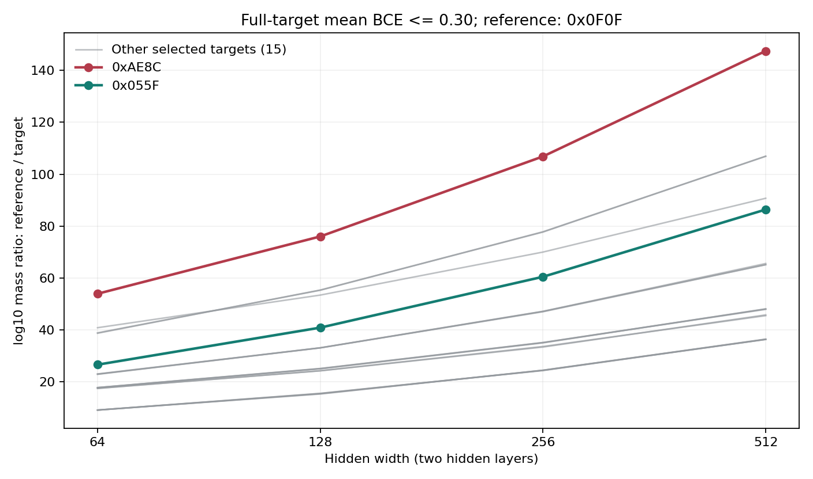

# E38: Relative Target Mass Across 4-bit Width and Depth Scans

> Status: completed 4-bit constrained SMC scan. Completion checks and release documentation dated 2026-10-21; 5 configurations, 95 target runs, and 855 threshold records. The evidence concerns static relative mass under a specified reference measure and finite sampling protocol.

## 1. Research Question

With the full 16-point truth table and target labels fixed, does increasing network width change the relative probability mass assigned to different targets' low-BCE events? E38 compares the width axis of four two-hidden-layer networks and adds a one-hidden-layer versus two-hidden-layer comparison at W256. It measures continuous loss events for complete targets, not actual training trajectories or test-error curves.

The networks have parameter spaces of different dimensions, but all induce probability distributions on the same 16-dimensional joint-logit space. The same target and BCE threshold define the same output event, allowing comparison of the probability each protocol assigns to that event. This is neither a direct comparison of unnormalized Euclidean volumes across dimensions nor a measure-independent intrinsic K.

## 2. Main Results

At the common threshold BCE = 0.30, using the single-bit rule `0x0F0F` as the reference and excluding the other single-bit rule `0xCCCC`, the relative mass disadvantages of all remaining 17 selected balanced targets strictly increase across W64, W128, W256, and W512. The medians of these 17 gaps are 17.7023, 25.0701, 35.0872, and 48.0666, respectively, in base-10 log mass ratios.

For the example `0xAE8C`, `log10[V(0x0F0F)/V(0xAE8C)]` is 53.8901, 75.9899, 106.8514, and 147.5235, respectively. The corresponding depth comparison at W256 is 92.4818 for D1 and 106.8514 for D2. The simple reference also loses absolute mass with width: the main result is a growing relative gap, not constant absolute mass for the simple target.

These results do not call BCE = 0.30 hard-exact, prove global SMC mixing, treat pools with shared adaptation as independent full-run repetitions, or directly validate all double descent or an equality between static mass and SGD selection probabilities. See [Results and Conclusions](RESULTS_AND_CONCLUSION.md) for the full limitations.

## 3. Completed Scope

`D` denotes the number of hidden layers. Hidden layers use tanh and the output is a linear logit; each target's mean BCE is evaluated over all 16 inputs.

| Configuration | Parameters | Pools x particles per pool | Completed targets | Thresholds |
|---|---:|---:|---:|---:|
| W64 D2 | 4,545 | 8 x 4,096 | 19/19 | 9 |
| W128 D2 | 17,281 | 8 x 4,096 | 19/19 | 9 |
| W256 D2 | 67,329 | 4 x 2,048 | 19/19 | 9 |
| W512 D2 | 265,729 | 4 x 1,024 | 19/19 | 9 |
| W256 D1 | 1,537 | 8 x 4,096 | 19/19 | 9 |

The common thresholds are 0.68, 0.65, 0.60, 0.55, 0.50, 0.45, 0.40, 0.35, and 0.30. There are `5 x 19 = 95` target runs and `95 x 9 = 855` threshold records. W256 D2 is counted only once; D3 and D4 are outside the final scan scope, and smoke-test and reproduction-check directories are not included in the formal records.

## 4. Files in This Directory

- [Motivation and Retrospective Protocol](MOTIVATION_AND_PREREGISTRATION.md): a retrospective protocol description dated 2026-10-21, not a new preregistration.
- [Results and Conclusions](RESULTS_AND_CONCLUSION.md): all 17 relative gaps, the depth comparison, completeness checks, and sampling limitations.
- [SMC numerical implementation](experiment_4bit_smc_width_depth.py): parameterization, targets, constrained sampling, and diagnostics.
- [Five-configuration scan driver](experiment_4bit_smc_width_depth_driver.py): per-configuration execution and preflight.
- [Offline analysis](analyze_results.py): reads and summarizes results generated by a rerun without starting training or sampling.

## 5. Reproduction Entry Points

The following instructions describe how to rerun sampling; they do not imply that these commands were executed during this documentation update. Use a CUDA-enabled Python environment with PyTorch, NumPy, and Matplotlib installed; check available devices and memory first, and do not occupy a GPU already in use. Run from this directory:

```powershell
python -E -s experiment_4bit_smc_width_depth_driver.py
```

After completion, the driver generates `results_4bit_smc_width_depth/` in this directory, with five configuration subdirectories containing configurations, target definitions, and target summaries. Then run the offline analysis from this directory:

```powershell
python -E -s analyze_results.py
```

For a rerun, verify the five-configuration scope, 19 targets, 9 thresholds, and particle budgets in the table, and check preflight and final completion status. The driver selects a budget from memory estimates; the actual saved configuration must be retained, and new results obtained with a different budget must not silently replace the readings in this table. The historical W512 D2 summary records approximately 78.69 hours, so this entry point is not a quick demonstration.

This release preserves the numerical sampling core of the completed experiment; changes to portable configuration, comments, analysis labels, and preflight failure handling do not change the scientific object declared here. Reproduction should check configurations and diagnostics, without promising bitwise equality across devices or software environments. The historical results in this document and results generated by rerunning must be identified separately.

## 6. Historical Source and Release Copies

The historical source and results are preserved unchanged. The SHA256 hashes of the original files at archival are:

| File | SHA256 of the historical original bytes |
|---|---|
| experiment_4bit_smc_width_depth.py | 6a0cd94615ae6ae2d37770fd25ab451587c06bd81f9da18d8a6bff9e174aec8a |
| experiment_4bit_smc_width_depth_driver.py | e23c038c803e3641467074cfaca942a0984aff8d6c7e63bfe1d8998501c32ea9 |

This directory contains release copies. Because of the explicitly listed changes below, their whole-file hashes must not be presented as historical source hashes. The numerical implementation only corrects the sampling-kernel name, reference-threshold descriptions, and analysis messages; 18 core definitions, including configuration, forward computation, survival selection, resampling, mutation, and result recording, pass an AST equivalence check with comments and docstrings removed.

The driver additionally fixes a preflight boundary branch: when every protocol exceeds the memory budget, the original incorrectly fell back to the first tier; it now falls back to the smallest tier and retains the warning. This does not change the choice when a tier meets the budget. Three protocol-selection branches were checked with memory-estimate stubs, without starting SMC. The new offline analysis script reconstructs the numerical tables and website figure from saved results without rewriting the original results.

# E38: Motivation and Retrospective Protocol

> Documentation date: 2026-10-21. Written after scan completion from saved configurations and results, this document is a retrospective protocol account, not a preregistration made before the scan began. Its filename follows the experiment-directory convention and does not establish that the question framing, reference choice, or statistical summaries were prospectively registered.

## 1. Motivation and Evidential Object

Increasing network capacity can change both task representability and the relative probability mass of different realizable targets. E38 examines only the latter static question: with fixed targets and a common loss threshold, are changes in width and depth accompanied by changes in relative preference?

This provides a measurable object for simplicity selection along the capacity axis, but does not simultaneously measure candidate competition on a finite training set, actual optimizer selection, or generalization curves. Connecting static mass to these dynamic phenomena still requires additional evidence; scan completion cannot substitute for it.

## 2. Fixed Inputs and Targets

The inputs are all 4-bit strings ordered by integers 0 through 15, with each input encoded as four `0/1` coordinates from the most significant to the least significant bit, not as `-1/+1`. Bit i of the target ID, counted from the least significant bit, gives the label of input i: `y_i = (function_id >> i) & 1`. The model assigns hard label 1 when `logit >= 0`.

All five configurations use exactly the same 19 targets, each a balanced rule with eight zeros and eight ones. The following IDs all carry the `fn_` prefix in the script:

```text
0x0F0F  0x88EE  0x3B23  0x1337  0x7F02  0xAE8C  0xCCCC
0xF550  0xBB22  0x4D4D  0x055F  0xAB2A  0x2AAB  0xD554
0x2F0B  0xF2B0  0x1F07  0xFD40  0xEAA8
```

This is a selected target set, not an enumeration of all 4-bit functions. `0x0F0F` and `0xCCCC` are the two single-bit rules; the 17 targets in the summary are the set remaining after excluding both. The description "complex-end example" refers to `0xAE8C` within this protocol, without treating target IDs or ANF metrics as measure-independent complexity ground truth.

## 3. Networks and Reference Measure

Networks are `4 -> W -> 1` or `4 -> W -> W -> 1`, with tanh hidden layers, a linear output logit, and biases in every layer. For parameter count p, the normalized parameter coordinates are independently distributed as `uniform[-1,1]`:

$$
\mu_{W,D}=\operatorname{Unif}([-1,1]^{p(W,D)}).
$$

In the forward pass, both first-layer weights and biases are multiplied by `1/sqrt(4)`; both weights and biases in subsequent hidden layers and the output layer are multiplied by `1/sqrt(W)`. Width changes therefore also change the reference distribution as specified by this fixed scaling rule; they cannot be interpreted as adding neurons while leaving all other distributional properties unchanged. The reference measure is uniform on the normalized parameter box, not Gaussian.

The completed runs used an NVIDIA GeForce RTX 3080 with 10GB memory, with recorded device `cuda:1`. Particles and forward calculations use float32, log-mass accumulation uses float64, and TF32 is disabled. Subsequent reproduction must record the actual software and device environment and must not present a change of precision as the same numerical protocol.

## 4. Common Output Events and Comparison Quantities

Let `U` contain all 16 inputs, let `z = Z_{W,D}(theta)` be their joint logit vector, and let the labels be `y_i = f(x_i)`. Define mean BCE using natural logarithms:

$$
\mathcal L_f(z)=\frac{1}{16}\sum_{i=0}^{15}
\left[\log(1+e^{z_i})-y_i z_i\right],
\qquad
E_f(\epsilon)=\{z\in\mathbb R^{16}:\mathcal L_f(z)\le\epsilon\}.
$$

The different parameter spaces all map into this common 16-dimensional output space. Their pushforward probability distributions and complete-target event masses are defined as:

$$
\rho_{W,D}=(Z_{W,D})_\#\mu_{W,D},
\qquad
V_{W,D}(f;\epsilon)=\rho_{W,D}(E_f(\epsilon))
=\mu_{W,D}\{\theta:L_{U,f}(\theta)\le\epsilon\}.
$$

This makes comparison across dimensions a question of how much probability different generative protocols assign to the same output event. Relative ratios remove overall normalization factors but not the redistribution of mass across regions by the reference measure. The results therefore cannot be elevated to a measure-independent K, nor can complete-target event masses be treated as the full candidate-competition odds on the same finite training set.

Results use the median of the pools' `log10 V` estimates for each target, rather than averaging volumes before taking the logarithm. With `s = 0x0F0F`, define the reported quantities:

$$
\widehat\ell_{W,D}(f;\epsilon)
=\operatorname{median}_{r}\bigl[\widehat{\log_{10}V}_{W,D,r}(f;\epsilon)\bigr],
\qquad
\widehat C_{W,D}(f;\epsilon)=-\widehat\ell_{W,D}(f;\epsilon).
$$

$$
\widehat\Delta_{W,D}(f;\epsilon)
=\widehat\ell_{W,D}(s;\epsilon)-\widehat\ell_{W,D}(f;\epsilon)
=\widehat C_{W,D}(f;\epsilon)-\widehat C_{W,D}(s;\epsilon).
$$

`Delta > 0` means the reference event has greater estimated mass; this document abbreviates it as a base-10 log mass ratio. It is not a Neural K difference measured in bits; conversion to bits requires multiplication by `log2(10)`. The median of the gaps for 17 targets is a separate across-target summary and must not be confused with the within-target median across pools.

## 5. SMC Protocol and Budgets

Saved nodes are fixed at 0.68, 0.65, 0.60, 0.55, 0.50, 0.45, 0.40, 0.35, and 0.30. Multiple adaptive SMC levels can occur between adjacent saved nodes; nine saved nodes do not mean only nine executed levels.

| Item | Actual protocol |
|---|---|
| Initial particles | Independent uniform sampling within the normalized parameter box |
| Intermediate threshold | Maximum of the pools' 0.5 loss quantiles, further constrained by the next saved node and the current threshold |
| Resampling | Sampling survivors with replacement within each pool and accumulating log survival fractions across levels |
| Local proposals | Symmetric blockwise and all-parameter random walks, reflected at the parameter-box boundaries |
| Refresh proposals | Each block proposal is replaced by a uniform refresh of that block with probability 0.02 |
| Step-size adaptation | 8 sweeps per level, using acceptance aggregated across all pools, with target acceptance 0.30 |
| Fixed-step-size updates | A further 24 sweeps per level |
| Initial step sizes | First layer 0.050, middle layers 0.030, output layer 0.050, all parameters 0.015 |
| Step-size range | 0.0002 to 0.30 |
| Maximum levels | 2,000 levels per target |
| Numerical loss tolerance | Sampling acceptance uses 1e-7; completion checks separately test saved maximum loss with 1e-6 |

The random walk uses Gaussian perturbations, but the reference measure remains uniform within the box; this transition kernel is not pCN. At fixed thresholds and step sizes, the reflected random walk and uniform refresh are intended to preserve the constrained uniform measure; adaptation and finite updates in the actual runs do not provide a global mixing guarantee.

W64 D2 and W128 D2 use `8 x 4096`, W256 D2 uses `4 x 2048`, W512 D2 uses `4 x 1024`, and W256 D1 uses `8 x 4096`. These are the number of particle pools and particles per pool, not numbers of independent full-run repetitions. Pools share the next threshold and step-size adaptation; resampling within individual pools does not justify constructing confidence intervals as if they were independent repetitions.

The original protocol's base random seeds for prior sampling, resampling, mutation, and calibration are 2026082410, 2026082420, 2026082430, and 2026082440, respectively; seeds for the first three generators additionally include `1_000_003 * target_index`, and pools draw from the corresponding generators' sequences rather than independently starting full experimental runs. Additional direct-prior calibration uses 4,194,304 samples to check the three thresholds 0.68, 0.65, and 0.60; it does not replace mixing diagnostics at lower loss.

## 6. Retrospective Analysis and Interpretation Rules

This account summarizes the width axis at BCE = 0.30, completed by every configuration: use `0x0F0F` as a fixed reference, exclude `0x0F0F` and `0xCCCC`, list the relative gap for each of the 17 remaining targets, and calculate their median; separately report the W256 D1/D2 example comparison. This is a descriptive account of completed records, without adding unrun conditions or retrospectively calling the summary a prospective significance test.

Completion checks require 19 completed targets in each of the five configurations, all nine nodes for every target, finite log-volume estimates, and saved maximum loss no greater than the threshold plus the validation tolerance. Lineages, between-pool ranges, and hard-target hits are reported separately. Complete records do not imply unbiased estimates; consistent directions do not exclude shared mixing bias, and small between-pool differences do not bound systematic error.

# E38: Results and Conclusions

> Verification and documentation date: 2026-10-21. This report covers only the completed five-configuration 4-bit SMC scan, includes no other training tasks, and initiated no new experiments for this update. All numbers are finite-sampling estimates or diagnostic readings from saved records.

## 1. Completion Status

All five configurations completed 19/19 targets and all nine saved thresholds, for 95 target runs and 855 threshold records. Record-by-record checks found no missing nodes, nonfinite log-volume estimates, or saved maximum loss exceeding the threshold plus 1e-6. All five result packages passed ZIP CRC checks, each containing 19 complete target summaries; these establish only record and package integrity, not global mixing.

The last configuration to finish was W512 D2, whose overall summary records approximately 78.69 hours. The overall summaries of other configurations were rewritten when the resumed driver skipped completed targets, so `elapsed_seconds` records only that invocation's checking or aggregation time and cannot directly compare full execution costs.

## 2. Width Results at a Common Threshold

All results below use BCE = 0.30 and D2. `C(f) = -median_pool(log10 V(f))`, with relative gap `Delta(f) = C(f) - C(0x0F0F)`; the last column is the median of the 17 relative gaps after excluding the two single-bit rules. These are base-10 logarithmic quantities, not bit counts. Four decimal places faithfully transcribe the readings, not accuracy calibrated to that precision. Gaps are computed before rounding, so they may differ in the last digit from subtraction of the rounded first two columns.

| Width | C(0x0F0F) | C(0xAE8C) | Delta(0xAE8C) | Median Delta across 17 targets |
|---|---:|---:|---:|---:|
| 64 | 74.2142 | 128.1042 | 53.8901 | 17.7023 |
| 128 | 91.4117 | 167.4016 | 75.9899 | 25.0701 |
| 256 | 110.2689 | 217.1203 | 106.8514 | 35.0872 |
| 512 | 129.1326 | 276.6561 | 147.5235 | 48.0666 |

The absolute mass of `0x0F0F` also decreases with width, while that of `0xAE8C` decreases more. The supported observation is a growing mass advantage of the simple reference relative to this target, not immunity of the simple target's absolute mass to widening.



Each line follows the relative mass of the same target across the four widths. The vertical axis is not test error, and the ranges of pools with shared adaptation are not plotted as independent confidence intervals.

## 3. Relative Gaps for All 17 Targets

The table excludes the reference `0x0F0F` and the other single-bit rule `0xCCCC`, listing `Delta` for all remaining selected targets. All 17/17 sequences strictly increase across W64, W128, W256, and W512.

| Target | W64 D2 | W128 D2 | W256 D2 | W512 D2 |
|---|---:|---:|---:|---:|
| 0x88EE | 9.0126 | 15.4183 | 24.3574 | 36.2827 |
| 0x3B23 | 17.7023 | 25.0701 | 35.0726 | 48.0146 |
| 0x1337 | 38.6580 | 55.3287 | 77.6897 | 106.9552 |
| 0x7F02 | 40.7925 | 53.3776 | 69.9674 | 90.7186 |
| 0xAE8C | 53.8901 | 75.9899 | 106.8514 | 147.5235 |
| 0xF550 | 9.0389 | 15.2343 | 24.4020 | 36.2785 |
| 0xBB22 | 9.0296 | 15.4827 | 24.2693 | 36.3146 |
| 0x4D4D | 9.0373 | 15.3275 | 24.3866 | 36.4003 |
| 0x055F | 26.5401 | 40.8282 | 60.4422 | 86.3721 |
| 0xAB2A | 17.6706 | 24.9376 | 34.9480 | 48.0666 |
| 0x2AAB | 17.3836 | 24.1786 | 33.3372 | 45.7391 |
| 0xD554 | 17.3998 | 24.1873 | 33.5584 | 45.4463 |
| 0x2F0B | 17.6981 | 25.0202 | 35.0872 | 47.8712 |
| 0xF2B0 | 22.8222 | 33.0275 | 47.0894 | 65.5589 |
| 0x1F07 | 22.9634 | 33.0437 | 47.1258 | 65.1122 |
| 0xFD40 | 22.8965 | 33.0338 | 46.9543 | 65.0804 |
| 0xEAA8 | 38.8095 | 55.2474 | 77.7981 | 106.8981 |

This consistency statement concerns 17 specified targets relative to the same reference; it does not mean that gaps between all target pairs increase monotonically or that local rankings never reverse. This set does not represent all balanced functions, let alone all tasks or all loss windows.

## 4. Depth Comparison at W256

For the same `0x0F0F/0xAE8C` example, BCE = 0.30 gives:

| Hidden layers | C(0x0F0F) | C(0xAE8C) | Delta(0xAE8C) | Pools x particles per pool |
|---|---:|---:|---:|---:|
| D1 | 54.9400 | 147.4218 | 92.4818 | 8 x 4,096 |
| D2 | 110.2689 | 217.1203 | 106.8514 | 4 x 2,048 |

These are two depth points at one width, with different particle budgets, and cannot establish a general monotonic depth law. D3 and D4 have no corresponding completed results and are not inferred or extrapolated as missing values.

## 5. BCE 0.30 Is Not Hard-Exact

Any misclassified point or zero-margin point contributes at least `ln(2)` to its individual BCE, while all other points contribute nonnegative BCE. A sufficient hard-exact condition for mean BCE over 16 points is therefore a value strictly below this boundary:

$$
L_{U,f}(\theta)<\frac{\ln 2}{16}\approx 0.04332
\quad\Longrightarrow\quad
\text{all 16 hard labels match }f.
$$

The common endpoint 0.30 exceeds this boundary, so mean loss does not establish correctness of all hard labels. Among D2 endpoint particles for `0xAE8C`, the exact hard-target hit fractions at W64 and W128 are 0.0002136230 and 0.0000610352, respectively; no hits were observed at W256 or W512. These are empirical fractions within conditional particle samples, not independently measured unconditional hard-function probabilities; zero observed hits do not prove zero true mass.

Accordingly, the preceding tables and figure describe the mass of continuous loss events for the target labels, not mass ratios of the `0xAE8C` hard cell. Even where a historical field is named `HARD_EXACT_REFERENCE_THRESHOLD`, 0.30 must be interpreted only as this scan's common reference threshold; a field name provides no mathematical guarantee.

## 6. Sampling Diagnostics and Uncertainty

The minimum lineage count below is the smallest number of surviving initial lineages across targets and pools in that configuration at BCE = 0.30. The maximum between-pool range is obtained by taking the maximum minus minimum pool `log10 V` for each target, then the maximum across targets.

| Configuration | Minimum initial lineages | Maximum between-pool log10 mass range |
|---|---:|---:|
| W64 D2 | 5 | 0.6234 |
| W128 D2 | 5 | 0.6042 |
| W256 D2 | 1 | 0.9419 |
| W512 D2 | 1 | 0.7942 |
| W256 D1 | 4 | 0.5450 |

Both W256 D2 and W512 D2 include target pools with only one surviving initial lineage. This degeneration, particle budgets decreasing with width, thresholds and step-size adaptation shared across pools, and regions potentially missed by finite updates all limit precision claims. Without an independent budget-matching experiment, budget effects cannot be fully separated from width effects; agreement in direction for 17/17 targets does not eliminate shared mixing bias.

The maximum between-pool ranges of approximately 0.55 to 0.94 are diagnostic readings, not independent-repetition confidence intervals or upper bounds on systematic error. No significance claims or calibrated error bars are derived from them here; likewise, reasonable acceptance rates and complete files alone cannot guarantee global mixing.

There is only one saved node at or below 0.30, so no deep-tail contraction slope is fitted. The historical `deep_tail_slopes.csv` is empty because too few nodes are available; `parity_order_by_threshold.csv` is empty because targets are named `fn_0x` rather than `parity1` through `parity4`. Neither indicates missing target runs, nor justifies inventing the corresponding analyses.

## 7. Conclusions and Scope

The completed data support the following: under the specified uniform parameter box, fan-in scaling, 19 selected balanced targets, and common BCE = 0.30, after excluding the two single-bit rules, all 17 targets' estimated mass disadvantages relative to `0x0F0F` grow across the four two-hidden-layer widths; the single example at W256 also has a larger relative gap for D2 than D1.

This is evidence of static relative preference under a finite protocol. It does not establish a measure-independent K, relabel loss events as hard cells, guarantee the same result for all rules, architectures, or thresholds, or prove that widening necessarily improves generalization. E38 has not established a causal correspondence between complete-target mass and actual optimization competition on the same finite training set, and therefore cannot directly validate all double descent or claim that static mass equals SGD selection probability.
